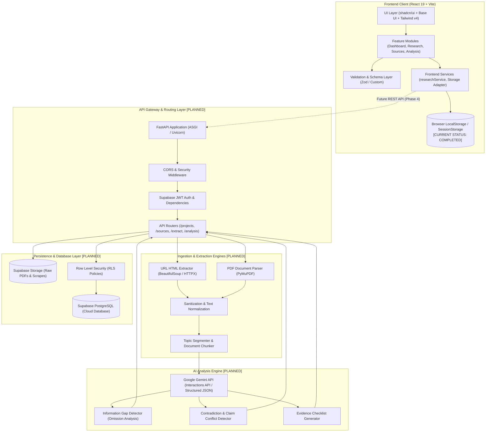

# Bharmafills — System Architecture & Technical Specifications

> **Document Status**: Canonical Architecture Baseline
> **Product Version**: 0.2.0 (Phase 2 Completed; Phase 3+ Planned)
> **Target Event**: Shinchan Online Hackathon 2026
> **Workspace Identifier**: `Shinchan`
> **Frontend Location**: `frontend/`
> **Backend Location**: `backend/` (Planned)
> **Database / Migrations**: `supabase/` (Planned)

---

## 1. System Overview

**Bharmafills** is designed as a decoupled, multi-tier system engineered for evidence-based information gap detection. The platform ingests heterogeneous unstructured documents (web pages and PDF files), parses and cleans content, isolates factual claims by research topic, runs comparative AI analysis to detect missing criteria and conflicting assertions, and renders actionable verification checklists.

### Architectural Principles
- **Decoupled Client & Server**: Frontend client functions autonomously with client-side state and local persistence (Phase 2 baseline) and is architected to seamlessly transition to RESTful API endpoints for backend persistence and AI processing (Phase 4).
- **Service-Oriented Backend**: Backend operations are organized by functional domain (Extraction, Analysis, AI, Storage) rather than monolithic controllers.
- **Fail-Safe & Graceful Degradation**: Robust client and server error handling prevents corrupted states, unhandled crashes, or silent data loss.
- **Zero-Fabrication Data Flow**: AI prompts and parsing pipelines strictly mandate verifiable citations and excerpts, preventing hallucinated conclusions.

---

## 2. High-Level Architecture Diagram



---

## 3. Frontend Architecture

### 3.1 Organization
The frontend (`frontend/src/`) employs a strict **feature-based** organization:

```
frontend/src/
├── components/
│   ├── layout/          # Shell layout: Sidebar, Topbar, Responsive Mobile Drawer
│   ├── shared/          # Reusable shared components: ErrorBoundary, Toast, ConfirmDialog
│   └── ui/              # Primitive design system components (Base UI / Nova)
├── features/
│   ├── dashboard/       # DashboardPage, StatCards, RecentResearchList
│   ├── research/        # Project management: ResearchListPage, ResearchModal, ProjectCard
│   │   ├── components/  # Research-specific sub-components (ProjectForm, DeleteConfirmModal)
│   │   └── schemas/     # Domain validation schemas (researchProjectSchema.js)
│   ├── sources/         # Source management UI (Phase 3 placeholder / views)
│   ├── analysis/        # Gap analysis and conflict detection views (Phase 4 placeholder)
│   └── checklist/       # Verification checklist views (Phase 5 placeholder)
├── hooks/               # Custom React hooks (useProjects, useDebounce, useMediaQuery)
├── services/            # Client data services: researchService.js, storageAdapters.js
├── lib/                 # Utility libraries: utils.js (tailwind-merge, clsx)
├── types/               # Type definition contracts and JSDoc typedefs
├── App.jsx              # Application router, shell integration, and global state providers
├── index.css            # Nova design tokens, Tailwind CSS v4 directives, light-mode palette
└── main.jsx             # Entrypoint mounting React 19 root
```

### 3.2 Key Technical Decisions
- **React 19 & Vite 8**: Modern React runtime with fast HMR and optimized asset bundling.
- **Tailwind CSS v4 & Nova Theme**: Zero-configuration utility engine using CSS `@theme` directives with Geist Variable fonts and WCAG AA contrast compliance.
- **Base UI & Radix Primitives**: Unstyled, accessible primitives with managed focus loops, screen reader ARIA roles, and escape key handling.
- **Client Validation Layer**: All inputs pass through client-side schemas with descriptive field-level error messages before updating state or persistent stores.
- **Local Storage Resilience**:
  - Structured versioning (`SCHEMA_VERSION: 1`).
  - Safe parsing with corrupt payload quarantine (`bharmafills_research_corrupted_backup_<timestamp>`).
  - Explicit quota exhaustion error handling (`QuotaExceededError` detection).
  - Memory-safe fallback for private/restricted browsing contexts.

---

## 4. Backend Architecture (Planned — Phase 3/4)

The backend (`backend/app/`) will be structured as an asynchronous FastAPI application adhering to a service-based architecture:

```
backend/app/
├── api/
│   ├── routes/
│   │   ├── health.py        # System health & diagnostic checks
│   │   ├── auth.py          # Supabase JWT token verification
│   │   ├── projects.py      # Project CRUD operations
│   │   ├── sources.py       # Source metadata & document management
│   │   ├── extraction.py    # URL scraping & PDF parsing triggers
│   │   └── analysis.py      # AI gap detection & checklist generation
│   └── dependencies.py      # Database session & authenticated user dependencies
├── core/
│   ├── config.py            # Pydantic Settings reading .env (validated at startup)
│   ├── security.py          # Token decoders, rate limiting, and CORS configuration
│   └── exceptions.py        # Centralized HTTP and domain exception handlers
├── services/
│   ├── extraction/
│   │   ├── url_service.py   # BeautifulSoup HTML fetching & text cleaning
│   │   └── pdf_service.py   # PyMuPDF document extraction & page-level indexing
│   ├── analysis/
│   │   ├── gap_detector.py  # Missing information identification logic
│   │   └── conflict_rule.py # Contradiction & claim discrepancy engine
│   └── ai/
│       ├── gemini_client.py # Google Gemini API client with retry and JSON schemas
│       └── prompts.py       # Versioned system instructions and analysis templates
├── models/                  # SQLAlchemy / SQLModel ORM models
├── schemas/                 # Pydantic v2 validation models for request/response bodies
├── db/
│   ├── session.py           # Async database engine & connection pool
│   └── base.py              # Declarative base
├── utils/                   # Text normalization, sanitization, hashing utilities
└── main.py                  # FastAPI application entrypoint with lifespan event hooks
```

---

## 5. Ingestion & Extraction Architecture (Planned — Phase 3)

### 5.1 URL HTML Extraction
- **HTTP Client**: `httpx.AsyncClient` with custom User-Agent, configurable timeout (10s), and redirect limits.
- **Parser**: `BeautifulSoup4` with `lxml` parser.
- **Sanitization & Cleaning**: Strip script, style, nav, footer, header, and advertisements. Extract title, publication date, meta tags, and semantic body content.
- **Security Protections**: Block local IP subnets (127.0.0.1, 10.0.0.0/8, 192.168.0.0/16, 169.254.169.254) to eliminate Server-Side Request Forgery (SSRF) vulnerabilities.

### 5.2 PDF Document Extraction
- **Parser**: `PyMuPDF` (`fitz`) for fast, local text and layout extraction without external network dependencies.
- **Page-Level Traceability**: Text chunks retain strict metadata: `document_id`, `page_number`, `bounding_box` (optional), and character offsets.
- **Security Protections**: File size cap (max 20 MB), page limit cap (max 100 pages), stream validation to mitigate PDF decompression bombs.

---

## 6. AI & Analysis Engine (Planned — Step 9–11)

- **Provider**: Google Gemini API via the official Python SDK (`google-genai`).
- **Model Target**: Runtime-configurable via environment variable (`GEMINI_MODEL`, e.g. `gemini-2.5-flash`, `gemini-1.5-pro`, or latest supported model), evaluated at implementation time for availability, latency, cost efficiency, and structured JSON adherence.
- **Untrusted External Data Principle**: Ingested web text and uploaded PDF content are strictly treated as untrusted data. External content is isolated inside fenced XML tags (`<source_document id="...">...</source_document>`) with system prompt directives forbidding the execution of embedded instructions or prompt injections.
- **Prompt Strategy**:
  - Grounding instructions: AI must strictly analyze provided excerpts without fabricating outside facts.
  - Identification of Missing Topics: Compare extracted claims against a topic taxonomy for the research question.
  - Identification of Conflicts: Flag direct contradictions between Source A and Source B with exact citations.
  - Structured Response: Formatted strictly as JSON conforming to domain Pydantic schemas via Gemini's `response_schema`.

---

## 7. Database Architecture (Planned — Step 6)

- **Engine**: Supabase PostgreSQL 15+.
- **Access Patterns**: Async SQLAlchemy ORM or PostgREST via Supabase Python client.
- **Security**: PostgreSQL Row Level Security (RLS) enforcing workspace/user isolation on every table.
- **Entities**: Projects, Sources, Extracted Documents, Extracted Claims, Topics, Information Gaps, Conflicting Claims, and Verification Checklist Items. (Detailed in `DATABASE.md`).

---

## 8. Cross-Cutting Concerns

### 8.1 Error Handling Strategy
- **Frontend**: Multi-layered:
  - React Error Boundaries catch rendering exceptions and offer safe recovery buttons.
  - Toast and form notifications display human-readable, non-technical failure descriptions.
  - Network retries with exponential backoff on transient network failures.
- **Backend**:
  - Global FastAPI exception handler formats all unhandled errors into RFC 7807 Problem Details JSON format.
  - Domain exceptions (`ExtractionFailedError`, `QuotaExceededError`, `InvalidSourceUrlError`) map to standard HTTP status codes (400, 422, 502, 504).

### 8.2 Logging and Observability
- **Frontend**: Structured console logging enabled only in development environments; production suppresses debug traces.
- **Backend**: Python `structlog` emitting JSON log records with `request_id`, `user_id`, `project_id`, execution duration, and error traces.

### 8.3 Security Boundaries
- **No Hardcoded Secrets**: All tokens (Gemini API key, Supabase service roles) reside in environment variables.
- **Content Sanitization**: Markdown and HTML outputs in the frontend are sanitized via DOMPurify to eliminate Cross-Site Scripting (XSS).
- **Network Boundaries**: Extraction engine isolates scraping from internal service infrastructure with SSRF and DNS rebinding protections.

---

## 9. Implementation Roadmap & Status

| Architectural Component | Canonical Step | Implementation Status | Storage / Runtime |
| :--- | :--- | :--- | :--- |
| **Frontend Shell & Dashboard** | Step 1 & 2 | `COMPLETED` | React 19, Tailwind v4, Nova Preset |
| **Project Management Module** | Step 3 | `COMPLETED` | Local Storage (`researchService.js`) |
| **Documentation Foundation** | Step 4 | `COMPLETED` | Canonical Markdown Architecture Suite |
| **FastAPI Foundation** | Step 5 | `COMPLETED` (5A) | Python 3.15, FastAPI, Uvicorn, 23 Pytest Tests |
| **Supabase Connection & RLS** | Step 6 | `PLANNED` *(Next)* | Supabase PostgreSQL 15, RLS Policies |
| **URL Extraction Pipeline** | Step 7 | `PLANNED` | BeautifulSoup4, HTTPX, SSRF Defense |
| **PDF Extraction Engine** | Step 8 | `PLANNED` | PyMuPDF (`fitz`), Sandboxed Extraction |
| **AI Extraction & Prompt Fencing** | Step 9 | `PLANNED` | Google GenAI SDK (Configurable Model) |
| **AI Gap & Conflict Engine** | Step 10 & 11 | `PLANNED` | Google Gemini API Structured JSON |
| **Verification Checklist & Export** | Step 12 & 13 | `PLANNED` | React 19 UI, Playwright E2E, PDF/CSV Export |

---

## 10. Related Specifications
- Product Requirements: [PRD.md](file:///d:/Users/Vikas%20Salunke/Downloads/Shinchan/PRD.md)
- Design System: [DESIGN.md](file:///d:/Users/Vikas%20Salunke/Downloads/Shinchan/DESIGN.md)
- Database Schema: [DATABASE.md](file:///d:/Users/Vikas%20Salunke/Downloads/Shinchan/DATABASE.md)
- REST API Reference: [API.md](file:///d:/Users/Vikas%20Salunke/Downloads/Shinchan/API.md)
- AI Agent Instructions: [AGENTS.md](file:///d:/Users/Vikas%20Salunke/Downloads/Shinchan/AGENTS.md)
