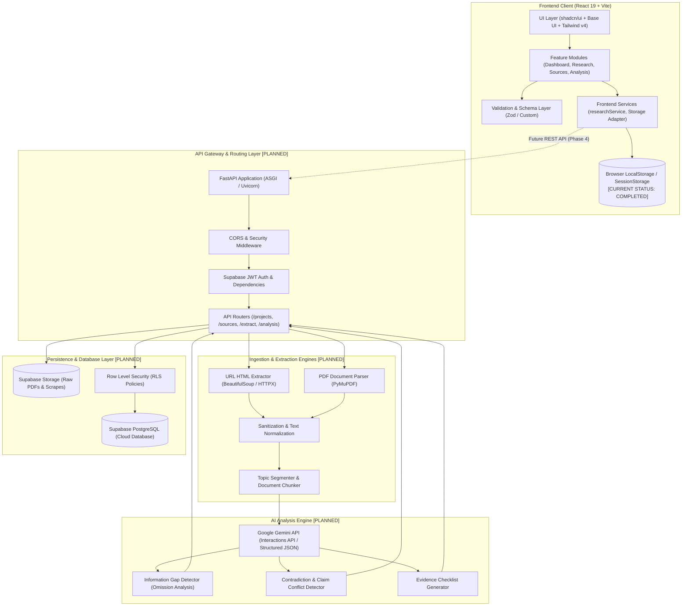

# Bharmafills — System Architecture & Technical Specifications

> **Document Status**: Canonical Architecture Baseline
> **Product Version**: 0.2.0 (Phase 2 Completed; Phase 3+ Planned)
> **Target Event**: Shinchan Online Hackathon 2026
> **Workspace Identifier**: `Shinchan`
> **Frontend Location**: `frontend/`
> **Backend Location**: `backend/` (FastAPI Foundation & Supabase Connection Active)
> **Database / Migrations**: `supabase/` (Supabase PostgreSQL 17.11 Connected; Step 6B Initial Schema Migration Applied)

---

## 1. System Overview

**Bharmafills** is designed as a decoupled, multi-tier system engineered for evidence-based information gap detection. The platform ingests heterogeneous unstructured documents (web pages and PDF files), parses and cleans content, isolates factual claims by research topic, runs comparative AI analysis to detect missing criteria and conflicting assertions, and renders actionable verification checklists.

### Architectural Principles
- **Decoupled Client & Server**: Frontend client functions autonomously with client-side state and local persistence (Phase 2 baseline) and is architected to seamlessly transition to RESTful API endpoints for backend persistence and AI processing (Phase 4).
- **Service-Oriented Backend**: Backend operations are organized by functional domain (Extraction, Analysis, AI, Storage) rather than monolithic controllers.
- **Fail-Safe & Graceful Degradation**: Robust client and server error handling prevents corrupted states, unhandled crashes, or silent data loss.
- **Zero-Fabrication Data Flow**: AI prompts and parsing pipelines strictly mandate verifiable citations and excerpts, preventing hallucinated conclusions.

---

## 2. High-Level Architecture Diagram



---

## 3. Frontend Architecture

### 3.1 Organization
The frontend (`frontend/src/`) employs a strict **feature-based** organization:

```
frontend/src/
├── components/
│   ├── layout/          # Shell layout: Sidebar, Topbar, Responsive Mobile Drawer
│   ├── shared/          # Reusable shared components: ErrorBoundary, Toast, ConfirmDialog
│   └── ui/              # Primitive design system components (Base UI / Nova)
├── features/
│   ├── dashboard/       # DashboardPage, StatCards, RecentResearchList
│   ├── research/        # Project management: ResearchListPage, ResearchModal, ProjectCard
│   │   ├── components/  # Research-specific sub-components (ProjectForm, DeleteConfirmModal)
│   │   └── schemas/     # Domain validation schemas (researchProjectSchema.js)
│   ├── sources/         # Source management UI (Phase 3 placeholder / views)
│   ├── analysis/        # Gap analysis and conflict detection views (Phase 4 placeholder)
│   └── checklist/       # Verification checklist views (Phase 5 placeholder)
├── hooks/               # Custom React hooks (useProjects, useDebounce, useMediaQuery)
├── services/            # Client data services: researchService.js, storageAdapters.js
├── lib/                 # Utility libraries: utils.js (tailwind-merge, clsx)
├── types/               # Type definition contracts and JSDoc typedefs
├── App.jsx              # Application router, shell integration, and global state providers
├── index.css            # Nova design tokens, Tailwind CSS v4 directives, light-mode palette
└── main.jsx             # Entrypoint mounting React 19 root
```

### 3.2 Key Technical Decisions
- **React 19 & Vite 8**: Modern React runtime with fast HMR and optimized asset bundling.
- **Tailwind CSS v4 & Nova Theme**: Zero-configuration utility engine using CSS `@theme` directives with Geist Variable fonts and WCAG AA contrast compliance.
- **Base UI & Radix Primitives**: Unstyled, accessible primitives with managed focus loops, screen reader ARIA roles, and escape key handling.
- **Client Validation Layer**: All inputs pass through client-side schemas with descriptive field-level error messages before updating state or persistent stores.
- **Local Storage Resilience**:
  - Structured versioning (`SCHEMA_VERSION: 1`).
  - Safe parsing with corrupt payload quarantine (`bharmafills_research_corrupted_backup_<timestamp>`).
  - Explicit quota exhaustion error handling (`QuotaExceededError` detection).
  - Memory-safe fallback for private/restricted browsing contexts.

---

## 4. Backend Architecture (Planned — Phase 3/4)

The backend (`backend/app/`) will be structured as an asynchronous FastAPI application adhering to a service-based architecture:

```
backend/app/
├── api/
│   ├── routes/
│   │   ├── health.py        # System health & diagnostic checks
│   │   ├── auth.py          # Supabase JWT token verification
│   │   ├── projects.py      # Project CRUD operations
│   │   ├── sources.py       # Source metadata & document management
│   │   ├── extraction.py    # URL scraping & PDF parsing triggers
│   │   └── analysis.py      # AI gap detection & checklist generation
│   └── dependencies.py      # Database session & authenticated user dependencies
├── core/
│   ├── config.py            # Pydantic Settings reading .env (validated at startup)
│   ├── security.py          # Token decoders, rate limiting, and CORS configuration
│   └── exceptions.py        # Centralized HTTP and domain exception handlers
├── services/
│   ├── extraction/
│   │   ├── url_service.py   # BeautifulSoup HTML fetching & text cleaning
│   │   └── pdf_service.py   # PyMuPDF document extraction & page-level indexing
│   ├── analysis/
│   │   ├── gap_detector.py  # Missing information identification logic
│   │   └── conflict_rule.py # Contradiction & claim discrepancy engine
│   └── ai/
│       ├── gemini_client.py # Google Gemini API client with retry and JSON schemas
│       └── prompts.py       # Versioned system instructions and analysis templates
├── models/                  # SQLAlchemy / SQLModel ORM models
├── schemas/                 # Pydantic v2 validation models for request/response bodies
├── db/
│   ├── session.py           # Async database engine & connection pool
│   └── base.py              # Declarative base
├── utils/                   # Text normalization, sanitization, hashing utilities
└── main.py                  # FastAPI application entrypoint with lifespan event hooks
```

---

## 5. Ingestion & Extraction Architecture (Implemented & Tested — Steps 7 & 8)

### 5.1 URL HTML Extraction (Steps 7A & 7B)
- **HTTP Client**: `SafeWebFetcher` with socket-level DNS pinning via custom HTTPX transport to eliminate TOCTOU rebinding gaps, controlled User-Agent, manual redirect validation (max 5 hops, no downgrade, loop detection), and streaming size caps (2 MB).
- **Parser**: `WebContentExtractor` using `BeautifulSoup4` with `lxml` parser.
- **Sanitization & Cleaning**: Strip script, style, nav, footer, header, and aside tags. Extract clean paragraphs, headings, title, meta description, author, language, canonical URL, and SHA-256 content hash.
- **Security Protections**: `URLValidator` blocks loopback, private IPv4 (RFC 1918), CGNAT, link-local, cloud metadata (169.254.169.254), IDN Punycode spoofing, and IPv6 zone IDs to eliminate Server-Side Request Forgery (SSRF) vulnerabilities.
- **Persistence**: `WebSourceIngestionService` validates project, enforces idempotent deduplication (`idx_sources_project_url_unique` and `idx_sources_project_hash_unique`), and executes atomic transactions persisting to `public.sources` and `public.extracted_content`.

### 5.2 PDF Document Extraction (Step 8)
- **Parser**: `PyMuPDF` (`fitz`) for fast, local in-memory text and layout extraction (`pymupdf.open(stream=bytes, filetype="pdf")`) without temporary files or network dependencies.
- **Page-Level Traceability**: Page-by-page text extraction (`PDFPageItem`), page-level word/character counts, 1-based page indexing, whitespace normalization, and document metadata extraction.
- **Security Protections**: File size cap (`PDF_MAX_UPLOAD_BYTES=20MB`), page count cap (`PDF_MAX_PAGES=200`), magic header `%PDF-` verification, encrypted/password-protected document rejection, and filename sanitization (255-char bound preserving `.pdf`).
- **Scanned PDF Handling**: Scanned/image-only PDFs (0 extractable characters) are safely logged in `public.sources` with `ingestion_status='failed'` without violating non-empty database check constraints on `public.extracted_content`.
- **Persistence**: `PDFSourceIngestionService` checks binary SHA-256 hash deduplication per project, writes atomic transactions to `public.sources` and `public.extracted_content`.

---

## 6. AI & Analysis Engine (Steps 9A, 9B.1, 9B.2.1, 9B.2.2B, 9B.3 Implemented & Tested; Step 10+ Planned)

- **AI Provider**: OpenRouter API (`https://openrouter.ai/api/v1`) via asynchronous HTTPX client (`OpenRouterClient`).
- **Active Model Target**: Runtime-configurable via environment variable (`OPENROUTER_MODEL`), defaulting to `nvidia/nemotron-3-ultra-550b-a55b:free`.
- **Structured Output Safety**: Because the Nemotron free endpoint does not support enforced JSON schema decoding, output is parsed through `SafeResponseParser`, which extracts markdown/bracketed JSON and validates against strict Pydantic schemas. Unparseable responses return safe validation failure states without hallucinating missing fields or unverified citations.
- **Privacy & Data Security Restriction**: The free endpoint carries strict privacy guidelines. Under Step 9A, zero uploaded website texts, PDF contents, or user research files are transmitted to OpenRouter.
- **Resilience Strategy**: Bounded retries (maximum 2 retries) with exponential backoff on transient HTTP 429, 502, 503, and timeouts. Immediate failure without retries on 401/403 (unauthorized) and 402 (quota exceeded).
- **Untrusted External Data & Prompt Security (Step 9B.1)**: Ingested web text and uploaded PDF content are strictly treated as untrusted data. External content is isolated inside fenced XML tags (`<untrusted_source_document id="...">...</untrusted_source_document>`) by `PromptBuilder` with explicit system prompt directives forbidding instruction execution, plus structured truncation and source omission reporting (`PromptBuildResult`).
- **Evidence Extraction Data Models (Step 9B.2.1 `IMPLEMENTED & TESTED`)**:
  - Foundational, strongly validated Pydantic models in `backend/app/services/ai/evidence_schemas.py`: `EvidenceLocation`, `ExtractedFact`, `SourceClaim`, and `EvidenceExtractionResult`.
  - Disallows representing paraphrased summaries as verbatim quotes via `RepresentationType` (`direct_quote` vs `paraphrase`).
  - Prohibits treating claims as objectively true (`verified=True` / `is_true` forbidden).
  - Enforces cross-field source consistency and integrity constraints (truncated source cannot report `success` status; must be `partial`).
- **Evidence Extraction Pipeline & Structured Parser (Step 9B.2.2B `IMPLEMENTED & TESTED`)**:
  - `EvidenceExtractionService` coordinating prompt assembly, OpenRouter async completions, `SafeResponseParser` decoding into `EvidenceExtractionPayload`, and authoritative `EvidenceExtractionResult` envelope compilation.
  - Multi-source batch extraction (`extract_sources_batch`) with strict per-source failure isolation into `BatchEvidenceExtractionResult`.
  - Evidence integrity verification: source attribution matching, whitespace-normalized verbatim quote checks, character offset bounds verification, and web claim domain consistency checks.
  - FastAPI endpoint `POST /api/v1/projects/{project_id}/sources/{source_id}/extract` with full error mapping (404, 503, 422).
- **Evidence Database Persistence & Retrieval (Step 9B.3 `IMPLEMENTED & TESTED`)**:
  - `EvidencePersistenceService` providing atomic transactional persistence of extracted facts into `public.evidence` and source assertions into `public.source_claims`.
  - Dedicated execution auditing via `public.extraction_runs` capturing AI model provenance, character truncation counts, warnings, and errors.
  - Deduplication and idempotency protection through unique constraints and idempotency keys.
  - Automatic persistence integration in the extraction endpoint (`POST /.../extract`) with graceful degradation when database is unavailable.
  - Granular evidence retrieval endpoints with multi-dimensional filtering (by source, extraction run, item type, fact type, claim type) and pagination.
- **Information Gap Detection Engine (Step 10 — Architecture in 10A; Schemas & Prompts in 10B; Service & Grounding in 10C `IMPLEMENTED & TESTED`)**:
  - **Purpose**: Identify important unanswered questions, missing prerequisites, insufficiently evidenced assertions, and incomplete subtopic coverage across a research project's multi-source evidence corpus.
  - **InformationGapDetectionService (`backend/app/services/ai/gap_detection_service.py` — Steps 10C & 10C.1 `IMPLEMENTED & TESTED`)**:
    - Project ownership verification (`verify_project_ownership`) with generic HTTP 404 IDOR masking.
    - Parameterized evidence retrieval loading facts (`public.evidence`), source claims (`public.source_claims`), and topics.
    - Structured evidence representation preserving source identity and explicitly separating extracted source statements from unverified source claims.
    - Empty corpus & failed ingestion diagnostics preventing artificial gap generation.
    - Truncation transparency propagating `PromptBuildResult` warnings and cautions.
    - Independent candidate validation using canonical concept clustering (`_CANONICAL_CONCEPT_CLUSTERS`), contextual background concept isolation, and conservative verdict rules (`confirmed`, `partially_covered`, `disputed_by_evidence`, `redundant`) without superficial keyword traps.
    - Strictly in-memory analysis; zero database mutations.
  - **Pydantic Schemas & Prompt Templates (`backend/app/services/ai/gap_schemas.py` & `backend/app/services/ai/prompts/gap_templates.py` — Step 10B `IMPLEMENTED & TESTED`)**:
    - Strong types for controlled enums (`GapType`, `GapPriority`, `GapStatus`, `GapSubtype`, `GapReviewStatus`).
    - 4-Tier Data Model Separation: `AIGapCandidatePayload` (untrusted LLM output), `ValidatedGapFinding` (backend validation envelope with covered evidence tracking), `InformationGapResponse` (matching `public.information_gaps`), and `GapReviewUpdate` (review workflow).
    - Prompt assembly with strict epistemic grounding (absence in sources $\ne$ false in reality), XML isolation, anti-fabrication directives, and dynamic truncation awareness.
  - **5-Stage Detection Workflow**:
    - *Stage A (Research Scope)*: Deconstruct `research_projects.research_question`, title, and category into core objective, required subquestions, and expected topical criteria.
    - *Stage B (Evidence Examination)*: Aggregate all persisted facts (`public.evidence`) and claims (`public.source_claims`) across project sources, tracking coverage and source diversity.
    - *Stage C (Gap Identification)*: Generate candidate gap findings categorized under `gap_type` (`no_evidence`, `insufficient_evidence`, `conflicting_evidence`, `unverified`) with granular subtypes (`unanswered_question`, `missing_topic`, `incomplete_detail`, `single_source_assertion`, `temporal_coverage_gap`).
    - *Stage D (Evidence Grounding & Validation)*: Cross-check every candidate against the evidence corpus. If evidence exists, candidate is rejected or downgraded; if corpus was truncated (`source_truncated=True`), corpus limitation warnings are attached. Never declares an external topic false or missing from the internet.
    - *Stage E (Prioritization)*: Assign deterministic priority (`critical`, `high`, `medium`, `low`) based on impact on the core research conclusion and degree of missingness.
- **Conflict Detection Engine (Planned — Step 11)**:
  - Identification of Conflicts: Flag direct pairwise contradictions between Source A and Source B with exact citations and stance classification (`public.conflicts`, `public.conflict_evidence`).

---

## 7. Database Architecture (Implemented & Verified — Steps 6A, 6B, 7B, 8, 9B.3)

- **Engine**: Supabase PostgreSQL 17 on AWS via Session Pooler (`asyncpg==0.32.0`, `statement_cache_size=0`).
- **Access Patterns**: `DatabaseManager` providing async connection acquisition with timeouts and safe cleanup; `DatabaseMigrator` running version-controlled DDL transactions.
- **Security**: PostgreSQL Row Level Security (RLS) enabled on all Bharmafills domain tables.
- **Entities**: 13 verified tables: `research_projects`, `sources`, `extracted_content`, `topics`, `evidence`, `source_claims`, `extraction_runs`, `evidence_topics`, `information_gaps`, `conflicts`, `conflict_evidence`, `verification_checklist`, `schema_migrations`. (Detailed in `DATABASE.md`).

---

## 8. Cross-Cutting Concerns

### 8.1 Error Handling Strategy
- **Frontend**: Multi-layered:
  - React Error Boundaries catch rendering exceptions and offer safe recovery buttons.
  - Toast and form notifications display human-readable, non-technical failure descriptions.
  - Network retries with exponential backoff on transient network failures.
- **Backend**:
  - Global FastAPI exception handler formats all unhandled errors into RFC 7807 Problem Details JSON format.
  - Domain exceptions (`ExtractionFailedError`, `QuotaExceededError`, `InvalidSourceUrlError`) map to standard HTTP status codes (400, 422, 502, 504).

### 8.2 Logging and Observability
- **Frontend**: Structured console logging enabled only in development environments; production suppresses debug traces.
- **Backend**: Python `structlog` emitting JSON log records with `request_id`, `user_id`, `project_id`, execution duration, and error traces.

### 8.3 Security Boundaries
- **No Hardcoded Secrets**: All tokens (Gemini API key, Supabase service roles) reside in environment variables.
- **Content Sanitization**: Markdown and HTML outputs in the frontend are sanitized via DOMPurify to eliminate Cross-Site Scripting (XSS).
- **Network Boundaries**: Extraction engine isolates scraping from internal service infrastructure with SSRF and DNS rebinding protections.

---

## 9. Implementation Roadmap & Status

| Architectural Component | Canonical Step | Implementation Status | Storage / Runtime |
| :--- | :--- | :--- | :--- |
| **Frontend Shell & Dashboard** | Step 1 & 2 | `COMPLETED` | React 19, Tailwind v4, Nova Preset |
| **Project Management Module** | Step 3 | `COMPLETED` | Local Storage (`researchService.js`) |
| **Documentation Foundation** | Step 4 | `COMPLETED` | Canonical Markdown Architecture Suite |
| **FastAPI Foundation** | Step 5 | `COMPLETED` (5A) | Python 3.15, FastAPI, Uvicorn, 23 Pytest Tests |
| **Supabase Connection & RLS** | Step 6 | `COMPLETED` (6A/6B) | Supabase PostgreSQL 17, RLS Policies, asyncpg |
| **URL Extraction Pipeline** | Step 7 | `COMPLETED` (7A/7B) | BeautifulSoup4, HTTPX DNS Pinning, SSRF Defense |
| **PDF Extraction Engine** | Step 8 | `COMPLETED` | PyMuPDF (`fitz`), In-Memory Chunking, Hash Deduplication |
| **AI Provider & Nemotron Foundation** | Step 9A | `COMPLETED` | OpenRouter API, HTTPX, Nemotron 3 Ultra, Safe Parser |
| **Evidence Extraction Pipeline & Schemas** | Step 9B | `COMPLETED` | Prompt Fencing, Truncation Metadata, Evidence Extraction Pipeline |
| **Evidence Database Persistence & Retrieval** | Step 9B.3 / 9B.3.2 | `COMPLETED & LIVE DATABASE VERIFIED` | Supabase PostgreSQL 17, Extraction Runs, Claims Separation, RLS |
| **Supabase JWT Authentication Core** | Phase C2 | `COMPLETED & TESTED` | PyJWT, cryptography, ES256/JWKS, P-256 Curve |
| **Route Authentication & Audit** | Phase C3 / C4 | `COMPLETED & VERIFIED` | FastAPI get_current_user, Bearer Auth on /projects/..., 472 Tests |
| **Project Ownership Foundation & Identity Hardening** | Phase D2 / D2.1 | `COMPLETED & TESTED` | Reusable ownership module, OwnedProjectContext, mandatory user_id UUID, 27 Tests |
| **Route Ownership Enforcement** | Phase D3 | `COMPLETED & TESTED` | `OwnedProjectContext = Depends(get_owned_project)` on all 10 endpoints, uniform 404 IDOR masking, 25 Security Tests |
| **Ownership Regression & Penetration Audit** | Phase D4 | `COMPLETED & VERIFIED` | Full stack regression audit, IDOR cross-tenant boundary verification, side-effect isolation, 17 Penetration Tests, 489 Tests |
| **AI Information Gap Detection Planning** | Step 10A | `COMPLETED` | Architecture baseline, 5-stage pipeline, 4-tier data model, DB-aligned schema |
| **AI Information Gap Detection Schemas & Templates** | Step 10B | `COMPLETED & TESTED` | Pydantic schemas, injection defense prompts, truncation metadata, 70 Tests |
| **AI Information Gap Detection Service & Remediation** | Step 10C / 10C.1 | `COMPLETED & TESTED` | Concept clustering, bounded evidence grounding, read-only safety, 46 Tests |
| **Information Gap Persistence & Idempotent Storage** | Step 10D.1 | `COMPLETED & TESTED` | GapPersistenceService, SHA-256 fingerprinting, advisory locks, 44 Tests |
| **Information Gap API Routes & Ownership** | Step 10D.2 | `COMPLETED & TESTED` | Protected FastAPI endpoints, get_owned_project, IDOR masking, 41 Tests |
| **Information Gap Frontend UI** | Step 10E | `PLANNED` | Interactive Information Gaps UI in ResearchDetails.jsx |
| **Cross-Source Conflict Engine** | Step 11 | `PLANNED` | Pairwise contradiction analysis, stance classification, conflict evidence |
| **Verification Checklist & Export** | Step 12 & 13 | `PLANNED` | React 19 UI, Playwright E2E, PDF/CSV Export |

---

## 10. Related Specifications
- Product Requirements: [PRD.md](file:///d:/Users/Vikas%20Salunke/Downloads/Shinchan/PRD.md)
- Design System: [DESIGN.md](file:///d:/Users/Vikas%20Salunke/Downloads/Shinchan/DESIGN.md)
- Database Schema: [DATABASE.md](file:///d:/Users/Vikas%20Salunke/Downloads/Shinchan/DATABASE.md)
- REST API Reference: [API.md](file:///d:/Users/Vikas%20Salunke/Downloads/Shinchan/API.md)
- AI Agent Instructions: [AGENTS.md](file:///d:/Users/Vikas%20Salunke/Downloads/Shinchan/AGENTS.md)
