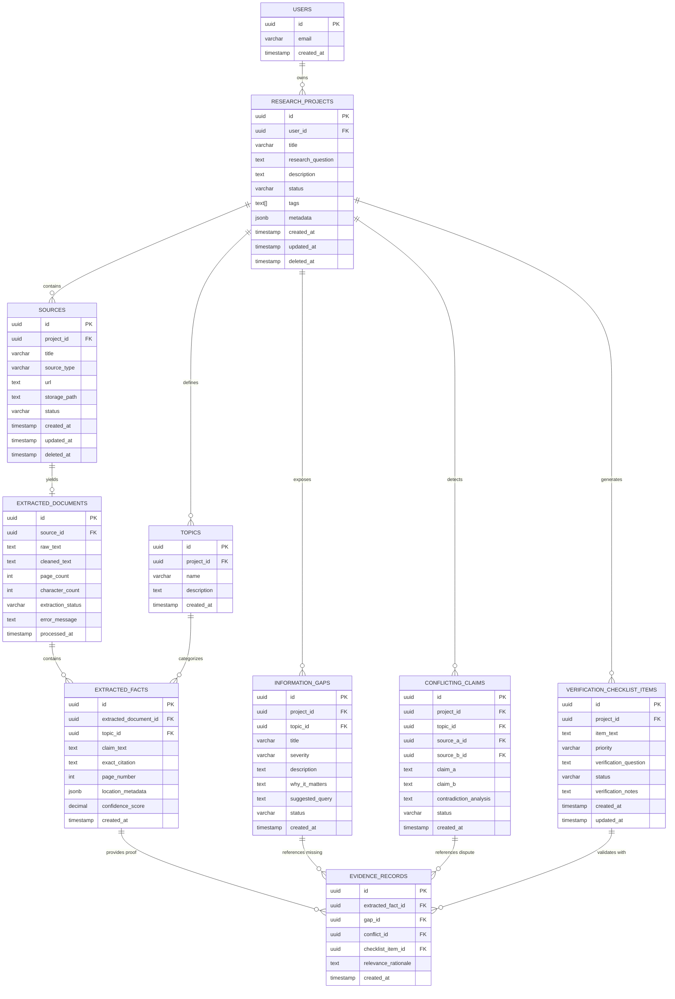
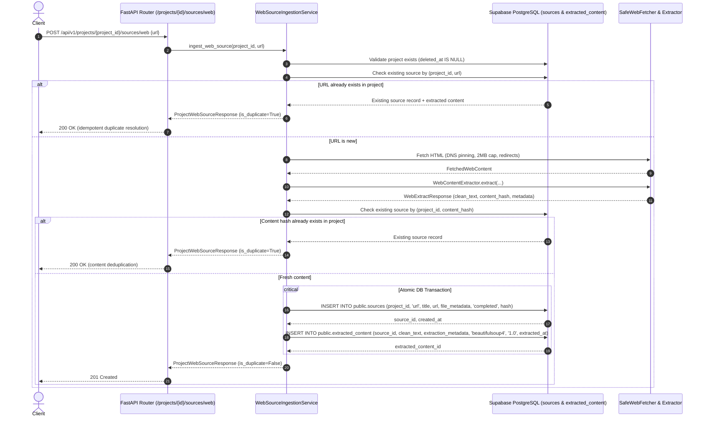
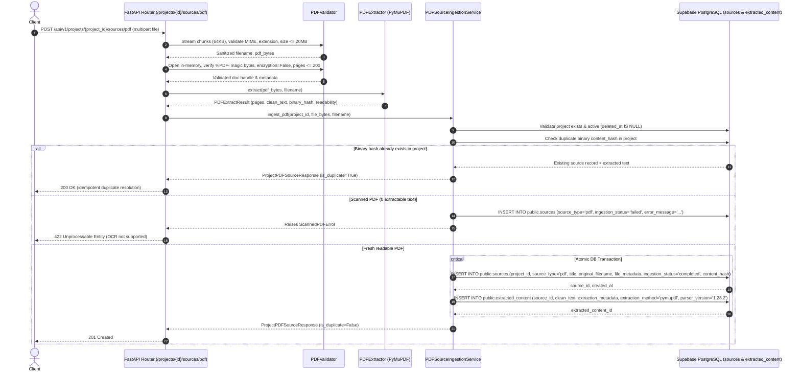

# Bharmafills — Database Specification & Data Models

> **Document Status**: Production Schema Implemented & Live Migrated
> **Target Engine**: Supabase PostgreSQL 15+ (PostgreSQL 17.11 Server Verified)
> **Current Storage**: Client-Side Local Storage (`researchService.js` / `SCHEMA_VERSION: 1`) on Frontend; PostgreSQL Schema Initialized & Live Verified on Supabase
> **Connectivity Status**: Supabase PostgreSQL Session Pooler connection verified; Initial schema (`20261031123000`) and Evidence Persistence schema (`20261101120000`) applied and live catalog verified (Step 6B & Step 9B.3.2)
> **Workspace Identifier**: `Shinchan`

---

## 1. Overview & Storage Strategy

Bharmafills currently persists research projects in the user's browser via a resilient client-side storage service (`frontend/src/services/researchService.js`). For multi-source extraction, AI analysis, cross-device persistence, and collaborative verification (Phase 4), Bharmafills will transition to **Supabase PostgreSQL**.

### Architecture Guidelines
- **Tenant & User Isolation**: Enforced at the database tier via PostgreSQL Row Level Security (RLS) using Supabase Auth JWT claims (`auth.uid()`).
- **Data Integrity & Traceability**: Foreign keys and check constraints guarantee that every identified gap, conflicting claim, or checklist item links back to valid source records.
- **Auditability**: `created_at` and `updated_at` timestamps on all tables with automated trigger updates.
- **Soft Deletion**: Sensitive entities (Projects, Sources) support soft deletion (`deleted_at IS NULL`) to protect against accidental data loss.

---

## 2. Entity-Relationship Diagram (ERD)



---

## 3. Detailed Table Specifications

### 3.1 `research_projects`
Core project container corresponding to Phase 2 `ResearchProject` data model.

```sql
CREATE TABLE research_projects (
    id UUID PRIMARY KEY DEFAULT gen_random_uuid(),
    user_id UUID NOT NULL REFERENCES auth.users(id) ON DELETE CASCADE,
    title VARCHAR(150) NOT NULL,
    research_question TEXT NOT NULL,
    description TEXT,
    status VARCHAR(30) NOT NULL DEFAULT 'active' CHECK (status IN ('active', 'in_progress', 'completed', 'archived')),
    tags TEXT[] DEFAULT '{}',
    metadata JSONB DEFAULT '{}'::jsonb,
    created_at TIMESTAMPTZ NOT NULL DEFAULT timezone('utc', now()),
    updated_at TIMESTAMPTZ NOT NULL DEFAULT timezone('utc', now()),
    deleted_at TIMESTAMPTZ
);
```

### 3.2 `sources`
Input documents and web links associated with a research project.

```sql
-- PROPOSED SCHEMA (PLANNED FOR STEP 6 / SUPABASE CONNECTION)
CREATE TABLE sources (
    id UUID PRIMARY KEY DEFAULT gen_random_uuid(),
    project_id UUID NOT NULL REFERENCES research_projects(id) ON DELETE CASCADE,
    title VARCHAR(255) NOT NULL,
    source_type VARCHAR(20) NOT NULL CHECK (source_type IN ('url', 'pdf', 'manual_text')),
    url TEXT,
    storage_path TEXT,
    content_hash VARCHAR(64), -- SHA-256 fingerprint for deduplication
    status VARCHAR(30) NOT NULL DEFAULT 'pending' CHECK (status IN ('pending', 'extracting', 'parsed', 'failed')),
    created_at TIMESTAMPTZ NOT NULL DEFAULT timezone('utc', now()),
    updated_at TIMESTAMPTZ NOT NULL DEFAULT timezone('utc', now()),
    deleted_at TIMESTAMPTZ
);
```

### 3.3 `extracted_documents`
Cleaned textual payload generated from URL scraping or PDF parsing.

```sql
CREATE TABLE extracted_documents (
    id UUID PRIMARY KEY DEFAULT gen_random_uuid(),
    source_id UUID NOT NULL UNIQUE REFERENCES sources(id) ON DELETE CASCADE,
    raw_text TEXT,
    cleaned_text TEXT NOT NULL,
    page_count INTEGER DEFAULT 1,
    character_count INTEGER NOT NULL,
    extraction_status VARCHAR(30) NOT NULL DEFAULT 'completed' CHECK (extraction_status IN ('completed', 'truncated', 'failed')),
    error_message TEXT,
    processed_at TIMESTAMPTZ NOT NULL DEFAULT timezone('utc', now())
);
```

### 3.4 `topics`
Taxonomy categories relevant to the specific research question.

```sql
CREATE TABLE topics (
    id UUID PRIMARY KEY DEFAULT gen_random_uuid(),
    project_id UUID NOT NULL REFERENCES research_projects(id) ON DELETE CASCADE,
    name VARCHAR(100) NOT NULL,
    description TEXT,
    created_at TIMESTAMPTZ NOT NULL DEFAULT timezone('utc', now()),
    UNIQUE(project_id, name)
);
```

### 3.5 `extracted_facts`
Discrete factual assertions, requirements, or statements extracted from documents.

```sql
CREATE TABLE extracted_facts (
    id UUID PRIMARY KEY DEFAULT gen_random_uuid(),
    extracted_document_id UUID NOT NULL REFERENCES extracted_documents(id) ON DELETE CASCADE,
    topic_id UUID REFERENCES topics(id) ON DELETE SET NULL,
    claim_text TEXT NOT NULL,
    exact_citation TEXT NOT NULL,
    page_number INTEGER DEFAULT 1,
    location_metadata JSONB DEFAULT '{}'::jsonb,
    confidence_score NUMERIC(3, 2) CHECK (confidence_score >= 0.0 AND confidence_score <= 1.0),
    created_at TIMESTAMPTZ NOT NULL DEFAULT timezone('utc', now())
);
```

### 3.6 `information_gaps`
Missing information, unaddressed criteria, or omitted requirements detected by AI.

```sql
CREATE TABLE information_gaps (
    id UUID PRIMARY KEY DEFAULT gen_random_uuid(),
    project_id UUID NOT NULL REFERENCES research_projects(id) ON DELETE CASCADE,
    topic_id UUID REFERENCES topics(id) ON DELETE SET NULL,
    title VARCHAR(200) NOT NULL,
    severity VARCHAR(20) NOT NULL DEFAULT 'medium' CHECK (severity IN ('low', 'medium', 'high', 'critical')),
    description TEXT NOT NULL,
    why_it_matters TEXT NOT NULL,
    suggested_query TEXT,
    status VARCHAR(30) NOT NULL DEFAULT 'unresolved' CHECK (status IN ('unresolved', 'investigating', 'resolved', 'dismissed')),
    created_at TIMESTAMPTZ NOT NULL DEFAULT timezone('utc', now())
);
```

### 3.7 `conflicting_claims`
Direct contradictions or narrative discrepancies identified between two sources.

```sql
CREATE TABLE conflicting_claims (
    id UUID PRIMARY KEY DEFAULT gen_random_uuid(),
    project_id UUID NOT NULL REFERENCES research_projects(id) ON DELETE CASCADE,
    topic_id UUID REFERENCES topics(id) ON DELETE SET NULL,
    source_a_id UUID NOT NULL REFERENCES sources(id) ON DELETE CASCADE,
    source_b_id UUID NOT NULL REFERENCES sources(id) ON DELETE CASCADE,
    claim_a TEXT NOT NULL,
    claim_b TEXT NOT NULL,
    contradiction_analysis TEXT NOT NULL,
    status VARCHAR(30) NOT NULL DEFAULT 'unresolved' CHECK (status IN ('unresolved', 'reconciled', 'dismissed')),
    created_at TIMESTAMPTZ NOT NULL DEFAULT timezone('utc', now()),
    CHECK (source_a_id != source_b_id)
);
```

### 3.8 `evidence_records`
Associative audit links tying specific citations and extracted facts to gaps and conflicts.

```sql
CREATE TABLE evidence_records (
    id UUID PRIMARY KEY DEFAULT gen_random_uuid(),
    extracted_fact_id UUID NOT NULL REFERENCES extracted_facts(id) ON DELETE CASCADE,
    gap_id UUID REFERENCES information_gaps(id) ON DELETE CASCADE,
    conflict_id UUID REFERENCES conflicting_claims(id) ON DELETE CASCADE,
    checklist_item_id UUID, -- Forward reference to checklist
    relevance_rationale TEXT,
    created_at TIMESTAMPTZ NOT NULL DEFAULT timezone('utc', now()),
    CHECK (gap_id IS NOT NULL OR conflict_id IS NOT NULL OR checklist_item_id IS NOT NULL)
);
```

### 3.9 `verification_checklist_items`
Actionable checklist generated to guide manual follow-up and verification.

```sql
CREATE TABLE verification_checklist_items (
    id UUID PRIMARY KEY DEFAULT gen_random_uuid(),
    project_id UUID NOT NULL REFERENCES research_projects(id) ON DELETE CASCADE,
    item_text TEXT NOT NULL,
    priority VARCHAR(20) NOT NULL DEFAULT 'medium' CHECK (priority IN ('low', 'medium', 'high', 'urgent')),
    verification_question TEXT NOT NULL,
    status VARCHAR(30) NOT NULL DEFAULT 'pending' CHECK (status IN ('pending', 'in_progress', 'verified', 'debunked')),
    verification_notes TEXT,
    created_at TIMESTAMPTZ NOT NULL DEFAULT timezone('utc', now()),
    updated_at TIMESTAMPTZ NOT NULL DEFAULT timezone('utc', now())
);
```

---

### 3.10 Evidence Extraction Schemas & Database Compatibility Review (Step 9B.2.1)

The Pydantic domain models in `backend/app/services/ai/evidence_schemas.py` (`EvidenceLocation`, `ExtractedFact`, `SourceClaim`, and `EvidenceExtractionResult`) map seamlessly to the live Supabase database table `public.evidence` (defined in migration `20261031123000_initial_bharmafills_schema.sql`):

| Pydantic Model Field (`ExtractedFact` / `SourceClaim`) | Target Database Column (`public.evidence`) | Transformation & Type Handling | Compatibility Status |
| :--- | :--- | :--- | :--- |
| `fact_id` / `claim_id` | `id` (UUID PK) | Converted to UUID if generated as UUID string, or stored in `analysis_metadata` if local string ID | `COMPATIBLE` |
| Active project context | `project_id` (UUID FK) | Injected from parent research project session | `COMPATIBLE` |
| `location.source_id` / `claim.source_id` | `source_id` (UUID FK) | Direct UUID string mapping to `public.sources.id` | `DIRECT MAP` |
| Ingestion record context | `extracted_content_id` (UUID FK) | Injected from parent source's `extracted_content.id` | `DIRECT MAP` |
| `fact.statement` / `claim.claim_text` | `claim` (TEXT) | Direct string mapping (satisfies `chk_evidence_claim_len >= 5`) | `DIRECT MAP` |
| `fact.evidence_text` / excerpt | `supporting_excerpt` (TEXT) | Direct string mapping (satisfies `chk_evidence_excerpt_len >= 5`) | `DIRECT MAP` |
| `EvidenceLocation` instance | `location_reference` (JSONB) | Serialized via `location.model_dump()` storing URL, page, headings, offsets | `DIRECT MAP` |
| `confidence` (float 0.0–1.0) | `confidence_score` (NUMERIC(4, 3)) | Direct numeric mapping (satisfies `0.000 <= score <= 1.000`) | `DIRECT MAP` |
| `uncertainty_notes` | `confidence_explanation` (TEXT) | Direct text mapping capturing caveats and ambiguities | `DIRECT MAP` |
| Provider / model identifier | `ai_model` (VARCHAR(100)) | Injected from active AI provider settings (e.g. `nvidia/nemotron-3-ultra-550b-a55b:free`) | `DIRECT MAP` |
| `representation_type`, `fact_type`/`claim_type`, `qualifiers`, `extraction_warnings` | `analysis_metadata` (JSONB) | Serialized as structured JSON object preserving classification and warnings | `DIRECT MAP` |

#### Envelope Persistence Findings (`EvidenceExtractionResult`):
- Extraction run envelope metadata (`source_truncated`, `source_character_count`, `processed_character_count`, `extraction_status`, `warnings`, `errors`) represents execution-run telemetry rather than atomic evidence rows.
- In future Step 9B.3 (Persistence), run metadata can be recorded into `public.sources.metadata` (JSONB) or an `extraction_runs` table without requiring database schema alterations or relaxing constraints.
- **Migration Status**: Zero database migrations required for Step 9B.2.1. All database constraints remain strictly preserved.

---

## 4. Row Level Security (RLS) Policies

All tables mandate PostgreSQL RLS to enforce complete user isolation. All policies cascade from project ownership:

```sql
-- PROPOSED POLICIES (PLANNED FOR STEP 6 / SUPABASE CONNECTION)
-- Enable RLS on all tables
ALTER TABLE research_projects ENABLE ROW LEVEL SECURITY;
ALTER TABLE sources ENABLE ROW LEVEL SECURITY;
ALTER TABLE extracted_documents ENABLE ROW LEVEL SECURITY;
ALTER TABLE topics ENABLE ROW LEVEL SECURITY;
ALTER TABLE extracted_facts ENABLE ROW LEVEL SECURITY;
ALTER TABLE information_gaps ENABLE ROW LEVEL SECURITY;
ALTER TABLE conflicting_claims ENABLE ROW LEVEL SECURITY;
ALTER TABLE evidence_records ENABLE ROW LEVEL SECURITY;
ALTER TABLE verification_checklist_items ENABLE ROW LEVEL SECURITY;

-- 1. Projects Policy (Owner access only)
CREATE POLICY "Users can manage their own research projects"
ON research_projects FOR ALL
TO authenticated
USING (auth.uid() = user_id)
WITH CHECK (auth.uid() = user_id);

-- 2. Sources Policy (Cascaded through Project ownership)
CREATE POLICY "Users can manage sources belonging to their projects"
ON sources FOR ALL
TO authenticated
USING (
    EXISTS (
        SELECT 1 FROM research_projects p
        WHERE p.id = sources.project_id AND p.user_id = auth.uid()
    )
);

-- 3. Extracted Documents Policy
CREATE POLICY "Users can access documents belonging to their sources"
ON extracted_documents FOR ALL
TO authenticated
USING (
    EXISTS (
        SELECT 1 FROM sources s
        JOIN research_projects p ON p.id = s.project_id
        WHERE s.id = extracted_documents.source_id AND p.user_id = auth.uid()
    )
);

-- 4. Topics Policy
CREATE POLICY "Users can manage topics belonging to their projects"
ON topics FOR ALL
TO authenticated
USING (
    EXISTS (
        SELECT 1 FROM research_projects p
        WHERE p.id = topics.project_id AND p.user_id = auth.uid()
    )
);

-- 5. Extracted Facts Policy
CREATE POLICY "Users can access facts extracted from their documents"
ON extracted_facts FOR ALL
TO authenticated
USING (
    EXISTS (
        SELECT 1 FROM extracted_documents ed
        JOIN sources s ON s.id = ed.source_id
        JOIN research_projects p ON p.id = s.project_id
        WHERE ed.id = extracted_facts.extracted_document_id AND p.user_id = auth.uid()
    )
);

-- 6. Information Gaps Policy
CREATE POLICY "Users can manage information gaps in their projects"
ON information_gaps FOR ALL
TO authenticated
USING (
    EXISTS (
        SELECT 1 FROM research_projects p
        WHERE p.id = information_gaps.project_id AND p.user_id = auth.uid()
    )
);

-- 7. Conflicting Claims Policy
CREATE POLICY "Users can manage conflicting claims in their projects"
ON conflicting_claims FOR ALL
TO authenticated
USING (
    EXISTS (
        SELECT 1 FROM research_projects p
        WHERE p.id = conflicting_claims.project_id AND p.user_id = auth.uid()
    )
);

-- 8. Evidence Records Policy
CREATE POLICY "Users can access evidence records linked to their projects"
ON evidence_records FOR ALL
TO authenticated
USING (
    EXISTS (
        SELECT 1 FROM extracted_facts ef
        JOIN extracted_documents ed ON ed.id = ef.extracted_document_id
        JOIN sources s ON s.id = ed.source_id
        JOIN research_projects p ON p.id = s.project_id
        WHERE ef.id = evidence_records.extracted_fact_id AND p.user_id = auth.uid()
    )
);

-- 9. Verification Checklist Items Policy
CREATE POLICY "Users can manage checklist items for their projects"
ON verification_checklist_items FOR ALL
TO authenticated
USING (
    EXISTS (
        SELECT 1 FROM research_projects p
        WHERE p.id = verification_checklist_items.project_id AND p.user_id = auth.uid()
    )
);
```

---

## 5. Indexing & Deduplication Strategy

```sql
-- PROPOSED INDEXES (PLANNED FOR STEP 6 / SUPABASE CONNECTION)
-- Deduplication Unique Indexes (Prevent duplicate active sources within the same project)
CREATE UNIQUE INDEX idx_unique_project_url ON sources (project_id, url) WHERE deleted_at IS NULL AND url IS NOT NULL;
CREATE UNIQUE INDEX idx_unique_project_file_hash ON sources (project_id, content_hash) WHERE deleted_at IS NULL AND content_hash IS NOT NULL;

-- Performance Indexes for Foreign Key Joins & Filtering
CREATE INDEX idx_projects_user_status ON research_projects (user_id, status) WHERE deleted_at IS NULL;
CREATE INDEX idx_sources_project_id ON sources (project_id) WHERE deleted_at IS NULL;
CREATE INDEX idx_extracted_facts_document_id ON extracted_facts (extracted_document_id);
CREATE INDEX idx_information_gaps_project_severity ON information_gaps (project_id, severity);
CREATE INDEX idx_conflicting_claims_project ON conflicting_claims (project_id);
CREATE INDEX idx_checklist_project_status ON verification_checklist_items (project_id, status);

-- Full-Text Search Indexes (pg_trgm or tsvector)
CREATE INDEX idx_projects_fts ON research_projects USING gin (to_tsvector('english', title || ' ' || research_question));
CREATE INDEX idx_facts_citation_fts ON extracted_facts USING gin (to_tsvector('english', claim_text));
```

---

## 6. Migration & Backward Compatibility Strategy

### Phase 2 Local Storage Migration
When Phase 4 introduces Supabase cloud persistence:
1. **Schema Parity**: The database schema fields (`title`, `research_question`, `description`, `status`, `tags`, `metadata`) directly mirror `frontend/src/features/research/schemas/researchProjectSchema.js`.
2. **Client-Side Import Utility**: A migration helper will inspect `localStorage.getItem('bharmafills_research_projects')`.
3. **Upsert Sync**: For authenticated users, existing local records will be bulk-synced to Supabase with auto-assigned `user_id = auth.uid()`.
4. **Archive on Sync**: Once synchronized, local records will be preserved in a local archive key (`bharmafills_research_projects_migrated_backup`) to guarantee zero data loss.

---

## 7. Step 6A Connectivity Verification Audit

### 7.1 Driver & Transport Architecture
- **Driver**: `asyncpg==0.32.0` (native async CPython 3.15 wheel, zero external runtime dependencies).
- **Endpoint Target**: Supabase PostgreSQL Session Pooler (`aws-0-[region].pooler.supabase.com:5432/postgres`).
- **Connection Configuration**:
  - `statement_cache_size=0` for strict PgBouncer / pooler compatibility.
  - Connection timeout enforced via `DATABASE_CONNECT_TIMEOUT_SECONDS=5.0`.
  - Sensitive connection parameters are parsed directly by `asyncpg` without logging or printing.

### 7.2 Health Probes & Failure Modes
- **Process Liveness (`GET /api/v1/health`)**: Verified returning HTTP 200 independently of database connection status.
- **Database Health Probe (`GET /api/v1/health/database`)**: Verified returning HTTP 200 (`status: "ok", database: "connected"`) when healthy, HTTP 200 (`status: "not_configured", database: "not_configured"`) when unconfigured, and HTTP 503 (`status: "error", database: "unavailable"`) with zero leaked credentials when connectivity fails.

### 7.3 Live Connectivity Audit Finding & Final Verification Outcome
- **Initial Verification**: Identified that `backend/.env` originally retained the Supabase template placeholder `[YOUR-PASSWORD]`.
- **User Correction & Final Probe**:
  - `backend/.env` was updated with the real database password and square brackets removed.
  - Safe local configuration validation confirmed: `env_exists: True`, `has_url: True`, `has_placeholder: False`, `has_brackets: False`, `scheme_valid: True`.
  - Live probe executed using `DatabaseManager.check_connection()`:
    - Status: `ok`
    - Database: `connected`
    - Live Query: `SELECT 1;` successfully returned `1`.
    - Pooler Latency: ~1756 ms (Session Pooler cold-start / connection handshakes).
  - Process Health Probe (`GET /api/v1/health`): HTTP 200 `{"status": "ok", "service": "Bharmafills API", "version": "0.1.0"}`.
  - Database Health Probe (`GET /api/v1/health/database`): HTTP 200 `{"status": "ok", "database": "connected"}`.

---

## 8. Step 6B Initial Schema Migration & Live Verification Audit

### 8.1 Migration Artifact
- **Migration File**: `supabase/migrations/20261031123000_initial_bharmafills_schema.sql`
- **Version**: `20261031123000`
- **Checksum**: `9faba81ef747bb40d7040431835697693998f420cf67916053fef3c748c909e6`
- **Application Runner**: `backend/app/db/migrator.py` (`DatabaseMigrator`)
- **Transaction Safety**: All DDL executed inside an isolated `async with conn.transaction():` block.
- **Migration Tracking Table**: `public.schema_migrations` (`version`, `name`, `applied_at`, `checksum`).

### 8.2 Tables Created & Verified in Public Schema
1. `public.research_projects` (10 columns): Core research projects; UUID PK `gen_random_uuid()`; category and status controlled constraints; soft deletion support (`deleted_at`).
2. `public.sources` (13 columns): Web and PDF sources; URL/PDF mutual exclusion constraints; content hash for deduplication.
3. `public.extracted_content` (9 columns): Extracted document text, extraction metadata, method versioning.
4. `public.topics` (6 columns): Research domains; compound unique constraint `(project_id, name)`.
5. `public.evidence` (13 columns): Factual claims, supporting quotes, location references, confidence score bounded `0.000` to `1.000`, AI model provenance.
6. `public.evidence_topics` (3 columns): Many-to-many junction table between evidence and topics.
7. `public.information_gaps` (12 columns): Unanswered questions, priority, status, gap type (`no_evidence`, `insufficient_evidence`, `conflicting_evidence`, `unverified`).
8. `public.conflicts` (9 columns): Contradictory claims across sources; severity and status checks.
9. `public.conflict_evidence` (4 columns): Many-to-many junction table linking conflicts to evidence records with `stance` classification.
10. `public.verification_checklist` (12 columns): Actionable verification tasks; mutual target check constraint (`information_gap_id IS NULL OR conflict_id IS NULL`).
11. `public.schema_migrations` (4 columns): Migration history ledger.

### 8.3 Live Schema Verification Metrics
- **PostgreSQL Server**: PostgreSQL 17.11 on x86_64-pc-linux-gnu.
- **Tables Created**: 11 (10 Bharmafills domain tables + 1 migration tracking table).
- **Missing Tables**: 0.
- **Foreign Keys**: 17 constraints verified with cascade/set null rules.
- **Indexes**: 41 indexes verified across foreign keys and queried fields.
- **Check Constraints**: 100 check constraints active.
- **Row Level Security**: Enabled on all 10 domain tables (0 tables missing RLS). PostgREST access denied by default for browser-facing anon and authenticated roles.
- **Automated Tests**: 11 dedicated migration and structural tests passing in `backend/tests/test_db_migration.py`. Full backend test suite passing with 53 / 53 tests.

---

## 9. Step 7B Source Ingestion Persistence & Database Integration

### 9.1 Relational Ingestion Pattern
In Step 7B, the backend persists web content extracted via BeautifulSoup (`SafeWebFetcher` + `WebContentExtractor`) into Supabase PostgreSQL:



### 9.2 Deduplication Constraints & Enforcement
1. **URL Uniqueness Per Project**:
   - `idx_sources_project_url_unique` on `(project_id, original_url) WHERE deleted_at IS NULL AND original_url IS NOT NULL`.
   - Prevents re-fetching the same page for a project; returns existing source with `is_duplicate: True`.
   - The same URL can still be added to multiple distinct research projects without conflict (project isolation).
2. **Content Hash Deduplication**:
   - `idx_sources_project_hash_unique` on `(project_id, content_hash) WHERE deleted_at IS NULL AND content_hash IS NOT NULL`.
   - Prevents storing duplicate copies of identical web pages across different URLs within the same project.
3. **Atomic Rollback Guarantee**:
   - Both `sources` and `extracted_content` are written within an explicit `async with conn.transaction():` context. If text insertion or constraint validation fails, the `sources` header row is rolled back automatically.

### 9.3 Ingestion Metadata Structures
- **`sources.file_metadata` (JSONB)**:
  `{"final_url": "...", "status_code": 200, "redirect_count": 0, "language": "en", "canonical_url": "...", "meta_description": "...", "author": "...", "word_count": 380, "character_count": 2650}`
- **`extracted_content.extraction_metadata` (JSONB)**:
  `{"headings": [{"level": 1, "text": "..."}], "paragraphs_count": 12, "canonical_url": "...", "language": "en", "meta_description": "...", "author": "..."}`
- **Automated Verification**:
  29 dedicated unit and integration tests passing in `backend/tests/test_source_ingestion.py`. Full backend test suite passing with 114 / 114 tests.

---

## 10. Step 8 PDF Ingestion Persistence & PyMuPDF Integration

### 10.1 Relational Ingestion Pattern
In Step 8, the backend persists structured PDF document content extracted via PyMuPDF (`fitz`) into Supabase PostgreSQL:



### 10.2 Binary Hash Deduplication & Project Scoping
1. **Authoritative Hash**: `content_hash = hashlib.sha256(pdf_bytes).hexdigest()`.
   - Distinct from URL hashing, binary hashing evaluates exact binary stream equivalence.
   - Files uploaded with different filenames but identical contents are detected as duplicates.
2. **Project Isolation**:
   - `idx_sources_project_hash_unique` on `(project_id, content_hash) WHERE deleted_at IS NULL AND content_hash IS NOT NULL`.
   - The same PDF file can be uploaded to separate research projects independently.
   - Within the same project, duplicate uploads are resolved idempotently without duplicate storage.

### 10.3 Failure Isolation & Scanned PDF Auditing
- When a PDF contains 0 extractable characters (scanned image or empty vector drawing):
  - Check constraint `chk_extracted_content_text_not_empty` (`length(btrim(clean_text)) > 0`) forbids empty text rows in `public.extracted_content`.
  - The service records the upload in `public.sources` with:
    - `source_type = 'pdf'`
    - `ingestion_status = 'failed'`
    - `error_message = 'Document contains no extractable embedded text (scanned or image-only PDF). OCR is not supported.'`
    - `file_metadata = {"readability_status": "no_extractable_text", "page_count": N, "file_size_bytes": B}`
  - Prevents silent data discarding while protecting downstream AI pipelines from empty evidence contexts.

### 10.4 Metadata Structures (JSONB)
- **`sources.file_metadata`**:
  ```json
  {
    "page_count": 14,
    "readable_page_count": 14,
    "readability_status": "fully_readable",
    "pdf_metadata": {
      "title": "National Climate Assessment 2026",
      "author": "Climate Science Taskforce",
      "subject": "Policy Impact Analysis",
      "creation_date": "D:20260415120000"
    },
    "file_size_bytes": 1048576,
    "text_content_hash": "a1b2c3d4..."
  }
  ```
- **`extracted_content.extraction_metadata`**:
  ```json
  {
    "extraction_tool": "pymupdf",
    "pdf_metadata": { ... },
    "pages": [
      {
        "page_number": 1,
        "character_count": 2240,
        "word_count": 350,
        "is_empty": false
      }
    ],
    "clean_text_preview": "Executive Summary: National Climate Assessment 2026..."
  }
  ```

### 10.5 Schema Migration Compatibility
- Step 8 required **0 SQL schema migrations**.
- The existing Step 6B schema (`public.sources` and `public.extracted_content`) natively supports:
  - `source_type = 'pdf'` (governed by `chk_sources_source_type`)
  - `original_filename VARCHAR(255)`
  - `file_metadata JSONB`
  - `content_hash VARCHAR(64)`
  - `extraction_method VARCHAR(50)`
  - `parser_version VARCHAR(50)`
- Automated verification: 34 dedicated tests passing in `backend/tests/test_pdf_ingestion.py`. Full backend test suite passing with 148 / 148 tests. Combined automated tests: 200 passing.

---

## 11. Step 9B.3 Evidence Database Persistence & Retrieval Schema

### 11.1 Migration Artifact
- **Migration File**: `supabase/migrations/20261101120000_add_evidence_claims_and_runs.sql`
- **Version**: `20261101120000`
- **Application Runner**: `backend/app/db/migrator.py` (`DatabaseMigrator`)
- **Transaction Safety**: All DDL executed inside an isolated `async with conn.transaction():` block.
- **Migration Tracking Table**: Recorded in `public.schema_migrations`.
- **Live Status**: `LIVE DATABASE VERIFIED ON SUPABASE POSTGRESQL 17.11` (Applied: 2026-11-01 03:48:23 UTC).
- **Verified SHA256 Checksum**: `895361b72cabcad4d5de857ec3235a73717c62e7ee70401c2031910461871567` (Matches disk migration file exactly).
- **Live Catalog Verification**:
  - `public.extraction_runs`: Verified exists (17 columns, 5 indexes, status & count check constraints, RLS enabled).
  - `public.source_claims`: Verified exists (19 columns, 5 indexes, type & length check constraints, RLS enabled).
  - `public.evidence`: Verified 11 additive columns present, unique compound index `idx_evidence_run_fact_id_unique` present, RLS enabled.
  - Foreign key cascading verified with `ON DELETE CASCADE` and `ON DELETE SET NULL`.

### 11.2 Schema Enhancements & Relational Model

In Step 9B.3, the database schema was extended to support granular provenance tracking, unverified source assertion storage, and AI extraction execution auditing:

1. **`public.extraction_runs` (New Table)**:
   - Tracks each AI extraction invocation per source.
   - Columns: `id` (UUID PK), `project_id` (UUID FK -> `research_projects`), `source_id` (UUID FK -> `sources`), `ai_provider` (VARCHAR(50)), `ai_model` (VARCHAR(100)), `extraction_status` (VARCHAR(30) CHECK `success`, `partial`, `failed`, `no_content`), `source_truncated` (BOOLEAN), `source_character_count` (INTEGER), `processed_character_count` (INTEGER), `extracted_facts_count` (INTEGER), `extracted_claims_count` (INTEGER), `warnings` (TEXT[]), `errors` (TEXT[]), `prompt_tokens`, `completion_tokens`, `latency_ms`, `idempotency_key` (VARCHAR(128)), `created_at` (TIMESTAMPTZ).
   - Foreign Keys: `ON DELETE CASCADE` on `project_id` and `source_id`.
   - Indexes: `idx_extraction_runs_project_id`, `idx_extraction_runs_source_id`, `idx_extraction_runs_created_at`, `idx_extraction_runs_idempotency_unique` (unique where idempotency_key is not null).

2. **`public.evidence` (Enhanced Table)**:
   - Preserves all 13 original Step 6B columns.
   - Additive Columns:
     - `extraction_run_id` (UUID FK -> `extraction_runs` ON DELETE CASCADE)
     - `fact_id` (VARCHAR(100))
     - `fact_type` (VARCHAR(50) CHECK `general`, `statistical`, `procedural`, `eligibility`, `definitional`, `temporal`)
     - `representation_type` (VARCHAR(30) CHECK `direct_quote`, `paraphrase`)
     - `qualifiers` (TEXT[])
     - `uncertainty_notes` (TEXT)
     - `extraction_warnings` (TEXT[])
     - `start_char` (INTEGER)
     - `end_char` (INTEGER)
     - `page_number` (INTEGER)
     - `url` (TEXT)
   - Constraints: `chk_evidence_char_offsets_order` (`end_char IS NULL OR start_char IS NULL OR end_char >= start_char`).
   - Indexes: `idx_evidence_extraction_run_id`, `idx_evidence_fact_type`, `idx_evidence_run_fact_id_unique` (unique on `extraction_run_id, fact_id` where both are not null).

3. **`public.source_claims` (New Table)**:
   - Stores unverified source assertions, recommendations, predictions, and policy statements without conflating claims with factual evidence.
   - Columns: `id` (UUID PK), `project_id` (UUID FK -> `research_projects`), `source_id` (UUID FK -> `sources`), `extraction_run_id` (UUID FK -> `extraction_runs`), `claim_id` (VARCHAR(100)), `claim_text` (TEXT NOT NULL), `claim_type` (VARCHAR(50) CHECK `factual_assertion`, `recommendation`, `policy_statement`, `prediction`, `opinion`, `eligibility_condition`, `numerical_or_statistical`), `representation_type` (VARCHAR(30) CHECK `direct_quote`, `paraphrase`), `confidence_score` (NUMERIC(4,3) CHECK `0.000 <= score <= 1.000`), `confidence_explanation` (TEXT), `qualifiers` (TEXT[]), `uncertainty_notes` (TEXT), `extraction_warnings` (TEXT[]), `location_reference` (JSONB), `start_char` (INTEGER), `end_char` (INTEGER), `page_number` (INTEGER), `url` (TEXT), `ai_model` (VARCHAR(100)), `created_at` (TIMESTAMPTZ).
   - Constraints: `chk_source_claims_text_len` (`length(claim_text) >= 5`), `chk_source_claims_char_offsets_order` (`end_char IS NULL OR start_char IS NULL OR end_char >= start_char`).
   - Indexes: `idx_source_claims_project_id`, `idx_source_claims_source_id`, `idx_source_claims_run_id`, `idx_source_claims_type`, `idx_source_claims_run_claim_id_unique`.

### 11.3 Transactional Rollback & Integrity Guarantees
- **Atomic Runs**: `EvidencePersistenceService.persist_extraction_result` wraps the insertion of `extraction_runs`, `evidence` (facts), and `source_claims` in a single `async with conn.transaction():` context.
- **Rollback on Any Failure**: If any single fact or claim fails a constraint (e.g. invalid offset bounds or invalid foreign key), the entire transaction aborts and rolls back cleanly without leaving orphan extraction runs.
- **Deduplication & Idempotency**:
  - `idx_extraction_runs_idempotency_unique` ensures identical idempotency keys reject duplicate insertion.
  - Per-run unique indexes `idx_evidence_run_fact_id_unique` and `idx_source_claims_run_claim_id_unique` enforce item integrity within each run.
- **Row Level Security**:
  - RLS enabled on `public.extraction_runs` and `public.source_claims`.
  - All access policies cascade strictly from `research_projects.user_id = auth.uid()`.

---

## 12. Step 10D.1 Information Gap Database Persistence & Storage Architecture

### 12.1 Schema Overview & Migration Status
- **Schema Migration Status**: **Zero DDL migrations required**. The production schema defined in `supabase/migrations/20261031123000_initial_bharmafills_schema.sql` natively provides the required table and constraints:
  - Table: `public.information_gaps`
  - Columns: `id` (UUID PK), `project_id` (UUID FK -> `research_projects`), `topic_id` (UUID FK -> `topics`), `gap_description` (TEXT NOT NULL), `explanation` (TEXT NOT NULL), `suggested_query` (TEXT), `priority` (VARCHAR(20) CHECK `critical`, `high`, `medium`, `low`), `status` (VARCHAR(20) CHECK `open`, `investigating`, `resolved`, `dismissed`), `gap_type` (VARCHAR(50) CHECK `no_evidence`, `unverified`, `conflicting_evidence`, `insufficient_evidence`), `confidence_metadata` (JSONB NOT NULL DEFAULT `'{}'::jsonb`), `created_at` (TIMESTAMPTZ), `updated_at` (TIMESTAMPTZ).
  - Existing RLS Policy: `information_gaps_project_isolation` restricts access to `research_projects.user_id = auth.uid()`.

### 12.2 Relational Column Mapping
`GapPersistenceService` maps `ValidatedGapFinding` from `InformationGapDetectionService` to table columns:

| Database Column | Source Expression / Type | Constraints / Verification |
|---|---|---|
| `id` | `UUID` (new `uuid4()` on insert; preserved on rerun) | Primary Key |
| `project_id` | Caller `project_id: UUID` | Foreign Key -> `research_projects.id` |
| `topic_id` | Verified project topic UUID or `NULL` | Foreign Key -> `topics.id` (set to `NULL` if topic name is unmatched or absent) |
| `gap_description` | `cand.gap_description` (string) | Min length 5 chars (`chk_information_gaps_desc_len`) |
| `explanation` | `cand.explanation` (string) | NOT NULL |
| `suggested_query` | `cand.suggested_query` (string or NULL) | Optional search query |
| `priority` | `cand.priority.value` (string) | CHECK `critical`, `high`, `medium`, `low` |
| `status` | `'open'` on initial insert | Preserved across reruns (`open`, `investigating`, `resolved`, `dismissed`) |
| `gap_type` | `cand.gap_type.value` (string) | CHECK `no_evidence`, `unverified`, `conflicting_evidence`, `insufficient_evidence` |
| `confidence_metadata` | JSONB namespaced under `'bharmafills'` | Merged with existing JSONB; preserves custom external keys |
| `created_at` | `now()` | Set on insert; immutable on update |
| `updated_at` | `now()` | Updated on rerun update and user review update |

### 12.3 Namespaced JSONB Schema (`confidence_metadata->'bharmafills'`)
All Bharmafills AI metadata, validation verdicts, and user review annotations are packaged in the `'bharmafills'` namespace inside `confidence_metadata`:

```json
{
  "bharmafills": {
    "schema_version": 1,
    "fingerprint": "e3b0c44298fc1c149afbf4c8996fb92427ae41e4649b934ca495991b7852b855",
    "target_subquestion": "What are the non-resident eligibility rules?",
    "gap_subtype": "incomplete_detail",
    "validation_verdict": "confirmed",
    "grounding_notes": "Analyzed 4 sources; no statements found addressing non-resident eligibility.",
    "covered_evidence_ids": [
      "11111111-1111-4000-a000-000000000001",
      "22222222-2222-4000-a000-000000000002"
    ],
    "corpus_truncation_warning": false,
    "source_omission_warning": false,
    "ai_confidence": 0.88,
    "ai_reasoning": "The extracted corpus establishes guidelines for residents but is silent on non-residents.",
    "user_review": {
      "notes": "Reviewed with policy team; follow-up query needed.",
      "updated_at": "2026-11-01T14:00:00Z"
    }
  }
}
```

- **Top-Level JSONB Key Preservation**: Any keys outside `bharmafills` (e.g. external analytics tags, third-party ingestion flags) are preserved during rerun updates and review status updates.
- **Evidence Fact ID Sanitization**: Evidence UUIDs in `covered_evidence_ids` are verified against `public.evidence.id` records belonging to the project. Any foreign or unverified IDs are discarded.

### 12.4 Idempotency & Transaction Serialization
- **Deterministic SHA-256 Fingerprinting**:
  ```python
  compute_gap_fingerprint(project_id, target_subquestion, gap_description, gap_subtype)
  ```
  Normalizes subquestion, description, and subtype (lowercase, collapsed whitespace) and hashes with `project_id`.
- **Rerun In-Place Update**:
  When a candidate's fingerprint matches an existing row in the project:
  - Executes `UPDATE public.information_gaps SET ... WHERE id = $8 AND project_id = $9`.
  - Preserves: `id`, `project_id`, `created_at`, `status` (e.g. `investigating`, `resolved`, `dismissed`), and `user_review` notes.
  - Updates: `gap_description`, `explanation`, `suggested_query`, `priority`, `gap_type`, `topic_id`, and detection metadata in `confidence_metadata`.
- **Non-Destructive Reruns**:
  Gaps from prior runs not present in a new detection result remain intact in the database and are not deleted.
- **PostgreSQL Advisory Locking**:
  ```sql
  SELECT pg_advisory_xact_lock(hashtext('bharmafills_gap_persistence_' || $1::text));
  ```
  Prevents race conditions between concurrent detection persistence runs on the same project. Released automatically at transaction completion.
