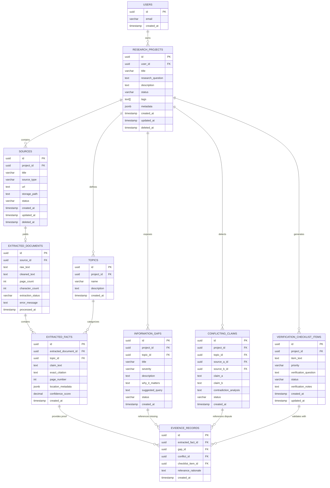

# Bharmafills — Database Specification & Data Models

> **Document Status**: Proposed Baseline / Technical Specification
> **Target Engine**: Supabase PostgreSQL 15+
> **Current Storage (Phase 2)**: Client-Side Local Storage (`researchService.js` / `SCHEMA_VERSION: 1`)
> **Target Implementation Phase**: Phase 4
> **Workspace Identifier**: `Shinchan`

---

## 1. Overview & Storage Strategy

Bharmafills currently persists research projects in the user's browser via a resilient client-side storage service (`frontend/src/services/researchService.js`). For multi-source extraction, AI analysis, cross-device persistence, and collaborative verification (Phase 4), Bharmafills will transition to **Supabase PostgreSQL**.

### Architecture Guidelines
- **Tenant & User Isolation**: Enforced at the database tier via PostgreSQL Row Level Security (RLS) using Supabase Auth JWT claims (`auth.uid()`).
- **Data Integrity & Traceability**: Foreign keys and check constraints guarantee that every identified gap, conflicting claim, or checklist item links back to valid source records.
- **Auditability**: `created_at` and `updated_at` timestamps on all tables with automated trigger updates.
- **Soft Deletion**: Sensitive entities (Projects, Sources) support soft deletion (`deleted_at IS NULL`) to protect against accidental data loss.

---

## 2. Entity-Relationship Diagram (ERD)



---

## 3. Detailed Table Specifications

### 3.1 `research_projects`
Core project container corresponding to Phase 2 `ResearchProject` data model.

```sql
CREATE TABLE research_projects (
    id UUID PRIMARY KEY DEFAULT gen_random_uuid(),
    user_id UUID NOT NULL REFERENCES auth.users(id) ON DELETE CASCADE,
    title VARCHAR(150) NOT NULL,
    research_question TEXT NOT NULL,
    description TEXT,
    status VARCHAR(30) NOT NULL DEFAULT 'active' CHECK (status IN ('active', 'in_progress', 'completed', 'archived')),
    tags TEXT[] DEFAULT '{}',
    metadata JSONB DEFAULT '{}'::jsonb,
    created_at TIMESTAMPTZ NOT NULL DEFAULT timezone('utc', now()),
    updated_at TIMESTAMPTZ NOT NULL DEFAULT timezone('utc', now()),
    deleted_at TIMESTAMPTZ
);
```

### 3.2 `sources`
Input documents and web links associated with a research project.

```sql
-- PROPOSED SCHEMA (PLANNED FOR STEP 6 / SUPABASE CONNECTION)
CREATE TABLE sources (
    id UUID PRIMARY KEY DEFAULT gen_random_uuid(),
    project_id UUID NOT NULL REFERENCES research_projects(id) ON DELETE CASCADE,
    title VARCHAR(255) NOT NULL,
    source_type VARCHAR(20) NOT NULL CHECK (source_type IN ('url', 'pdf', 'manual_text')),
    url TEXT,
    storage_path TEXT,
    content_hash VARCHAR(64), -- SHA-256 fingerprint for deduplication
    status VARCHAR(30) NOT NULL DEFAULT 'pending' CHECK (status IN ('pending', 'extracting', 'parsed', 'failed')),
    created_at TIMESTAMPTZ NOT NULL DEFAULT timezone('utc', now()),
    updated_at TIMESTAMPTZ NOT NULL DEFAULT timezone('utc', now()),
    deleted_at TIMESTAMPTZ
);
```

### 3.3 `extracted_documents`
Cleaned textual payload generated from URL scraping or PDF parsing.

```sql
CREATE TABLE extracted_documents (
    id UUID PRIMARY KEY DEFAULT gen_random_uuid(),
    source_id UUID NOT NULL UNIQUE REFERENCES sources(id) ON DELETE CASCADE,
    raw_text TEXT,
    cleaned_text TEXT NOT NULL,
    page_count INTEGER DEFAULT 1,
    character_count INTEGER NOT NULL,
    extraction_status VARCHAR(30) NOT NULL DEFAULT 'completed' CHECK (extraction_status IN ('completed', 'truncated', 'failed')),
    error_message TEXT,
    processed_at TIMESTAMPTZ NOT NULL DEFAULT timezone('utc', now())
);
```

### 3.4 `topics`
Taxonomy categories relevant to the specific research question.

```sql
CREATE TABLE topics (
    id UUID PRIMARY KEY DEFAULT gen_random_uuid(),
    project_id UUID NOT NULL REFERENCES research_projects(id) ON DELETE CASCADE,
    name VARCHAR(100) NOT NULL,
    description TEXT,
    created_at TIMESTAMPTZ NOT NULL DEFAULT timezone('utc', now()),
    UNIQUE(project_id, name)
);
```

### 3.5 `extracted_facts`
Discrete factual assertions, requirements, or statements extracted from documents.

```sql
CREATE TABLE extracted_facts (
    id UUID PRIMARY KEY DEFAULT gen_random_uuid(),
    extracted_document_id UUID NOT NULL REFERENCES extracted_documents(id) ON DELETE CASCADE,
    topic_id UUID REFERENCES topics(id) ON DELETE SET NULL,
    claim_text TEXT NOT NULL,
    exact_citation TEXT NOT NULL,
    page_number INTEGER DEFAULT 1,
    location_metadata JSONB DEFAULT '{}'::jsonb,
    confidence_score NUMERIC(3, 2) CHECK (confidence_score >= 0.0 AND confidence_score <= 1.0),
    created_at TIMESTAMPTZ NOT NULL DEFAULT timezone('utc', now())
);
```

### 3.6 `information_gaps`
Missing information, unaddressed criteria, or omitted requirements detected by AI.

```sql
CREATE TABLE information_gaps (
    id UUID PRIMARY KEY DEFAULT gen_random_uuid(),
    project_id UUID NOT NULL REFERENCES research_projects(id) ON DELETE CASCADE,
    topic_id UUID REFERENCES topics(id) ON DELETE SET NULL,
    title VARCHAR(200) NOT NULL,
    severity VARCHAR(20) NOT NULL DEFAULT 'medium' CHECK (severity IN ('low', 'medium', 'high', 'critical')),
    description TEXT NOT NULL,
    why_it_matters TEXT NOT NULL,
    suggested_query TEXT,
    status VARCHAR(30) NOT NULL DEFAULT 'unresolved' CHECK (status IN ('unresolved', 'investigating', 'resolved', 'dismissed')),
    created_at TIMESTAMPTZ NOT NULL DEFAULT timezone('utc', now())
);
```

### 3.7 `conflicting_claims`
Direct contradictions or narrative discrepancies identified between two sources.

```sql
CREATE TABLE conflicting_claims (
    id UUID PRIMARY KEY DEFAULT gen_random_uuid(),
    project_id UUID NOT NULL REFERENCES research_projects(id) ON DELETE CASCADE,
    topic_id UUID REFERENCES topics(id) ON DELETE SET NULL,
    source_a_id UUID NOT NULL REFERENCES sources(id) ON DELETE CASCADE,
    source_b_id UUID NOT NULL REFERENCES sources(id) ON DELETE CASCADE,
    claim_a TEXT NOT NULL,
    claim_b TEXT NOT NULL,
    contradiction_analysis TEXT NOT NULL,
    status VARCHAR(30) NOT NULL DEFAULT 'unresolved' CHECK (status IN ('unresolved', 'reconciled', 'dismissed')),
    created_at TIMESTAMPTZ NOT NULL DEFAULT timezone('utc', now()),
    CHECK (source_a_id != source_b_id)
);
```

### 3.8 `evidence_records`
Associative audit links tying specific citations and extracted facts to gaps and conflicts.

```sql
CREATE TABLE evidence_records (
    id UUID PRIMARY KEY DEFAULT gen_random_uuid(),
    extracted_fact_id UUID NOT NULL REFERENCES extracted_facts(id) ON DELETE CASCADE,
    gap_id UUID REFERENCES information_gaps(id) ON DELETE CASCADE,
    conflict_id UUID REFERENCES conflicting_claims(id) ON DELETE CASCADE,
    checklist_item_id UUID, -- Forward reference to checklist
    relevance_rationale TEXT,
    created_at TIMESTAMPTZ NOT NULL DEFAULT timezone('utc', now()),
    CHECK (gap_id IS NOT NULL OR conflict_id IS NOT NULL OR checklist_item_id IS NOT NULL)
);
```

### 3.9 `verification_checklist_items`
Actionable checklist generated to guide manual follow-up and verification.

```sql
CREATE TABLE verification_checklist_items (
    id UUID PRIMARY KEY DEFAULT gen_random_uuid(),
    project_id UUID NOT NULL REFERENCES research_projects(id) ON DELETE CASCADE,
    item_text TEXT NOT NULL,
    priority VARCHAR(20) NOT NULL DEFAULT 'medium' CHECK (priority IN ('low', 'medium', 'high', 'urgent')),
    verification_question TEXT NOT NULL,
    status VARCHAR(30) NOT NULL DEFAULT 'pending' CHECK (status IN ('pending', 'in_progress', 'verified', 'debunked')),
    verification_notes TEXT,
    created_at TIMESTAMPTZ NOT NULL DEFAULT timezone('utc', now()),
    updated_at TIMESTAMPTZ NOT NULL DEFAULT timezone('utc', now())
);
```

---

## 4. Row Level Security (RLS) Policies

All tables mandate PostgreSQL RLS to enforce complete user isolation. All policies cascade from project ownership:

```sql
-- PROPOSED POLICIES (PLANNED FOR STEP 6 / SUPABASE CONNECTION)
-- Enable RLS on all tables
ALTER TABLE research_projects ENABLE ROW LEVEL SECURITY;
ALTER TABLE sources ENABLE ROW LEVEL SECURITY;
ALTER TABLE extracted_documents ENABLE ROW LEVEL SECURITY;
ALTER TABLE topics ENABLE ROW LEVEL SECURITY;
ALTER TABLE extracted_facts ENABLE ROW LEVEL SECURITY;
ALTER TABLE information_gaps ENABLE ROW LEVEL SECURITY;
ALTER TABLE conflicting_claims ENABLE ROW LEVEL SECURITY;
ALTER TABLE evidence_records ENABLE ROW LEVEL SECURITY;
ALTER TABLE verification_checklist_items ENABLE ROW LEVEL SECURITY;

-- 1. Projects Policy (Owner access only)
CREATE POLICY "Users can manage their own research projects"
ON research_projects FOR ALL
TO authenticated
USING (auth.uid() = user_id)
WITH CHECK (auth.uid() = user_id);

-- 2. Sources Policy (Cascaded through Project ownership)
CREATE POLICY "Users can manage sources belonging to their projects"
ON sources FOR ALL
TO authenticated
USING (
    EXISTS (
        SELECT 1 FROM research_projects p
        WHERE p.id = sources.project_id AND p.user_id = auth.uid()
    )
);

-- 3. Extracted Documents Policy
CREATE POLICY "Users can access documents belonging to their sources"
ON extracted_documents FOR ALL
TO authenticated
USING (
    EXISTS (
        SELECT 1 FROM sources s
        JOIN research_projects p ON p.id = s.project_id
        WHERE s.id = extracted_documents.source_id AND p.user_id = auth.uid()
    )
);

-- 4. Topics Policy
CREATE POLICY "Users can manage topics belonging to their projects"
ON topics FOR ALL
TO authenticated
USING (
    EXISTS (
        SELECT 1 FROM research_projects p
        WHERE p.id = topics.project_id AND p.user_id = auth.uid()
    )
);

-- 5. Extracted Facts Policy
CREATE POLICY "Users can access facts extracted from their documents"
ON extracted_facts FOR ALL
TO authenticated
USING (
    EXISTS (
        SELECT 1 FROM extracted_documents ed
        JOIN sources s ON s.id = ed.source_id
        JOIN research_projects p ON p.id = s.project_id
        WHERE ed.id = extracted_facts.extracted_document_id AND p.user_id = auth.uid()
    )
);

-- 6. Information Gaps Policy
CREATE POLICY "Users can manage information gaps in their projects"
ON information_gaps FOR ALL
TO authenticated
USING (
    EXISTS (
        SELECT 1 FROM research_projects p
        WHERE p.id = information_gaps.project_id AND p.user_id = auth.uid()
    )
);

-- 7. Conflicting Claims Policy
CREATE POLICY "Users can manage conflicting claims in their projects"
ON conflicting_claims FOR ALL
TO authenticated
USING (
    EXISTS (
        SELECT 1 FROM research_projects p
        WHERE p.id = conflicting_claims.project_id AND p.user_id = auth.uid()
    )
);

-- 8. Evidence Records Policy
CREATE POLICY "Users can access evidence records linked to their projects"
ON evidence_records FOR ALL
TO authenticated
USING (
    EXISTS (
        SELECT 1 FROM extracted_facts ef
        JOIN extracted_documents ed ON ed.id = ef.extracted_document_id
        JOIN sources s ON s.id = ed.source_id
        JOIN research_projects p ON p.id = s.project_id
        WHERE ef.id = evidence_records.extracted_fact_id AND p.user_id = auth.uid()
    )
);

-- 9. Verification Checklist Items Policy
CREATE POLICY "Users can manage checklist items for their projects"
ON verification_checklist_items FOR ALL
TO authenticated
USING (
    EXISTS (
        SELECT 1 FROM research_projects p
        WHERE p.id = verification_checklist_items.project_id AND p.user_id = auth.uid()
    )
);
```

---

## 5. Indexing & Deduplication Strategy

```sql
-- PROPOSED INDEXES (PLANNED FOR STEP 6 / SUPABASE CONNECTION)
-- Deduplication Unique Indexes (Prevent duplicate active sources within the same project)
CREATE UNIQUE INDEX idx_unique_project_url ON sources (project_id, url) WHERE deleted_at IS NULL AND url IS NOT NULL;
CREATE UNIQUE INDEX idx_unique_project_file_hash ON sources (project_id, content_hash) WHERE deleted_at IS NULL AND content_hash IS NOT NULL;

-- Performance Indexes for Foreign Key Joins & Filtering
CREATE INDEX idx_projects_user_status ON research_projects (user_id, status) WHERE deleted_at IS NULL;
CREATE INDEX idx_sources_project_id ON sources (project_id) WHERE deleted_at IS NULL;
CREATE INDEX idx_extracted_facts_document_id ON extracted_facts (extracted_document_id);
CREATE INDEX idx_information_gaps_project_severity ON information_gaps (project_id, severity);
CREATE INDEX idx_conflicting_claims_project ON conflicting_claims (project_id);
CREATE INDEX idx_checklist_project_status ON verification_checklist_items (project_id, status);

-- Full-Text Search Indexes (pg_trgm or tsvector)
CREATE INDEX idx_projects_fts ON research_projects USING gin (to_tsvector('english', title || ' ' || research_question));
CREATE INDEX idx_facts_citation_fts ON extracted_facts USING gin (to_tsvector('english', claim_text));
```

---

## 6. Migration & Backward Compatibility Strategy

### Phase 2 Local Storage Migration
When Phase 4 introduces Supabase cloud persistence:
1. **Schema Parity**: The database schema fields (`title`, `research_question`, `description`, `status`, `tags`, `metadata`) directly mirror `frontend/src/features/research/schemas/researchProjectSchema.js`.
2. **Client-Side Import Utility**: A migration helper will inspect `localStorage.getItem('bharmafills_research_projects')`.
3. **Upsert Sync**: For authenticated users, existing local records will be bulk-synced to Supabase with auto-assigned `user_id = auth.uid()`.
4. **Archive on Sync**: Once synchronized, local records will be preserved in a local archive key (`bharmafills_research_projects_migrated_backup`) to guarantee zero data loss.
