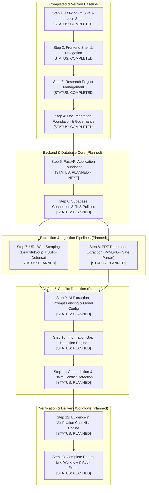

# Bharmafills — Master Development Roadmap & Milestone Tracker

> **Document Status**: Canonical Project Roadmap (Audited & Aligned)
> **Target Event**: Shinchan Online Hackathon 2026
> **Workspace Identifier**: `Shinchan`
> **Current Status**: Steps 1–4 COMPLETED; Step 5 (FastAPI Foundation) is the next milestone.

---

## 1. Canonical 13-Stage Development Sequence

To ensure rigorous architectural dependencies, Bharmafills follows an agreed 13-stage development sequence. Under this sequence, backend foundation and database infrastructure precede ingestion pipelines, ensuring that extracted data from URLs and PDFs has a validated persistence schema and secure API contracts.

---

## 2. Master Development Sequence Table

| Step # | Development Stage | Primary Technology | Current Status | Verification Criteria & Deliverables |
| :---: | :--- | :--- | :---: | :--- |
| **Step 1** | **Tailwind and shadcn setup** | Tailwind CSS v4, Base UI, Nova preset | `COMPLETED` | CSS variables in `index.css`, Geist fonts, Nova design system verified. |
| **Step 2** | **Frontend application shell** | React 19, Vite 8, Lucide React | `COMPLETED` | Sidebar, Topbar, mobile slide-over drawer, responsive breakpoints, dashboard UI. |
| **Step 3** | **Research Project Management** | React 19, Zod/Custom Schemas, LocalStorage | `COMPLETED` | Full CRUD lifecycle, input validation, search/filters/sorting, 52 passing Vitest tests. |
| **Step 4** | **Documentation Foundation** | Markdown Specifications & Runbooks | `COMPLETED` | 16 canonical documents (`PRD.md`, `ARCHITECTURE.md`, `DATABASE.md`, `API.md`, `docs/*`). |
| **Step 5** | **FastAPI Foundation** | Python 3.15, FastAPI, Uvicorn, Pydantic v2 | `COMPLETED` (5A) | App scaffold (`backend/app/`), CORS, health probe, Pydantic settings, 23 passing Pytest tests. |
| **Step 6** | **Supabase Connection** | Supabase PostgreSQL 15, RLS, Auth JWT | `PLANNED` *(Next)* | Connection pooling, 10-table schema, RLS policies, client sync migration adapter. |
| **Step 7** | **URL Extraction** | BeautifulSoup4, HTTPX, lxml | `PLANNED` | Asynchronous scraping, SSRF defense, DNS rebinding mitigation, redirect protection, clean text. |
| **Step 8** | **PDF Extraction** | PyMuPDF (`fitz`), Async Worker | `PLANNED` | Page-level text extraction, citation offsets, 20MB file cap, 100-page limit, bomb defense. |
| **Step 9** | **AI Extraction and Analysis** | Google GenAI SDK (Configurable Model) | `PLANNED` | Configurable model (`GEMINI_MODEL`), XML untrusted prompt fencing, Pydantic response schema. |
| **Step 10** | **Information Gap Detection** | Google Gemini API, Topic Modeling | `PLANNED` | Omission detection algorithm, taxonomy mapping, severity rating, suggested queries. |
| **Step 11** | **Conflict Detection** | Google Gemini API, Comparison Engine | `PLANNED` | Pairwise claim contradiction detection, citation linking, side-by-side excerpt viewer. |
| **Step 12** | **Evidence & Verification Checklist** | React 19 UI & Backend Checklist API | `PLANNED` | Actionable checklist generation, interactive item statuses (*Pending/Verified/Debunked*), citation anchors. |
| **Step 13** | **Complete End-to-End Workflow** | Full System Integration & Playwright | `PLANNED` | Seamless flow (Create Project -> Ingest Sources -> Analyze Gaps -> Export Audit Report). |

---

## 3. Detailed Stage Specifications

### Step 1: Tailwind and shadcn Setup (`COMPLETED`)
- **Deliverables**: Initialized Tailwind CSS v4, Base UI primitives, Nova preset design tokens, Geist font integration, high-contrast heading definitions.
- **Verification**: Zero CSS build warnings; WCAG AA contrast ratio compliance verified.

### Step 2: Frontend Application Shell (`COMPLETED`)
- **Deliverables**: Responsive layout shell comprising desktop sidebar (`w-64`), topbar with page titles, responsive mobile slide-over drawer with backdrop dismiss, and dashboard overview page.
- **Verification**: Verified across mobile (375px), tablet (768px), and desktop (1280px) viewports; Phase 1 regression test suite passing.

### Step 3: Research Project Management (`COMPLETED`)
- **Deliverables**: Complete project management module:
  - Form validation with character length constraints (`researchProjectSchema.js`).
  - Reactive custom hook managing state and filters (`useResearchProjects.js`).
  - Storage adapter with quota handling and corrupted data quarantine (`researchService.js`).
  - Project listing, search, multi-field filtering, sorting, and project details inspection view.
- **Verification**: 52 automated tests passing in Vitest, clean ESLint check (0 errors, 0 warnings), clean production build.

### Step 4: Documentation Foundation (`COMPLETED`)
- **Deliverables**: Comprehensive canonical specifications: `PRD.md`, `ARCHITECTURE.md`, `DATABASE.md`, `API.md`, `AGENTS.md`, `README.md`, `.env.example`, and 8 operational guides in `docs/`.
- **Verification**: All documentation synchronized, free of fictional claims, and adhering to strict technical standards.

### Step 5: FastAPI Foundation (`COMPLETED` — Step 5A Scaffold & Health Probe)
- **Scope**: Scaffold the backend service inside `backend/app/`:
  - `main.py` with FastAPI application factory (`create_app`) and CORS middleware.
  - `core/config.py` using Pydantic Settings reading `.env` and defaults.
  - `api/routes/health.py` truthful process health probe (`GET /api/v1/health`).
  - Pytest test suite covering health endpoint, application metadata, CORS, and configuration (23 tests passing).
- **Verification**: 23 automated tests passing in Pytest, live Uvicorn startup verified with HTTP 200 probe.

### Step 6: Supabase Connection (`PLANNED` — Next Immediate Stage)
- **Scope**: Establish relational database connectivity and user isolation:
  - Supabase client initialization and async PostgreSQL connection pooling.
  - Database schema definitions matching `DATABASE.md` (10 proposed tables).
  - Row Level Security (RLS) policies for user data isolation.
  - LocalStorage-to-Supabase client-side migration utility.
- **Dependencies**: Step 5.

### Step 7: URL Extraction (`PLANNED`)
- **Scope**: Build secure web scraping endpoint (`POST /api/v1/extract/url`):
  - Asynchronous HTTP requests using `httpx.AsyncClient`.
  - Comprehensive SSRF prevention: IP subnet blacklisting (RFC 1918, loopback, link-local metadata).
  - DNS rebinding mitigation (pinning resolved IP) and redirect destination validation.
  - HTML parsing, boilerplate stripping, and metadata extraction via BeautifulSoup4.
- **Dependencies**: Step 5, Step 6.

### Step 8: PDF Extraction (`PLANNED`)
- **Scope**: Build local PDF parsing endpoint (`POST /api/v1/extract/pdf`):
  - Ingestion of PDF binaries via PyMuPDF (`fitz`).
  - Page-by-page text extraction retaining citation boundaries and page offsets.
  - Defensive limits: 20 MB size limit, 100-page limit, memory/CPU sandboxed worker.
- **Dependencies**: Step 5, Step 6.

### Step 9: AI Extraction and Analysis (`PLANNED`)
- **Scope**: Establish AI analysis foundation using Google GenAI SDK:
  - Runtime-configurable model selection (`GEMINI_MODEL`, e.g. `gemini-2.5-flash`, `gemini-1.5-pro`).
  - Model evaluation protocol for latency, cost, and structured output reliability.
  - Prompt fencing: enclosing source text in XML tags with explicit instructions forbidding instruction following from external content.
  - Schema-validated output enforcement using Pydantic models.
- **Dependencies**: Step 7, Step 8.

### Step 10: Information Gap Detection (`PLANNED`)
- **Scope**: Comparative omission analysis:
  - Algorithm identifying critical questions, eligibility rules, or data points unaddressed across all sources.
  - Severity classification (*Critical*, *High*, *Medium*, *Low*).
  - Generation of suggested queries to locate missing information.
- **Dependencies**: Step 9.

### Step 11: Conflict Detection (`PLANNED`)
- **Scope**: Cross-source contradiction analysis:
  - Pairwise claim comparison identifying direct factual contradictions.
  - Side-by-side excerpt contrast linking Source A to Source B.
- **Dependencies**: Step 10.

### Step 12: Evidence & Verification Checklist (`PLANNED`)
- **Scope**: Actionable verification synthesis:
  - Compilation of detected gaps and conflicts into an interactive checklist.
  - Status management (*Pending*, *In Progress*, *Verified*, *Debunked*).
  - Traceability anchors linking checklist items to exact citations and page numbers.
- **Dependencies**: Step 11.

### Step 13: Complete End-to-End Workflow (`PLANNED`)
- **Scope**: End-to-end user journey and report generation:
  - Integrated research workflow from inquiry definition to checklist completion.
  - Export capabilities: PDF research dossier and CSV verification checklist.
  - Comprehensive Playwright automated E2E test suite.
- **Dependencies**: Step 12.

---

## 4. Architectural Dependency Justification

The sequence places **FastAPI Foundation (Step 5)** and **Supabase Connection (Step 6)** before **URL Extraction (Step 7)** and **PDF Extraction (Step 8)** for three primary technical reasons:
1. **Contract Integrity**: Ingestion endpoints require standard API routers, CORS configuration, authentication dependencies, and error handling established in the FastAPI foundation.
2. **Persistence Coupling**: Ingested sources and extracted document payloads require the database tables (`sources`, `extracted_documents`) and storage buckets to persist parsed content without relying on volatile memory.
3. **Traceability Foundation**: Page-level offsets and citation tracking must be mapped to persistent database foreign keys from the moment extraction occurs.
