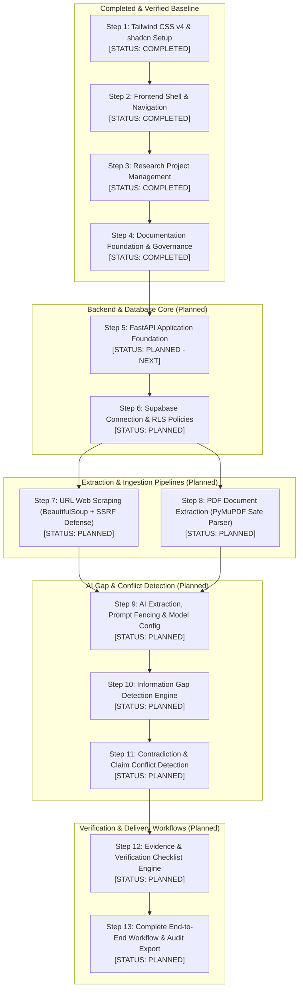

# Bharmafills — Master Development Roadmap & Milestone Tracker

> **Document Status**: Canonical Project Roadmap (Audited & Aligned)
> **Target Event**: Shinchan Online Hackathon 2026
> **Workspace Identifier**: `Shinchan`
> **Current Status**: Steps 1–5 COMPLETED; Step 6 (Supabase Connection & Initial Schema Migration) COMPLETED; Step 7 (URL Extraction) PLANNED.

---

## 1. Canonical 13-Stage Development Sequence

To ensure rigorous architectural dependencies, Bharmafills follows an agreed 13-stage development sequence. Under this sequence, backend foundation and database infrastructure precede ingestion pipelines, ensuring that extracted data from URLs and PDFs has a validated persistence schema and secure API contracts.

---

## 2. Master Development Sequence Table

| Step # | Development Stage | Primary Technology | Current Status | Verification Criteria & Deliverables |
| :---: | :--- | :--- | :---: | :--- |
| **Step 1** | **Tailwind and shadcn setup** | Tailwind CSS v4, Base UI, Nova preset | `COMPLETED` | CSS variables in `index.css`, Geist fonts, Nova design system verified. |
| **Step 2** | **Frontend application shell** | React 19, Vite 8, Lucide React | `COMPLETED` | Sidebar, Topbar, mobile slide-over drawer, responsive breakpoints, dashboard UI. |
| **Step 3** | **Research Project Management** | React 19, Zod/Custom Schemas, LocalStorage | `COMPLETED` | Full CRUD lifecycle, input validation, search/filters/sorting, 52 passing Vitest tests. |
| **Step 4** | **Documentation Foundation** | Markdown Specifications & Runbooks | `COMPLETED` | 16 canonical documents (`PRD.md`, `ARCHITECTURE.md`, `DATABASE.md`, `API.md`, `docs/*`). |
| **Step 5** | **FastAPI Foundation** | Python 3.15, FastAPI, Uvicorn, Pydantic v2 | `COMPLETED` (5A) | App scaffold (`backend/app/`), CORS, health probe, Pydantic settings, 23 passing Pytest tests. |
| **Step 6** | **Supabase Connection & Schema Migration** | Supabase PostgreSQL 17, asyncpg, RLS | `COMPLETED` (6A & 6B) | Session pooler connection, 10-table schema, RLS policies, 53 passing backend tests, live Supabase schema verified. |
| **Step 7** | **URL Extraction & SSRF Defense** | BeautifulSoup4, HTTPX, httpcore | `PARTIAL` (7A Done, 7B Planned) | SSRF-safe fetching with DNS pinning, manual redirect guards, BeautifulSoup extraction, 32 passing web tests (85 total backend). |
| **Step 8** | **PDF Extraction** | PyMuPDF (`fitz`), Async Worker | `PLANNED` | Page-level text extraction, citation offsets, 20MB file cap, 100-page limit, bomb defense. |
| **Step 9** | **AI Extraction and Analysis** | OpenRouter, Nemotron 3 Ultra, asyncpg, Supabase | `COMPLETED` | Prompt fencing, evidence extraction pipeline, schema validation, Supabase PostgreSQL persistence (339 passing backend tests). |
| **Step 10** | **Information Gap Detection** | Google Gemini / OpenRouter API, Topic Modeling | `PLANNED` | Omission detection algorithm, taxonomy mapping, severity rating, suggested queries. |
| **Step 11** | **Conflict Detection** | Google Gemini API, Comparison Engine | `PLANNED` | Pairwise claim contradiction detection, citation linking, side-by-side excerpt viewer. |
| **Step 12** | **Evidence & Verification Checklist** | React 19 UI & Backend Checklist API | `PLANNED` | Actionable checklist generation, interactive item statuses (*Pending/Verified/Debunked*), citation anchors. |
| **Step 13** | **Complete End-to-End Workflow** | Full System Integration & Playwright | `PLANNED` | Seamless flow (Create Project -> Ingest Sources -> Analyze Gaps -> Export Audit Report). |

---

## 3. Detailed Stage Specifications

### Step 1: Tailwind and shadcn Setup (`COMPLETED`)
- **Deliverables**: Initialized Tailwind CSS v4, Base UI primitives, Nova preset design tokens, Geist font integration, high-contrast heading definitions.
- **Verification**: Zero CSS build warnings; WCAG AA contrast ratio compliance verified.

### Step 2: Frontend Application Shell (`COMPLETED`)
- **Deliverables**: Responsive layout shell comprising desktop sidebar (`w-64`), topbar with page titles, responsive mobile slide-over drawer with backdrop dismiss, and dashboard overview page.
- **Verification**: Verified across mobile (375px), tablet (768px), and desktop (1280px) viewports; Phase 1 regression test suite passing.

### Step 3: Research Project Management (`COMPLETED`)
- **Deliverables**: Complete project management module:
  - Form validation with character length constraints (`researchProjectSchema.js`).
  - Reactive custom hook managing state and filters (`useResearchProjects.js`).
  - Storage adapter with quota handling and corrupted data quarantine (`researchService.js`).
  - Project listing, search, multi-field filtering, sorting, and project details inspection view.
- **Verification**: 52 automated tests passing in Vitest, clean ESLint check (0 errors, 0 warnings), clean production build.

### Step 4: Documentation Foundation (`COMPLETED`)
- **Deliverables**: Comprehensive canonical specifications: `PRD.md`, `ARCHITECTURE.md`, `DATABASE.md`, `API.md`, `AGENTS.md`, `README.md`, `.env.example`, and 8 operational guides in `docs/`.
- **Verification**: All documentation synchronized, free of fictional claims, and adhering to strict technical standards.

### Step 5: FastAPI Foundation (`COMPLETED` — Step 5A Scaffold & Health Probe)
- **Scope**: Scaffold the backend service inside `backend/app/`:
  - `main.py` with FastAPI application factory (`create_app`) and CORS middleware.
  - `core/config.py` using Pydantic Settings reading `.env` and defaults.
  - `api/routes/health.py` truthful process health probe (`GET /api/v1/health`).
  - Pytest test suite covering health endpoint, application metadata, CORS, and configuration (23 tests passing).
- **Verification**: 23 automated tests passing in Pytest, live Uvicorn startup verified with HTTP 200 probe.

### Step 6: Supabase PostgreSQL Integration
- **Step 6A: Connection Foundation (`COMPLETED & TESTED`)**:
  - Pinned `asyncpg==0.32.0` in `backend/requirements.txt` (Python 3.15 Windows AMD64 wheel).
  - Pydantic Settings integration with `SUPABASE_DB_URL` validation and timeout controls.
  - Modular connection manager (`app/db/connection.py`) with lazy initialization and safe cleanup.
  - Dedicated database health probe (`GET /api/v1/health/database`) returning truthful connectivity status without credential leaks.
  - 19 automated tests added (42 total backend tests passing in 0.57s).
- **Step 6B: Schema Migrations & Live Verification (`COMPLETED & TESTED`)**:
  - Designed and executed migration `20261031123000_initial_bharmafills_schema.sql` via `DatabaseMigrator`.
  - Applied live to Supabase PostgreSQL 17: 11 tables, 17 foreign keys, 41 indexes, 100 check constraints, RLS on all 10 domain tables.
  - 11 dedicated migration tests added (53 total backend tests passing).

### Step 7: Web Source Extraction & Ingestion Pipeline
- **Step 7A: Secure Web Fetching & Content Extraction (`COMPLETED & TESTED`)**:
  - Implemented `URLValidator` with comprehensive SSRF defenses (RFC 1918, CGNAT, loopback, link-local, cloud metadata, IDN Punycode, IPv6 zone IDs).
  - Implemented `SafeWebFetcher` with socket-level DNS pinning via custom HTTPX backend to eliminate TOCTOU rebinding gaps, manual redirect tracker (max 5 hops, no downgrade, loop detection), streaming size cap (2 MB), and Content-Type filtering (`text/html`, `application/xhtml+xml`).
  - Implemented `WebContentExtractor` using BeautifulSoup4 to isolate clean text, headings, author/language/canonical metadata, word/char counts, and SHA-256 hash.
  - Endpoint `POST /api/v1/web/extract` implemented and documented.
  - 32 dedicated web tests added (85 total backend tests passing).
- **Step 7B: Source Ingestion Persistence & Supabase Integration (`COMPLETED & TESTED`)**:
  - Implemented `WebSourceIngestionService` and `DatabaseManager.acquire_connection()`.
  - Enforced project validation (`SELECT FROM research_projects WHERE id = $1 AND deleted_at IS NULL`).
  - Enforced idempotent deduplication by `(project_id, original_url)` and `(project_id, content_hash)`.
  - Atomic transactions inserting into `public.sources` and `public.extracted_content`.
  - Endpoints implemented:
    - `POST /api/v1/projects/{project_id}/sources/web` (201 Created / 200 Duplicate)
    - `GET /api/v1/projects/{project_id}/sources` (200 OK)
    - `GET /api/v1/projects/{project_id}/sources/{source_id}` (200 OK)
  - 29 dedicated unit and integration tests added (114 total backend tests passing in 6.94s).

### Step 8: PDF Extraction Engine & PyMuPDF Ingestion (`COMPLETED & TESTED`)
- **Scope**: Secure, reliable local PDF ingestion pipeline with PyMuPDF (`fitz`):
  - Ingestion of PDF binaries via PyMuPDF in-memory stream processing (`pymupdf.open(stream=bytes, filetype="pdf")`), zero disk writes.
  - Multi-stage defensive validation: Content-Type and `.pdf` extension check, `%PDF-` magic header within first 1024 bytes, 64 KB streaming chunk cap (`PDF_MAX_UPLOAD_BYTES=20MB`), filename sanitization with 255-char bound, password-protection rejection, page count limits (`PDF_MAX_PAGES=200`).
  - Page-by-page text extraction, whitespace normalization, PDF metadata extraction (title, author, subject, creation date), and readability status classification (`fully_readable`, `partially_readable`, `no_extractable_text`, `empty`).
  - Scanned PDF detection: image-only/scanned documents safely logged with `ingestion_status='failed'` in `public.sources` without violating database check constraints.
  - Supabase PostgreSQL persistence: active project verification, binary SHA-256 hash deduplication (`idx_sources_project_hash_unique`), atomic multi-table transaction writing to `sources` and `extracted_content`.
  - Endpoint `POST /api/v1/projects/{project_id}/sources/pdf` returning typed responses (201 Created, 200 Duplicate, 400 Bad Request, 404 Not Found, 413 Payload Too Large, 415 Unsupported Media Type, 422 Unprocessable Entity, 503 Service Unavailable).
  - 34 automated tests added (148 total backend tests passing in 7.84s; 200 total tests passing across full stack).

### Step 9: AI Provider Foundation & Extraction Engine
- **Step 9A: OpenRouter API Integration Foundation & Nemotron 3 Ultra (`COMPLETED & TESTED`)**:
  - Provider abstraction with `BaseAIProvider` decoupling vendor SDKs from application services.
  - Asynchronous client `OpenRouterClient` utilizing existing `httpx.AsyncClient` with connection pooling, timeout controls, and lifecycle shutdown management.
  - Active model configuration: `nvidia/nemotron-3-ultra-550b-a55b:free` runtime-configurable via `OPENROUTER_MODEL` in `backend/.env`.
  - Structured output safety: `SafeResponseParser` extracting JSON from markdown/bracketed substrings and validating against Pydantic schemas without fabricating missing fields.
  - Bounded resilience: Exponential backoff retries for transient HTTP 429, 502, 503, and timeouts. Immediate failure on auth (401/403) and quota (402).
  - Diagnostic probe `GET /api/v1/health/ai` returning configuration status and active model without exposing any credential-derived information.
  - Privacy boundary: Strict isolation ensuring zero research documents or extracted web/PDF text are transmitted under Step 9A.
  - 23 automated tests added (171 backend tests passing; 223 total automated tests across full stack).
- **Step 9A.1: OpenRouter Security Corrections (`COMPLETED & TESTED`)**:
  - **Correction A**: Removed `masked_api_key` field from `AIConfigStatus` schema and all related code. `GET /api/v1/health/ai` now exposes zero credential-derived information in any form.
  - **Correction B**: Replaced inaccurate "Zero Hallucination Guarantee" language across `SafeResponseParser`, schemas, and documentation. Corrected description now accurately states that `SafeResponseParser` performs structural/type validation only and does NOT verify factual accuracy, citations, or quotations. Factual verification is a planned future stage.
  - **Correction C**: Created optional, explicitly-controlled live OpenRouter smoke test script at `backend/scripts/smoke_test_openrouter.py`. Never auto-executed; sends only fixed harmless message `"Reply with the single word OK."`.
  - Full test suite (173+ backend tests) verified passing after corrections.
- **Step 9B.1: Prompt Security Architecture — Trusted Instructions & Untrusted Source Isolation (`COMPLETED & TESTED`)**:
  - Centralized prompt architecture in `backend/app/services/ai/prompts/` enforcing 4-tier trust hierarchy (TRUSTED System, TRUSTED Task, UNTRUSTED Sources, UNVERIFIED Output).
  - Foundational security instruction template `SECURITY_SYSTEM_PROMPT` establishing prohibitions against instruction following, prompt injection/jailbreaks (DAN), credential disclosure, and fact fabrication.
  - Frozen `SourceDocument` domain model with attribute safety validation and type normalization (`web`, `pdf`, `url` -> `web`).
  - Pure functional `PromptBuilder` with XML sanitization stripping breakout tags (`</untrusted_source_document>`), fake `<system>` blocks, comments, and CDATA while preserving mathematical comparisons.
  - Multi-source XML fencing (`<untrusted_sources>`, `<untrusted_source_document id="..." type="..." index="N">`), source count capping (`MAX_SOURCES_PER_PROMPT=20`), and character truncation (`MAX_SOURCE_CHARS=40_000`).
  - 33 automated tests added (206 backend tests passing; 258 total automated tests across full stack).
- **Step 9B.1.1: Prompt Security Hardening & Truncation Transparency (`COMPLETED & TESTED`)**:
  - Replaced overly strong prompt-injection immunity claims with technically accurate threat model documentation (acknowledging probabilistic model attention boundaries and defense-in-depth reliance on downstream schema validation).
  - Implemented explicit truncation transparency: machine-readable `truncated="true/false"` and `omitted_chars="N"` attributes on fenced source tags, explicit text notices on content truncation, and `<sources_truncation_notice>` tags on source list capping.
  - Clarified 4-tier trust hierarchy in system instructions and documentation, explicitly distinguishing programmatically enforced boundaries from model-interpreted boundaries.
- **Step 9B.1.2: Structured Truncation Metadata & Source Omission Reporting (`COMPLETED & TESTED`)**:
  - Closed the data-integrity gap by returning structured truncation and omission metadata directly to prompt builder callers:
    - `SourceTruncationMetadata`: Exact per-source character counts (`source_id`, `source_type`, `was_truncated`, `original_char_count`, `retained_char_count`, `omitted_char_count`) with invariant verification.
    - `SourceOmissionSummary`: Aggregated source-level inclusion/omission counts (`total_sources_provided`, `total_sources_included`, `total_sources_omitted`, `omitted_source_ids`) with invariant verification.
    - `PromptBuildResult`: Structured return envelope providing direct programmatic access to `messages`, `source_metadata`, and `source_summary`, with `.to_dict()` serialization and sequence compatibility (`__iter__`, `__getitem__`, `__len__`).
  - Downstream callers (Step 9B.2+) never need to parse or regex XML strings to discover whether source material was truncated or omitted.
  - 21 automated test scenarios added to `backend/tests/test_prompt_security.py` (54 prompt security tests passing; 227 backend tests passing; 279 total tests passing across full stack).
- **Step 9B.2.1: Evidence Extraction Data Models & Pydantic Schemas (`COMPLETED & TESTED`)**:
  - Implemented strongly typed, immutable domain models in `backend/app/services/ai/evidence_schemas.py`:
    - `EvidenceLocation`: Source-agnostic physical and logical location descriptor supporting web (URLs, heading paths, paragraph index) and PDF (1-based page numbers, character offsets).
    - `ExtractedFact`: Discrete factual statement with explicit distinction between direct quotes and faithful paraphrases (`RepresentationType`), factual classification (`FactType`), 0.0–1.0 confidence bounds, qualifiers, uncertainty notes, and warnings.
    - `SourceClaim`: Representation of source assertions without asserting objective truth (`ClaimType`), enforcing cross-field consistency (`source_id == evidence_location.source_id`) and prohibiting implicit verification flags.
    - `EvidenceExtractionResult`: Single-source extraction envelope enforcing nested source ID consistency, truncation propagation (`source_truncated=True` rejects `success` status), and explicit failure/no-content invariants.
  - 33 automated tests added in `backend/tests/test_evidence_schemas.py` (260 backend tests passing; 312 total tests passing across full stack).
- **Step 9B.2.2A: Evidence Extraction Prompt Templates & Truncation Awareness (`COMPLETED & TESTED`)**:
  - Implemented source-grounded prompt templates in `backend/app/services/ai/prompts/evidence_templates.py`:
    - Strict task directives for facts, claims, locations, and representation types (`direct_quote` vs `paraphrase`).
    - Ten immutable grounding and anti-fabrication rules forbidding outside training memory or inferred facts.
    - Confidence score semantics defined as extraction fidelity rather than objective truth.
    - Prompt-injection defense instructions emphasizing probabilistic boundary adherence.
    - Automated truncation and source omission notices (`build_truncation_notice()`) warning the model of partial corpus coverage.
    - Strict raw JSON contract excluding backend-owned envelope fields (`extracted_at`, `extraction_status`, `source_truncated`, character counts, errors).
    - Model payload model `EvidenceExtractionPayload` added to `evidence_schemas.py` and validated with `SafeResponseParser`.
    - High-level coordinator `assemble_evidence_extraction_prompt()` integrating directly with `PromptBuilder`.
  - 18 automated tests added in `backend/tests/test_evidence_templates.py` (278 backend tests passing; 330 total tests passing across full stack).
- **Step 9B.2.2B: Evidence Extraction Pipeline & Structured Parser Integration (`COMPLETED & TESTED`)**:
  - `EvidenceExtractionService` coordinating prompt assembly, OpenRouter async completions, `SafeResponseParser` decoding into `EvidenceExtractionPayload`, and authoritative `EvidenceExtractionResult` envelope compilation.
  - Multi-source batch extraction (`extract_sources_batch`) with strict per-source failure isolation into `BatchEvidenceExtractionResult`.
  - Evidence integrity verification: source attribution matching, whitespace-normalized verbatim quote checks, character offset bounds verification, and web claim domain consistency checks.
  - FastAPI endpoint `POST /api/v1/projects/{project_id}/sources/{source_id}/extract` with full error mapping (404, 503, 422).
  - 35 automated tests in `backend/tests/test_evidence_pipeline.py` (313 backend tests passing; 365 total tests passing across full stack).
- **Step 9B.3: Evidence Database Persistence & Retrieval (`COMPLETED & TESTED`)**:
  - Designed and tested database migration `supabase/migrations/20261101120000_add_evidence_claims_and_runs.sql`:
    - Created `public.extraction_runs` table tracking execution provenance, model identifiers, truncation, facts/claims counts, warnings, and errors.
    - Enhanced `public.evidence` table with additive columns (`extraction_run_id`, `fact_id`, `fact_type`, `representation_type`, qualifiers, character offsets, warnings) and compound unique index.
    - Created `public.source_claims` table for unverified assertions, predictions, and policy statements without asserting objective truth.
    - Enabled Row Level Security (RLS) on `extraction_runs` and `source_claims` cascading from project ownership.
  - Implemented `EvidencePersistenceService` with atomic PostgreSQL transactions (`async with conn.transaction():`), ensuring complete rollback on constraint violations and zero orphan runs.
  - Implemented automatic persistence integration in `POST /api/v1/projects/{project_id}/sources/{source_id}/extract` with graceful degradation when database is unavailable (`is_persisted=False`).
  - Implemented dedicated persistence and retrieval endpoints:
    - `POST /api/v1/projects/{project_id}/sources/{source_id}/persist` (201 Created)
    - `GET /api/v1/projects/{project_id}/sources/{source_id}/evidence` (200 OK)
    - `GET /api/v1/projects/{project_id}/evidence` (200 OK)
    - `GET /api/v1/projects/{project_id}/sources/{source_id}/extraction-runs` (200 OK)
    - `GET /api/v1/projects/{project_id}/extraction-runs/{run_id}` (200 OK)
  - 26 automated tests added in `backend/tests/test_evidence_persistence.py` (339 backend tests passing; 391 total tests passing across full stack).
- **Step 9B.3.2: Live Supabase Migration Application & Full Regression (`COMPLETED & LIVE DATABASE VERIFIED`)**:
  - Live migration `20261101120000_add_evidence_claims_and_runs.sql` applied via `DatabaseMigrator` against Supabase PostgreSQL 17.11 instance (recorded at 2026-11-01 03:48:23 UTC, checksum `895361b72cabcad4d5de857ec3235a73717c62e7ee70401c2031910461871567`).
  - Direct catalog audit verified: `public.extraction_runs` (17 columns, 5 indexes, RLS enabled), `public.source_claims` (19 columns, 5 indexes, RLS enabled), `public.evidence` (11 additive columns, compound unique index, RLS enabled).
  - All constraints and foreign keys verified with zero data loss on existing tables.
  - Regression testing confirmed: 339 / 339 backend tests passing (`pytest`), 52 / 52 frontend tests passing (`vitest`), ESLint clean (0 errors), Vite production build clean.
- **Dependencies**: Step 7, Step 8, Step 9A, Step 9B.1, Step 9B.2.1, Step 9B.2.2A, Step 9B.2.2B.
- **Step 9B.3.1 Phase C2: Core Supabase JWT Authentication & Verification (`COMPLETED & TESTED`)**:
  - Implemented `SupabaseJWTVerifier` and `ResilientJWKClient` in `backend/app/core/auth.py`.
  - Configured asymmetric `ES256` Elliptic Curve verification via Supabase JWKS, with PyJWKClient key caching and refresh cooldown protection.
  - Implemented immutable `AuthenticatedUser` model and domain exception hierarchy in `backend/app/core/auth_schemas.py`.
  - Implemented reusable FastAPI dependencies `get_current_user` and `get_optional_user`.
  - Added dependencies `pyjwt[crypto]==2.10.1` and `cryptography==44.0.2` directly to `backend/requirements.txt`.
  - 35 automated tests added in `backend/tests/test_auth.py` (374 backend tests passing; 426 total tests passing across full stack).
- **Step 9B.3.1 Phase C3: Route Integration & Protection Boundary (`COMPLETED & TESTED`)**:
  - Enforced mandatory JWT authentication on all 10 project-scoped data endpoints in `backend/app/api/routes/sources.py` and `backend/app/api/routes/evidence.py` via `current_user: AuthenticatedUser = Depends(get_current_user)`:
    - `POST /api/v1/projects/{project_id}/sources/web`
    - `POST /api/v1/projects/{project_id}/sources/pdf`
    - `GET /api/v1/projects/{project_id}/sources`
    - `GET /api/v1/projects/{project_id}/sources/{source_id}`
    - `POST /api/v1/projects/{project_id}/sources/{source_id}/extract`
    - `POST /api/v1/projects/{project_id}/sources/{source_id}/persist`
    - `GET /api/v1/projects/{project_id}/sources/{source_id}/evidence`
    - `GET /api/v1/projects/{project_id}/evidence`
    - `GET /api/v1/projects/{project_id}/sources/{source_id}/extraction-runs`
    - `GET /api/v1/projects/{project_id}/extraction-runs/{run_id}`
  - Preserved public unauthenticated access for health checks (`/health`, `/health/database`, `/health/ai`), OpenAPI docs (`/docs`, `/redoc`, `/openapi.json`), and general utility scraper (`/web/extract`).
  - Updated `backend/tests/conftest.py` with session-scoped cryptographic ES256 keypair (`test_ec_keypair`), deterministic user fixture (`test_user`), valid JWT token generator (`test_jwt_token`), and authentication header injector (`auth_headers`). Overrode `get_jwt_verifier` with in-memory `mock_jwks_client` so all downstream tests execute zero network requests.
  - Added dedicated route protection test suite `backend/tests/test_route_protection.py` (46 tests) validating missing auth header rejection (HTTP 401 with `WWW-Authenticate: Bearer`), malformed token rejection, expired token rejection, valid token acceptance across all 10 endpoints, and public health endpoint accessibility.
  - Updated `test_evidence_persistence.py` and `test_evidence_pipeline.py` to use `(app, client)` fixtures, resolving unauthenticated 401 conflicts and ensuring clean dependency teardown.
  - Regression verified: 420 / 420 backend tests passing (`pytest`), 52 / 52 frontend tests passing (`vitest`), ESLint clean (0 errors), Vite production build clean (0 errors), `git diff --check` clean. Total tests: 472 passing.
- **Step 9B.3.1 Phase C4: Full Regression Testing & Living Documentation (`COMPLETED & VERIFIED`)**:
  - Conducted full security, regression, and documentation audit across Phase C authentication.
  - Independently audited all 14 registered FastAPI endpoints via runtime inspection and OpenAPI schema introspection, confirming 10 project endpoints strictly enforce `get_current_user` and 4 endpoints remain intentionally public.
  - Verified JWT cryptographic integrity: ES256 P-256 asymmetric signature verification precedes claim evaluation; algorithm confusion, `none`, and unconfigured symmetric algorithms fail closed; issuer, audience, exp, nbf, and UUID subject claims strictly enforced; ResilientJWKClient refresh cooldown (10s) and TTL caching (3600s) verified.
  - Verified test hermeticity: test suite executes 100% offline using in-memory ephemeral EC keypair, with zero outbound JWKS network traffic.
  - Re-executed full regression test suites:
    - Backend: 420 / 420 tests passing in 16.23s (`pytest`, exit code 0).
    - Frontend: 52 / 52 tests passing in 8.82s across 4 test suites (`vitest`, exit code 0).
    - Linter: 0 errors, 0 warnings (`eslint`, exit code 0).
    - Build: Vite production build succeeded in 1.91s (`vite build`, exit code 0).
    - Workspace & Git: `git diff --check` clean, zero commits/pushes/staging.
  - Formally documented the critical boundary distinction: Phase C verifies caller identity only; multi-tenant project ownership (`research_projects.user_id == current_user.id`) is deferred to Phase D.
- **Step 9B.3.1 Phase D1: Backend Project Ownership Architecture & Planning (`COMPLETED`)**:
  - Inspected live database schema and constraints: confirmed `research_projects.user_id` is UUID nullable; confirmed connected database user is `postgres` (bypasses RLS by default, necessitating backend-enforced ownership checks); confirmed all 12 domain tables link to `research_projects.id` via reliable foreign keys.
  - Formulated the backend-enforced ownership specification: `research_projects.user_id == current_user.id`.
  - Defined architecture rules: backend-enforced ownership checks only; zero RLS modifications; generic HTTP 404 masking for missing, unowned, and foreign-owned projects to prevent IDOR existence enumeration.
- **Step 9B.3.1 Phase D2: Reusable Backend Project Ownership Authorization Foundation (`COMPLETED & TESTED`)**:
  - Implemented core ownership authorization module `backend/app/core/ownership.py`:
    - `OwnedProjectContext`: immutable frozen dataclass (`id`, `user_id`, `title`, `status`).
    - Domain exceptions: `ProjectAccessDeniedError`, `ResourceMismatchError`, `ProjectNotFoundError`.
    - `verify_project_ownership(conn, project_id, user_id)`: parameterized SQL query with `$1`, excludes soft-deleted projects, rejects unowned projects (`user_id IS NULL`), rejects foreign-owned projects, never mutates records, never auto-assigns owners.
    - Child resource verification helpers: `verify_source_belongs_to_project`, `verify_evidence_belongs_to_project`, `verify_extraction_run_belongs_to_project`, `verify_source_claim_belongs_to_project`.
    - `get_owned_project`: FastAPI route dependency masking foreign-owned, unowned, and missing projects with identical HTTP 404 (`{"detail": "Research project '...' was not found."}`).
  - Updated domain services (`WebSourceIngestionService`, `PDFSourceIngestionService`, `EvidencePersistenceService`) to accept and enforce `user_id` inside transactional contexts.
  - Added dedicated test suite `backend/tests/test_ownership.py` (22 tests passing in 0.12s).
  - Regression verified: 442 / 442 backend tests passing (`pytest`), 52 / 52 frontend tests passing (`vitest`), ESLint clean (0 errors), Vite production build clean (0 errors), `git diff --check` clean. Total tests: 494 passing across full stack.
- **Step 9B.3.1 Phase D2.1: Mandatory Ownership Identity Hardening (`COMPLETED & TESTED`)**:
  - Eliminated all optional `user_id: UUID | None = None` signatures across ownership helpers and domain services (`WebSourceIngestionService`, `PDFSourceIngestionService`, `EvidencePersistenceService`).
  - Added strict runtime type validation (`isinstance(user_id, UUID)` / `isinstance(project_id, UUID)`), failing closed with `TypeError` before executing queries.
  - Allowed child resource helpers to accept either raw `UUID` or pre-verified `OwnedProjectContext` (verifying project ID match), eliminating redundant database queries while preventing cross-project resource forgery.
  - Updated route handlers in `backend/app/api/routes/sources.py` and `backend/app/api/routes/evidence.py` to pass verified `user_id=current_user.id`.
  - Added 5 new automated tests in `backend/tests/test_ownership.py` (27 tests passing).
  - Regression verified: 447 / 447 backend tests passing (`pytest`), 52 / 52 frontend tests passing (`vitest`), ESLint clean (0 errors), Vite production build clean (0 errors), `git diff --check` clean. Total tests: 499 passing across full stack.
- **Step 9B.3.1 Phase D3: Protected API Route Integration & Ownership Enforcement (`COMPLETED & TESTED`)**:
  - Attached `project_context: OwnedProjectContext = Depends(get_owned_project)` to all 10 project-scoped data endpoints:
    - `POST /api/v1/projects/{project_id}/sources/web`
    - `POST /api/v1/projects/{project_id}/sources/pdf`
    - `GET /api/v1/projects/{project_id}/sources`
    - `GET /api/v1/projects/{project_id}/sources/{source_id}`
    - `POST /api/v1/projects/{project_id}/sources/{source_id}/extract`
    - `POST /api/v1/projects/{project_id}/sources/{source_id}/persist`
    - `GET /api/v1/projects/{project_id}/sources/{source_id}/evidence`
    - `GET /api/v1/projects/{project_id}/evidence`
    - `GET /api/v1/projects/{project_id}/sources/{source_id}/extraction-runs`
    - `GET /api/v1/projects/{project_id}/extraction-runs/{run_id}`
  - Updated downstream service calls to forward `user_id=project_context.user_id` and `project_id=project_context.id` derived strictly from the cryptographically verified JWT and database ownership check.
  - Implemented generic HTTP 404 IDOR masking: foreign-owned, unowned, soft-deleted, and nonexistent projects return identical generic HTTP 404 (`{"detail": "Research project '...' was not found."}`).
  - Implemented child-resource IDOR protection: mismatched resources return generic HTTP 404 masking the existence of other tenants' records and foreign project UUIDs.
  - Preserved caller identity across background tasks: `extract_project_source_evidence_endpoint` binds `user_id=project_context.user_id` into background/inline persistence.
  - Added dedicated route ownership test suite `backend/tests/test_route_ownership.py` (25 tests passing in 1.12s).
  - Regression verified: 472 / 472 backend tests passing (`pytest`), 52 / 52 frontend tests passing (`vitest`), ESLint clean (0 errors), Vite production build clean (0 errors), `git diff --check` clean. Total tests: 524 passing across full stack.
- **Step 9B.3.1 Phase D4: Ownership Regression & Penetration Audit (`COMPLETED & VERIFIED`)**:
  - Implemented comprehensive ownership penetration audit suite `backend/tests/test_ownership_penetration.py` (17 tests passing in 0.56s).
  - Verified complete side-effect isolation: unauthorized requests trigger zero web fetches, zero PDF parses, zero AI completion calls, and zero database writes.
  - Verified identity spoofing and query parameter tampering immunity: requests with injected `user_id` in bodies or query parameters are rejected with 404 and cannot override verified token identity.
  - Verified cryptographic token regression boundaries: wrong issuer, wrong audience, expired timestamps, non-UUID subject claims, and untrusted key signatures strictly return HTTP 401.
  - Audited service-layer direct bypass resistance: domain services reject missing/invalid identities with `TypeError` and execute project ownership verification within active database connections.
  - Audited child resource IDOR and generic 404 error uniformity: confirmed identical generic error payload structure across foreign-owned, unowned, soft-deleted, and nonexistent projects with zero information disclosure.
  - Re-executed full regression test suites: 489 / 489 backend tests passing (`pytest`, exit code 0); 52 / 52 frontend tests passing (`vitest`, exit code 0); ESLint clean (0 errors); Vite production build clean (0 errors); `git diff --check` clean. Total tests across stack: 541 passing.
- **Immediate Next Stage**:
  - Step 10: Information Gap Detection (Substep 10A Planning completed; Substep 10B ready for execution).

### Step 10: Information Gap Detection (`IN PROGRESS`)
- **Step 10A: Architecture & Data Model Planning (`COMPLETED`)**:
  - Inspected existing schema: `research_projects.research_question`, `evidence`, `source_claims`, `topics`, `evidence_topics`, and `information_gaps` verified.
  - Designed 5-Stage Detection Workflow: Stage A (Research Scope), Stage B (Evidence Examination), Stage C (Gap Identification), Stage D (Evidence Grounding & Candidate Validation), Stage E (Deterministic Prioritization).
  - Designed 4-Tier Data Model Separation: `AIGapCandidatePayload` (untrusted LLM output), `ValidatedGapFinding` (backend grounded finding), `InformationGapResponse` (persisted PostgreSQL entity), `GapReviewUpdate` (user review state).
  - Outlined API Endpoints: `POST /projects/{id}/gaps/detect`, `GET /projects/{id}/gaps`, `GET /projects/{id}/gaps/{id}`, `PATCH /projects/{id}/gaps/{id}` with mandatory `OwnedProjectContext = Depends(get_owned_project)`.
  - Defined 16-scenario test matrix including side-effect isolation, corpus truncation limits, and anti-hallucination cross-checks.
- **Step 10B: Pydantic Data Models & Prompt Templates (`COMPLETED & TESTED`)**:
  - Implemented immutable Pydantic schemas in `backend/app/services/ai/gap_schemas.py`: `GapType`, `GapPriority`, `GapStatus`, `GapSubtype`, `GapReviewStatus`, `AIGapCandidatePayload`, `AIGapDetectionPayload`, `ValidatedGapFinding`, `InformationGapResponse`, `GapReviewUpdate`, `GapDetectionResult`.
  - Implemented secure prompt templates in `backend/app/services/ai/prompts/gap_templates.py`: `GAP_DETECTION_TASK_HEADER`, `GAP_GROUNDING_RULES`, `GAP_CLASSIFICATION_INSTRUCTIONS`, `GAP_PRIORITY_INSTRUCTIONS`, `GAP_PROMPT_INJECTION_DEFENSE`, `GAP_DETECTION_JSON_CONTRACT`, `build_gap_truncation_notice`, `build_gap_detection_prompt`, `assemble_gap_detection_prompt`.
  - Exported schemas and prompt templates cleanly in `backend/app/services/ai/__init__.py` and `backend/app/services/ai/prompts/__init__.py`.
  - Added 70 unit tests across `backend/tests/test_gap_schemas.py` (51 tests) and `backend/tests/test_gap_templates.py` (19 tests).
  - Regression verified: 559 / 559 backend tests passing (`pytest`), 52 / 52 frontend tests passing (`vitest`), ESLint clean (0 errors), Vite production build clean (0 errors), `git diff --check` clean. Total tests: 611 passing across full stack.
- **Step 10C: Core Gap Detection Service & Validation Pipeline (`COMPLETED & TESTED`)**:
  - Implemented `InformationGapDetectionService` in `backend/app/services/ai/gap_detection_service.py` with mandatory `user_id: UUID` verification and generic 404 IDOR masking.
  - Parameterized retrieval of project research questions, sources, topics, facts (`public.evidence`), source claims (`public.source_claims`), and topic links.
  - Formatted evidence into `SourceDocument` descriptors, strictly distinguishing extracted source statements from unverified source claims.
  - Handled empty corpus and failed ingestion with clean diagnostic envelopes without invoking AI completion.
  - Preserved `PromptBuildResult` truncation metadata, generating explicit corpus limitation warnings and grounding cautions.
  - Independent backend grounding validation (`ValidatedGapFinding`) producing `confirmed`, `partially_covered`, `disputed_by_evidence`, and `redundant` verdicts.
  - Added 36 automated unit tests in `backend/tests/test_gap_detection_service.py`.
  - Regression verified: 595 / 595 backend tests passing (`pytest`), 52 / 52 frontend tests passing (`vitest`), ESLint clean (0 errors), Vite production build clean (0 errors), `git diff --check` clean. Total tests: 647 passing across full stack.
- **Step 10C.1: Evidence Grounding Validation Remediation (`COMPLETED & TESTED`)**:
  - Eliminated overconfident validation semantics and simplistic lexical match heuristics in `InformationGapDetectionService`.
  - Implemented canonical concept clustering (`_CANONICAL_CONCEPT_CLUSTERS`, `_TOKEN_TO_CANONICAL`, `_stem_simple`) recognizing synonymous domain terms (e.g. "financial assistance" vs "means-tested subsidies and grants").
  - Isolated general research question background tokens to prevent domain co-occurrence from falsely establishing coverage across different contexts (e.g., shipping costs of solar panels vs recycling procedures).
  - Enforced conservative verdict rules: `disputed_by_evidence` is strictly reserved for concrete contradictions against `no_evidence` assertions; topic association alone yields `partially_covered`, never `disputed_by_evidence`; partial coverage of multi-facet inquiries yields `partially_covered`; zero lexical overlap produces `confirmed` scoped explicitly to the analyzed corpus.
  - Normalized evidence terminology: stopped claiming "independently verified" or "empirically validated facts"; standardized on "extracted source statements", "source-attributed statements", and "source claims (unverified assertions)".
  - Added 10 dedicated regression tests in `backend/tests/test_gap_detection_service.py` (`TestEvidenceGroundingRemediation`) bringing test file total to 46 unit tests.
  - Stack regression: 605 / 605 backend tests passing (`pytest`), 52 / 52 frontend tests passing (`vitest`), ESLint clean (0 errors), Vite production build clean (0 errors), `git diff --check` clean. Total tests: 657 passing across full stack.
- **Step 10D.1: Database Persistence Service & Idempotent Storage (`COMPLETED & TESTED`)**:
  - Implemented transactional `GapPersistenceService` in `backend/app/services/ai/gap_persistence_service.py` to persist validated findings into `public.information_gaps` using existing schema without migrations.
  - Implemented deterministic SHA-256 fingerprinting (`compute_gap_fingerprint`) ensuring reruns execute non-destructive in-place `UPDATE`s, preserving row UUID, `created_at`, `status`, and `user_review` notes.
  - Implemented namespaced JSONB metadata in `confidence_metadata->'bharmafills'` with safe top-level key preservation and evidence UUID sanitization.
  - Implemented project-scoped PostgreSQL advisory transaction locking (`pg_advisory_xact_lock`) to serialize concurrent persistence executions on the same project.
  - Implemented user review status transitions (`investigating`, `resolved`, `dismissed`) with note sanitization and immutability of AI detection metadata.
  - Mandatory caller ownership enforcement (`user_id: UUID`) and generic 404 IDOR masking across all persistence methods.
  - Added 43 unit tests in `backend/tests/test_gap_persistence_service.py`.
  - Stack regression: 648 / 648 backend tests passing (`pytest`), 52 / 52 frontend tests passing (`vitest`), ESLint clean (0 errors), Vite production build clean (0 errors), `git diff --check` clean. Total tests: 700 passing across full stack.
- **Step 10D.2: Protected API Route Integration & Ownership Enforcement (`COMPLETED & TESTED`)**:
  - Implemented 4 authenticated, project-owned FastAPI endpoints in `backend/app/api/routes/gaps.py`:
    - `POST /api/v1/projects/{project_id}/gaps/detect`: Gap detection and persistence orchestration.
    - `GET /api/v1/projects/{project_id}/gaps`: Scoped gap listing with pagination and filters (`status`, `priority`, `gap_type`).
    - `GET /api/v1/projects/{project_id}/gaps/{gap_id}`: Single gap inspection.
    - `PATCH /api/v1/projects/{project_id}/gaps/{gap_id}`: Review lifecycle updates (`investigating`, `resolved`, `dismissed`) with note sanitization.
  - Registered router in `backend/app/api/router.py`.
  - Mandatory caller ownership via `project_context: OwnedProjectContext = Depends(get_owned_project)`.
  - Generic 404 IDOR masking across foreign-owned, deleted, and nonexistent projects and gaps.
  - Zero AI calls or DB writes executed before caller ownership verification.
  - Comprehensive error translation for OpenRouter AI exceptions and database operational failures.
  - Added dedicated route test suite `backend/tests/test_gap_routes.py` (41 tests passing in 2.77s).
  - Stack regression: 690 / 690 backend tests passing (`pytest`), 52 / 52 frontend tests passing (`vitest`), ESLint clean (0 errors), Vite production build clean (0 errors), `git diff --check` clean. Total tests: 742 passing across full stack.
- **Step 10E: Frontend UI & End-to-End Regression (`PLANNED — Next Milestone`)**:
  - Interactive "Information Gaps" module in `ResearchDetails.jsx` and full stack verification.

### Step 11: Conflict Detection (`PLANNED`)
- **Scope**: Cross-source contradiction analysis:
  - Pairwise claim comparison identifying direct factual contradictions.
  - Side-by-side excerpt contrast linking Source A to Source B.
- **Dependencies**: Step 10.

### Step 12: Evidence & Verification Checklist (`PLANNED`)
- **Scope**: Actionable verification synthesis:
  - Compilation of detected gaps and conflicts into an interactive checklist.
  - Status management (*Pending*, *In Progress*, *Verified*, *Debunked*).
  - Traceability anchors linking checklist items to exact citations and page numbers.
- **Dependencies**: Step 11.

### Step 13: Complete End-to-End Workflow (`PLANNED`)
- **Scope**: End-to-end user journey and report generation:
  - Integrated research workflow from inquiry definition to checklist completion.
  - Export capabilities: PDF research dossier and CSV verification checklist.
  - Comprehensive Playwright automated E2E test suite.
- **Dependencies**: Step 12.

---

## 4. Architectural Dependency Justification

The sequence places **FastAPI Foundation (Step 5)** and **Supabase Connection (Step 6)** before **URL Extraction (Step 7)** and **PDF Extraction (Step 8)** for three primary technical reasons:
1. **Contract Integrity**: Ingestion endpoints require standard API routers, CORS configuration, authentication dependencies, and error handling established in the FastAPI foundation.
2. **Persistence Coupling**: Ingested sources and extracted document payloads require the database tables (`sources`, `extracted_documents`) and storage buckets to persist parsed content without relying on volatile memory.
3. **Traceability Foundation**: Page-level offsets and citation tracking must be mapped to persistent database foreign keys from the moment extraction occurs.
