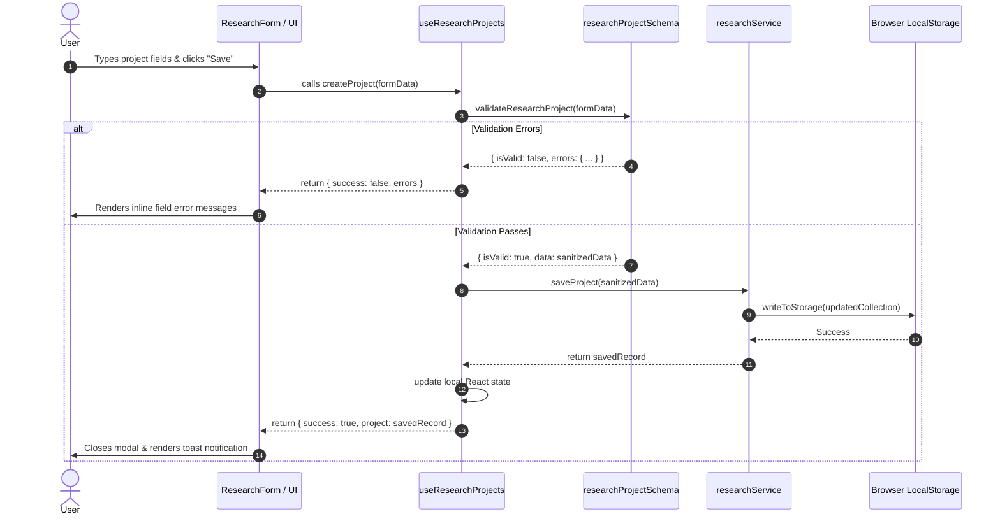

# Bharmafills — Codebase Inventory & Implementation Guide

> **Document Status**: Active
> **Product Version**: 0.2.0 (Phase 2 Completed)
> **Workspace Identifier**: `Shinchan`
> **Frontend Location**: `frontend/src/`
> **Backend Location**: `backend/app/` (Planned)

---

## 1. Codebase Inventory

### 1.1 Layout & Navigation Components
Location: `frontend/src/components/layout/`

- **`Sidebar.jsx`**:
  - Renders primary desktop navigation sidebar (width: `16rem` / 256px).
  - Navigation links: *Dashboard*, *Research*, *Sources* (badge: Planned), *Analysis* (badge: Planned), *Checklist* (badge: Planned).
  - Highlights active route with high-contrast text and subtle neutral background.
  - Collapses completely on screens below `md` breakpoint (`768px`) to prevent content compression.
- **`Topbar.jsx`**:
  - Header toolbar rendering current view title and breadcrumb context.
  - Contains responsive hamburger button visible on mobile (`< md`), triggering mobile navigation drawer.
  - Renders user profile initials avatar and quick-action buttons.
  - Implements keyboard accessible backdrop dismiss (`Escape` key listener) and outside-click dismiss for the mobile drawer.

---

### 1.2 Dashboard Feature Module
Location: `frontend/src/features/dashboard/`

- **`DashboardPage.jsx`**:
  - **Dynamic Metrics Engine**: Calculates project statistics dynamically from `researchService` without hardcoded dummy numbers.
  - 4 core KPI cards:
    - *Total Research Projects*: Count of non-archived projects.
    - *Active Investigations*: Count of projects with status `active` or `in_progress`.
    - *Identified Gaps*: Placeholder aggregate count for Phase 4 AI analysis.
    - *Pending Verifications*: Placeholder count for Phase 5 checklist items.
  - **Recent Activity Table**: Renders the 5 most recently created or updated research projects with direct navigation to their details view.
  - **Empty State**: Renders clear onboarding call-to-action ("Create your first research project") when storage is empty.

---

### 1.3 Research Project Management Module (Phase 2 Core)
Location: `frontend/src/features/research/`

#### Components (`features/research/components/`)
- **`ResearchPage.jsx`**: Master view orchestrating project lists, search bar, status filters, category dropdowns, sorting options, and create/edit/delete modals.
- **`ResearchList.jsx`**: Renders project cards in a responsive grid (`1 col` on mobile, `2 cols` on tablet, `3 cols` on desktop) with empty search results states.
- **`ResearchCard.jsx`**: Individual project card displaying:
  - Title, research inquiry excerpt, domain category badge, status badge.
  - Created/updated relative timestamps.
  - Context menu trigger for: *View Details*, *Edit Project*, *Delete Project*.
- **`ResearchDetails.jsx`**: Full-page inspection view rendering the complete inquiry question, description, metadata tags, and preview placeholders for sources and gap analysis.
- **`ResearchModal.jsx`**: Accessible modal wrapper utilizing Base UI / Radix primitives with managed focus trap, screen-reader titles, and outside-click dismiss.
- **`ResearchForm.jsx`**: Controlled form component handling project fields:
  - Title input (with character counter: 3–120 characters).
  - Research inquiry textarea (with character counter: 10–1000 characters).
  - Description textarea (optional).
  - Domain category selector (Education, Technology, Scholarships, Healthcare, etc.).
  - Real-time field-level validation feedback with inline error alerts.
- **`DeleteConfirmModal.jsx`**: Two-step destructive confirmation dialog requiring explicit user confirmation before removing project records.

#### Validation Schemas (`features/research/schemas/`)
- **`researchProjectSchema.js`**:
  - Pure JavaScript validation functions: `validateResearchProject(payload)`, `validateTitle(title)`, `validateResearchQuestion(question)`.
  - Canonical enums: `PROJECT_STATUS` (`active`, `in_progress`, `completed`, `archived`) and `PROJECT_CATEGORIES`.
  - Sanitization: trims whitespace, normalizes empty strings, rejects script injections.

#### State Management Hook (`features/research/hooks/`)
- **`useResearchProjects.js`**:
  - Encapsulates project collection state, active filter state (search query, status, category, sort order).
  - Exposes reactive actions: `createProject`, `updateProject`, `deleteProject`, `getProjectById`, `refreshProjects`.
  - Subscribes to window storage events to maintain multi-tab synchronization.

#### Persistence Service Layer (`features/research/services/`)
- **`researchService.js`**:
  - Abstraction layer decoupling UI components from browser storage.
  - Implements storage versioning (`SCHEMA_VERSION: 1`).
  - Quota safety: catches `QuotaExceededError`, reports honest failure to UI, falls back to memory storage.
  - Corruption quarantine: backs up unparseable JSON to `bharmafills_research_corrupted_backup_<timestamp>` before resetting to prevent irreversible data loss.

---

## 2. Data Flow Architecture

The following diagram illustrates the complete data flow for project operations:



---

## 3. Automated Test Suite Inventory

Location: `frontend/tests/` (Vitest + React Testing Library)

| Test File | Test Count | Scope & Coverage |
| :--- | :---: | :--- |
| `researchProjectSchema.test.js` | 14 tests | Title constraints, inquiry constraints, status/category validation, sanitization |
| `researchService.test.js` | 16 tests | CRUD operations, corrupted JSON quarantine, quota errors, in-memory fallback |
| `useResearchProjects.test.jsx` | 10 tests | Hook state management, filtering, search, sorting, multi-tab storage sync |
| `ResearchPage.test.jsx` | 12 tests | Form rendering, modal open/close, project creation, validation display, deletion |
| **Total Verified** | **52 tests** | **100% Passing in CI/Local** |

---

## 4. Planned Architecture for Upcoming Stages

### Step 5 & 6: Backend Application & Supabase Persistence
```
backend/app/
├── api/
│   ├── routes/
│   │   ├── health.py        # Liveness & readiness probes
│   │   ├── auth.py          # Supabase JWT token verification
│   │   ├── projects.py      # Project CRUD operations
│   │   ├── sources.py       # Source registration & documents
│   │   ├── extraction.py    # URL & PDF extraction endpoints
│   │   └── analysis.py      # AI gap detection & checklist endpoints
│   └── dependencies.py      # Database session & user dependencies
├── core/
│   ├── config.py            # Pydantic Settings reading .env
│   ├── security.py          # CORS & security headers
│   └── exceptions.py        # Centralized RFC 7807 exception handlers
└── db/
    ├── session.py           # Async database connection pool
    └── base.py              # Declarative base
```

### Step 7 & 8: Sources & Extraction Pipeline
```
frontend/src/features/sources/
├── components/
│   ├── SourceListPage.jsx      # List of sources attached to current project
│   ├── AddSourceModal.jsx      # Modal accepting URL or PDF file
│   ├── UrlSourceForm.jsx       # URL input with domain validation
│   ├── PdfUploadForm.jsx       # Drag-and-drop PDF uploader with progress
│   └── SourceExcerptViewer.jsx # Side-by-side view of extracted text and citations
├── hooks/
│   └── useSources.js           # State hook for source ingestion
└── services/
    └── sourceService.js        # API client calling backend extraction endpoints
```

### Step 9–11: AI Analysis & Contradiction Detection
```
frontend/src/features/analysis/
├── components/
│   ├── AnalysisDashboard.jsx   # Gap detection summary & severity cards
│   ├── InformationGapCard.jsx  # Card displaying omitted topic & why it matters
│   ├── ConflictCard.jsx        # Comparative card contrasting Source A vs Source B
│   └── TriggerAnalysisBtn.jsx  # Button triggering AI analysis job
├── hooks/
│   └── useGapAnalysis.js       # Hook polling analysis status
└── services/
    └── analysisService.js      # API client calling Gemini analysis endpoints
```
