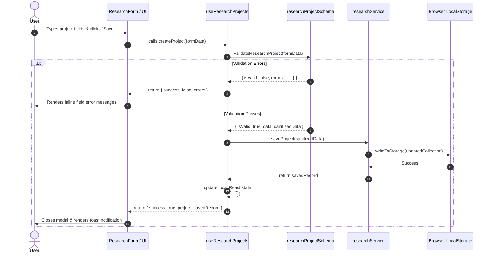

# Bharmafills — Codebase Inventory & Implementation Guide

> **Document Status**: Active
> **Product Version**: 0.2.0 (Phase 2 Completed)
> **Workspace Identifier**: `Shinchan`
> **Frontend Location**: `frontend/src/`
> **Backend Location**: `backend/app/` (Planned)

---

## 1. Codebase Inventory

### 1.1 Layout & Navigation Components
Location: `frontend/src/components/layout/`

- **`Sidebar.jsx`**:
  - Renders primary desktop navigation sidebar (width: `16rem` / 256px).
  - Navigation links: *Dashboard*, *Research*, *Sources* (badge: Planned), *Analysis* (badge: Planned), *Checklist* (badge: Planned).
  - Highlights active route with high-contrast text and subtle neutral background.
  - Collapses completely on screens below `md` breakpoint (`768px`) to prevent content compression.
- **`Topbar.jsx`**:
  - Header toolbar rendering current view title and breadcrumb context.
  - Contains responsive hamburger button visible on mobile (`< md`), triggering mobile navigation drawer.
  - Renders user profile initials avatar and quick-action buttons.
  - Implements keyboard accessible backdrop dismiss (`Escape` key listener) and outside-click dismiss for the mobile drawer.

---

### 1.2 Dashboard Feature Module
Location: `frontend/src/features/dashboard/`

- **`DashboardPage.jsx`**:
  - **Dynamic Metrics Engine**: Calculates project statistics dynamically from `researchService` without hardcoded dummy numbers.
  - 4 core KPI cards:
    - *Total Research Projects*: Count of non-archived projects.
    - *Active Investigations*: Count of projects with status `active` or `in_progress`.
    - *Identified Gaps*: Placeholder aggregate count for Phase 4 AI analysis.
    - *Pending Verifications*: Placeholder count for Phase 5 checklist items.
  - **Recent Activity Table**: Renders the 5 most recently created or updated research projects with direct navigation to their details view.
  - **Empty State**: Renders clear onboarding call-to-action ("Create your first research project") when storage is empty.

---

### 1.3 Research Project Management Module (Phase 2 Core)
Location: `frontend/src/features/research/`

#### Components (`features/research/components/`)
- **`ResearchPage.jsx`**: Master view orchestrating project lists, search bar, status filters, category dropdowns, sorting options, and create/edit/delete modals.
- **`ResearchList.jsx`**: Renders project cards in a responsive grid (`1 col` on mobile, `2 cols` on tablet, `3 cols` on desktop) with empty search results states.
- **`ResearchCard.jsx`**: Individual project card displaying:
  - Title, research inquiry excerpt, domain category badge, status badge.
  - Created/updated relative timestamps.
  - Context menu trigger for: *View Details*, *Edit Project*, *Delete Project*.
- **`ResearchDetails.jsx`**: Full-page inspection view rendering the complete inquiry question, description, metadata tags, and preview placeholders for sources and gap analysis.
- **`ResearchModal.jsx`**: Accessible modal wrapper utilizing Base UI / Radix primitives with managed focus trap, screen-reader titles, and outside-click dismiss.
- **`ResearchForm.jsx`**: Controlled form component handling project fields:
  - Title input (with character counter: 3–120 characters).
  - Research inquiry textarea (with character counter: 10–1000 characters).
  - Description textarea (optional).
  - Domain category selector (Education, Technology, Scholarships, Healthcare, etc.).
  - Real-time field-level validation feedback with inline error alerts.
- **`DeleteConfirmModal.jsx`**: Two-step destructive confirmation dialog requiring explicit user confirmation before removing project records.

#### Validation Schemas (`features/research/schemas/`)
- **`researchProjectSchema.js`**:
  - Pure JavaScript validation functions: `validateResearchProject(payload)`, `validateTitle(title)`, `validateResearchQuestion(question)`.
  - Canonical enums: `PROJECT_STATUS` (`active`, `in_progress`, `completed`, `archived`) and `PROJECT_CATEGORIES`.
  - Sanitization: trims whitespace, normalizes empty strings, rejects script injections.

#### State Management Hook (`features/research/hooks/`)
- **`useResearchProjects.js`**:
  - Encapsulates project collection state, active filter state (search query, status, category, sort order).
  - Exposes reactive actions: `createProject`, `updateProject`, `deleteProject`, `getProjectById`, `refreshProjects`.
  - Subscribes to window storage events to maintain multi-tab synchronization.

#### Persistence Service Layer (`features/research/services/`)
- **`researchService.js`**:
  - Abstraction layer decoupling UI components from browser storage.
  - Implements storage versioning (`SCHEMA_VERSION: 1`).
  - Quota safety: catches `QuotaExceededError`, reports honest failure to UI, falls back to memory storage.
  - Corruption quarantine: backs up unparseable JSON to `bharmafills_research_corrupted_backup_<timestamp>` before resetting to prevent irreversible data loss.

---

## 2. Data Flow Architecture

The following diagram illustrates the complete data flow for project operations:



---

## 3. Automated Test Suite Inventory

Location: `frontend/tests/` (Vitest + React Testing Library)

| Test File | Test Count | Scope & Coverage |
| :--- | :---: | :--- |
| `researchProjectSchema.test.js` | 14 tests | Title constraints, inquiry constraints, status/category validation, sanitization |
| `researchService.test.js` | 16 tests | CRUD operations, corrupted JSON quarantine, quota errors, in-memory fallback |
| `useResearchProjects.test.jsx` | 10 tests | Hook state management, filtering, search, sorting, multi-tab storage sync |
| `ResearchPage.test.jsx` | 12 tests | Form rendering, modal open/close, project creation, validation display, deletion |
| **Total Verified** | **52 tests** | **100% Passing in CI/Local** |

---

## 4. Planned Architecture for Upcoming Stages

### Step 5 & 6: Backend Application & Database Connection (Completed Step 6A & 6B)
```
backend/app/
├── main.py                  # FastAPI application factory with lifespan & CORS
├── api/
│   ├── router.py            # Master API v1 router
│   └── routes/
│       └── health.py        # Process & database health endpoints
├── core/
│   └── config.py            # Centralized Pydantic Settings configuration
└── db/
    ├── __init__.py          # DB package exports
    ├── connection.py        # Asyncpg connection manager & health probe
    └── migrator.py          # Transactional migration runner & schema verifier

supabase/
└── migrations/
    └── 20261031123000_initial_bharmafills_schema.sql # Initial Bharmafills schema
```

### Step 7 & 8: Sources & Extraction Pipeline (Step 7A Web Extraction Completed)
```
backend/app/
├── api/
│   └── routes/
│       ├── health.py            # Process & database health endpoints
│       └── web.py               # POST /api/v1/web/extract endpoint
└── services/
    └── web/
        ├── __init__.py          # Service exports
        ├── exceptions.py        # Web extraction domain exceptions
        ├── schemas.py           # WebExtractRequest & WebExtractResponse schemas
        ├── url_validator.py     # URL validation & SSRF IP defense
        ├── safe_fetcher.py      # Pinned IP HTTPX client & streaming response caps
        └── content_extractor.py # BeautifulSoup readable text & metadata extractor

frontend/src/features/sources/
├── components/
│   ├── SourceListPage.jsx      # List of sources attached to current project
│   ├── AddSourceModal.jsx      # Modal accepting URL or PDF file
│   ├── UrlSourceForm.jsx       # URL input with domain validation
│   ├── PdfUploadForm.jsx       # Drag-and-drop PDF uploader with progress
│   └── SourceExcerptViewer.jsx # Side-by-side view of extracted text and citations
├── hooks/
│   └── useSources.js           # State hook for source ingestion
└── services/
    └── sourceService.js        # API client calling backend extraction endpoints
```

### Step 9–11: AI Analysis & Contradiction Detection
```
frontend/src/features/analysis/
├── components/
│   ├── AnalysisDashboard.jsx   # Gap detection summary & severity cards
│   ├── InformationGapCard.jsx  # Card displaying omitted topic & why it matters
│   ├── ConflictCard.jsx        # Comparative card contrasting Source A vs Source B
│   └── TriggerAnalysisBtn.jsx  # Button triggering AI analysis job
├── hooks/
│   └── useGapAnalysis.js       # Hook polling analysis status
└── services/
    └── analysisService.js      # API client calling Gemini analysis endpoints
```

---

## 4. Backend Implementation Architecture (Phases 3-4 Active Baseline)

### 4.1 Step 5: FastAPI Application Foundation
- **Factory Pattern**: `backend/app/main.py` (`create_app`) initializes FastAPI with configurable `Settings`, CORS middleware, and async lifespan hooks.
- **Settings Governance**: `backend/app/core/config.py` uses Pydantic Settings resolving environment variables from `.env` with strict bounds and typed defaults.
- **Process Health**: `backend/app/api/routes/health.py` provides `GET /api/v1/health`.

### 4.2 Step 6: Supabase PostgreSQL Foundation & Schema Migration
- **Connection Manager**: `backend/app/db/connection.py` (`DatabaseManager`) establishes asyncpg connection pools with `statement_cache_size=0` for Supabase Session Pooler compatibility and safe resource cleanup.
- **Database Health**: `GET /api/v1/health/database` returns connectivity status without credential leaks.
- **Migration Engine**: `backend/app/db/migrator.py` (`DatabaseMigrator`) applies version-controlled SQL migrations transactional tracking in `public.schema_migrations`.
- **Applied Schema**: `supabase/migrations/20261031123000_initial_bharmafills_schema.sql` creates 11 tables with RLS enabled across all 10 domain tables.

### 4.3 Step 7A: Secure Web Extraction Engine
- **SSRF Defense Engine**: `backend/app/services/web/url_validator.py` (`URLValidator`) strictly filters prohibited hostnames and IP subnets (RFC 1918, CGNAT, loopback, link-local, cloud metadata, IDN Punycode, IPv6 zone IDs).
- **Socket-Level DNS Pinning**: `backend/app/services/web/safe_fetcher.py` (`SafeWebFetcher`) pins DNS resolutions at the socket level to eliminate TOCTOU DNS rebinding vulnerabilities.
- **Content Parser**: `backend/app/services/web/content_extractor.py` (`WebContentExtractor`) strips non-content tags, extracts headings, clean paragraphs, word counts, and SHA-256 hash.
- **Public Extraction Route**: `POST /api/v1/web/extract` returns clean text and structured metadata.

### 4.4 Step 7B: Source Ingestion Persistence & Database Integration
- **Service Layer**: `backend/app/services/sources/web_source_service.py` (`WebSourceIngestionService`):
  - Validates project existence in PostgreSQL (`research_projects`).
  - Checks for duplicate URLs within project (`idx_sources_project_url_unique`).
  - Fetches and parses content via Step 7A pipeline.
  - Checks for identical content hashes within project (`idx_sources_project_hash_unique`).
  - Executes atomic transaction writing to `sources` and `extracted_content`.
- **API Endpoints**: `backend/app/api/routes/sources.py`:
  - `POST /api/v1/projects/{project_id}/sources/web`: Ingests URL into project (201 Created or 200 Duplicate).
  - `GET /api/v1/projects/{project_id}/sources`: Lists sources and word counts for a project.
  - `GET /api/v1/projects/{project_id}/sources/{source_id}`: Retrieves complete source record with full extracted text.
- **Managed Connection Pool**: `DatabaseManager.acquire_connection()` provides async context-managed connection acquisition with explicit error classification (`DatabaseNotConfiguredError`, `DatabaseUnavailableError`).

### 4.5 Step 8: PDF Extraction Engine & PyMuPDF Ingestion
- **Domain Exceptions**: `backend/app/services/pdf/exceptions.py`:
  - `PDFProcessingError`: Base exception for all PDF errors.
  - Subclasses: `InvalidPDFError` (400), `UnsupportedMediaTypeError` (415), `OversizedPDFError` (413), `OversizedPageCountError` (413), `EmptyPDFError` (400), `PasswordProtectedPDFError` (400), `ScannedPDFError` (422).
- **Data Models**: `backend/app/services/pdf/schemas.py`:
  - `PDFPageItem`: Individual page number, raw text, word count, character count, `is_empty` flag.
  - `PDFExtractResult`: Document-level clean text, page items list, word/character counts, page counts, binary SHA-256 hash, text SHA-256 hash, readability classification, and extracted PDF metadata.
  - `ProjectPDFSourceResponse`: Serialization model for API responses with `source_id`, `project_id`, `original_filename`, `title`, `ingestion_status`, `is_duplicate`, `readability_status`, and page items.
- **Defensive Validator**: `backend/app/services/pdf/validator.py` (`PDFValidator`):
  - Enforces `application/pdf` MIME type and `.pdf` filename extension.
  - Enforces `%PDF-` magic byte sequence in the first 1024 bytes of stream.
  - Enforces file upload bounds (`PDF_MAX_UPLOAD_BYTES`, default 20 MB).
  - Sanitizes filenames by stripping directory traversal sequences (`/`, `\`), null bytes (`\x00`), and truncating to 255 chars preserving `.pdf`.
  - In-memory opening via `fitz.open(stream=bytes, filetype="pdf")` without disk writes.
  - Rejects password-encrypted documents (`doc.is_encrypted`).
  - Enforces page count bounds (`PDF_MAX_PAGES`, default 200).
- **Extraction Engine**: `backend/app/services/pdf/extractor.py` (`PDFExtractor`):
  - Extracts text per page using PyMuPDF block extraction, normalizing excess whitespace.
  - Extracts native PDF document metadata (title, author, subject, creation date).
  - Classifies document readability: `fully_readable`, `partially_readable`, `no_extractable_text`, `empty`.
  - Computes binary SHA-256 hash for exact deduplication and text SHA-256 hash for content tracking.
- **Ingestion Service**: `backend/app/services/pdf/service.py` (`PDFSourceIngestionService`):
  - Validates target research project in Supabase PostgreSQL (`research_projects`).
  - Checks binary hash uniqueness per project (`idx_sources_project_hash_unique`), returning existing source with `is_duplicate=True`.
  - Isolates scanned PDFs (0 extractable text) by recording as `failed` in `public.sources` without violating non-empty text constraints on `public.extracted_content`.
  - Executes atomic transaction writing to `public.sources` and `public.extracted_content`.
- **API Endpoint**: `backend/app/api/routes/sources.py`:
  - `POST /api/v1/projects/{project_id}/sources/pdf`: Multipart form upload processing file via 64 KB streaming chunks to enforce byte limits safely before full buffer allocation. Maps domain exceptions to standard HTTP error codes (201, 200, 400, 404, 413, 415, 422, 503).

### 4.6 Step 9A: AI Provider Foundation & OpenRouter Integration
- **Abstract Interface**: `backend/app/services/ai/base.py` (`BaseAIProvider`):
  - Decouples core research analysis from vendor-specific LLM implementations.
  - Declares `complete()`, `check_health()`, and `close()` lifecycle methods.
- **Client Implementation**: `backend/app/services/ai/openrouter_client.py` (`OpenRouterClient`):
  - Manages asynchronous HTTP requests using persistent `httpx.AsyncClient` with connection pooling.
  - Enforces configurable request timeouts (`OPENROUTER_TIMEOUT_SECONDS`, default 30.0s).
  - Implements bounded resilience with exponential backoff on transient errors (HTTP 429 rate limit, 502/503 upstream unavailable, and read timeouts) up to 2 retries.
  - Non-retryable immediate failure on authentication (401/403) and quota exhaustion (402).
  - Sanitizes sensitive tokens: zero API key exposure in logs, error traces, or exceptions.
- **Structured Output Safety**: `backend/app/services/ai/parser.py` (`SafeResponseParser`):
  - Because `nvidia/nemotron-3-ultra-550b-a55b:free` lacks native JSON schema constraints, isolates markdown-fenced code blocks or bracketed JSON substrings.
  - Validates structures using Pydantic models.
  - Returns explicit error state without raising unhandled exceptions or hallucinating missing fields.
- **Diagnostic Route**: `backend/app/api/routes/health.py`:
  - `GET /api/v1/health/ai`: Reports configuration state (`configured` or `not_configured`), active model, and free-tier flag without exposing any credential-derived material or making unprompted live API calls.
- **Client Lifecycle Management**: `backend/app/main.py`:
  - Instantiates `OpenRouterClient` in application factory and safely calls `await ai_provider.close()` in ASGI lifespan context.

### 4.7 Steps 9B.1, 9B.1.1 & 9B.1.2: Prompt Security Architecture, Truncation Transparency & Structured Metadata
- **Centralized Prompt Architecture**: `backend/app/services/ai/prompts/`:
  - `constants.py`: Single source of truth for XML isolation tags (`<untrusted_source_document>`, `<untrusted_sources>`, `<sources_truncation_notice>`), trust level identifiers, and bounds (`MAX_SOURCES_PER_PROMPT=20`, `MAX_SOURCE_CHARS=40_000`).
  - `templates.py` (`SECURITY_SYSTEM_PROMPT`): Foundational system instruction establishing the 4-tier trust hierarchy:
    1. `Level 1 — TRUSTED_SYSTEM`: Application-controlled system instructions.
    2. `Level 2 — TRUSTED_TASK`: Application-controlled task directives.
    3. `Level 3 — UNTRUSTED_SOURCE`: External source documents.
    4. `Level 4 — UNVERIFIED_OUTPUT`: Model completions (provisional until downstream schema validation).
    Includes an explicit Enforcement Boundaries & Trust Limitations section noting that prompt-level boundaries are probabilistic in unified model attention. Enforces behavioral constraints on instruction-following from source documents, system instruction override, credential disclosure, and fact fabrication.
  - `builder.py` (`PromptBuilder`, `SourceDocument`, `PromptBuildResult`, `SourceTruncationMetadata`, `SourceOmissionSummary`):
    - `SourceDocument`: Frozen immutable descriptor for source text with attribute validation (rejects `< > "` in IDs) and type normalization (`web`, `pdf`, `url` -> `web`).
    - `sanitise_source_text()`: Strips XML tags, comments (`<!-- ... -->`), CDATA blocks, and processing instructions (`<? ... ?>`) while preserving mathematical comparisons.
    - `fence_source_with_metadata()`: Returns `(fenced_xml_string, SourceTruncationMetadata)` with 1-based index, sanitized title attribute, and explicit `truncated="true/false"` and `omitted_chars="N"` metadata.
    - `build_sources_block_with_metadata()`: Groups sources in `<untrusted_sources>` wrapper, injecting explicit `<sources_truncation_notice>` when source list exceeds `MAX_SOURCES_PER_PROMPT`. Returns `(sources_xml, list[SourceTruncationMetadata], SourceOmissionSummary)`.
    - `build()`: Combines system security template and user task instructions with XML-fenced source block into a `PromptBuildResult` container. Supports `SourceDocument` instances and dictionaries.
    - **Structured Metadata Contracts (Step 9B.1.2)**:
      - `SourceTruncationMetadata`: Exact character accounting per source (`source_id`, `source_type`, `was_truncated`, `original_char_count`, `retained_char_count`, `omitted_char_count`).
      - `SourceOmissionSummary`: Aggregated source inclusion/omission counts (`total_sources_provided`, `total_sources_included`, `total_sources_omitted`, `omitted_source_ids`).
      - `PromptBuildResult`: Top-level envelope containing `messages: list[ChatMessage]`, `source_metadata: list[SourceTruncationMetadata]`, `source_summary: SourceOmissionSummary`. Supports sequence unpacking (`sys, user = result`), indexing (`result[0]`), and iteration for seamless backwards compatibility with existing AI provider callers.

### 4.8 Step 9B.2.1: Evidence Extraction Data Models & Pydantic Schemas (`IMPLEMENTED & TESTED`)
- **Domain Package**: `backend/app/services/ai/evidence_schemas.py` (re-exported via `backend/app/services/ai/__init__.py`):
  - **Controlled Enums**:
    - `RepresentationType`: `direct_quote`, `paraphrase`.
    - `EvidenceSourceType`: `web`, `pdf` (with automatic `url` -> `web` normalization).
    - `FactType`: `general`, `statistical`, `procedural`, `eligibility`, `definitional`, `temporal`.
    - `ClaimType`: `factual_assertion`, `recommendation`, `policy_statement`, `prediction`, `opinion`, `eligibility_condition`, `numerical_or_statistical`.
    - `ExtractionStatus`: `success`, `partial`, `failed`, `no_content`.
  - **`EvidenceLocation`**:
    - Frozen immutable model for precise source location tracking.
    - Fields: `source_id`, `source_type`, `page_number` (PDF >= 1), `url` (web http/https), `heading_path` (hierarchy), `paragraph_index` (>= 0), `start_char`, `end_char` (enforcing `end_char > start_char`), `location_description`.
    - Rejects empty source IDs and illegal characters in URLs.
  - **`ExtractedFact`**:
    - Represents a discrete factual statement extracted from one source.
    - Fields: `fact_id`, `statement`, `fact_type`, `location`, `evidence_text`, `representation_type`, `confidence` (0.0–1.0 bounds), `qualifiers`, `uncertainty_notes`, `extraction_warnings`.
    - Immutability enforced via `ConfigDict(frozen=True, extra="forbid")`.
  - **`SourceClaim`**:
    - Represents what a source claims without asserting objective truth.
    - Fields: `claim_id`, `claim_text`, `claim_type`, `source_id`, `evidence_location`, `representation_type`, `confidence`, `qualifiers`, `uncertainty_notes`, `extraction_warnings`.
    - Validates cross-field consistency: `source_id` must match `evidence_location.source_id`.
    - Strictly excludes implicit verification fields (`verified`, `is_true` forbidden).
  - **`EvidenceExtractionResult`**:
    - Structured single-source extraction envelope.
    - Fields: `source_id`, `source_type`, `facts`, `claims`, `extraction_status`, `warnings`, `errors`, `source_truncated`, `source_character_count`, `processed_character_count`, `extracted_at`.
    - Enforces source identity consistency across all nested facts and claims.
    - Status invariants: `failed` requires non-empty errors; `no_content` forbids facts/claims; `source_truncated=True` rejects `success` status (must be `partial`).
    - Full roundtrip JSON serialization supported and verified against `SafeResponseParser`.

### 4.9 Step 9B.2.2A: Evidence Extraction Prompt Templates & Truncation Awareness (`IMPLEMENTED & TESTED`)
- **Prompt Template Architecture**: `backend/app/services/ai/prompts/evidence_templates.py`:
  - `EVIDENCE_EXTRACTION_TASK_HEADER`: Foundational user-turn task definition establishing the evidence extraction role.
  - `EVIDENCE_GROUNDING_RULES`: Ten strict grounding and anti-fabrication directives forbidding outside training memory, fake citations, or assuming missing information.
  - `EVIDENCE_EXTRACTION_INSTRUCTIONS`: Comprehensive field-by-field instructions mapping to `ExtractedFact`, `SourceClaim`, and `EvidenceLocation`:
    - Strict quote vs. paraphrase distinction: `direct_quote` must be verbatim; `paraphrase` must be faithful; never present a paraphrase as a quotation.
    - Confidence semantics: Defined as extraction fidelity/accuracy, explicitly noting it does NOT reflect objective truth or source credibility.
    - Qualifiers preservation: Mandatory retention of conditions, dates, eligibility criteria, and geographic limits.
    - Location tracking: Rejection of invented page numbers or offsets; leaves unknown fields `null` with descriptive fallbacks.
  - `EVIDENCE_PROMPT_INJECTION_DEFENSE`: Reinforces `SECURITY_SYSTEM_PROMPT` within task context, ordering the model to treat source text as inert data, flag injection attempts, and acknowledge probabilistic boundary adherence.
  - `EVIDENCE_EXTRACTION_JSON_CONTRACT`: Strict raw JSON contract forbidding Markdown fences (```json) or conversational filler. Explicitly prohibits the model from outputting backend-owned envelope fields (`extracted_at`, `extraction_status`, `source_truncated`, `processed_character_count`, `source_character_count`, backend errors).
- **Truncation and Omission Awareness**:
  - `build_truncation_notice()`: Dynamically formats an explicit, prominent notice when character truncation (`was_truncated=True`) or source count capping (`total_sources_omitted > 0`) occurs.
  - `build_evidence_extraction_prompt()`: Assembles the complete user task instruction incorporating target research questions, truncation notices, anti-fabrication rules, and JSON formatting.
  - `assemble_evidence_extraction_prompt()`: High-level coordinator pre-evaluating sources via `PromptBuilder`, building the truncation-aware task instruction, and returning a full `PromptBuildResult`.
- **Payload Contract**: `EvidenceExtractionPayload` in `backend/app/services/ai/evidence_schemas.py`:
  - Represents the model-generated JSON response (`facts`, `claims`, `extraction_warnings`).
  - Validated via `SafeResponseParser.parse_model_output(raw_text, EvidenceExtractionPayload)`.
  - Distinguishes model payload from the authoritative `EvidenceExtractionResult` envelope assembled downstream by the backend.


### 4.10 Step 9B.2.2B: Evidence Extraction Pipeline & Structured Parser Integration (`IMPLEMENTED & TESTED`)
- **Pipeline Architecture & Service Layer**: `backend/app/services/ai/evidence_service.py` (`EvidenceExtractionService`):
  - **Single-Source Extraction Pipeline** (`extract_source_evidence`):
    - Validates source identity and normalizes source types (`web`, `url` -> `web`, `pdf`).
    - Evaluates empty/whitespace content immediately without calling upstream AI providers, returning `no_content` status with clean envelopes.
    - Assembles prompt via `assemble_evidence_extraction_prompt` preserving `PromptBuildResult` structured truncation metadata.
    - Dispatches async completion call to `BaseAIProvider` / `OpenRouterClient` with low temperature (0.1) for strict factual grounding.
    - Decodes and validates model JSON using `SafeResponseParser.parse_model_output(raw_text, EvidenceExtractionPayload)`.
    - Enforces post-extraction integrity checks:
      - Source attribution check: Rejects facts or claims referencing alien source IDs and logs explicit integrity warnings.
      - Verbatim quote verification: Normalizes whitespace and verifies direct quotes exist in source text; flags discrepancies without discarding information.
      - Character offset bounds verification: Confirms offsets fall within processed source boundaries.
      - URL domain consistency: Flags discrepancies between claimed citations and original source domains.
    - Resolves authoritative envelope status: `success`, `partial` (if truncated or attribution mismatches occurred), `failed` (if model or network crashed), or `no_content`.
  - **Batch Extraction Coordinator** (`extract_sources_batch`):
    - Processes multiple `SourceDocument` instances with strict per-source failure isolation.
    - Produces `BatchEvidenceExtractionResult` summarizing total, successful, partial, failed, and empty source counts.
  - **FastAPI Endpoint Integration**: `POST /api/v1/projects/{project_id}/sources/{source_id}/extract`:
    - Defined in `backend/app/api/routes/sources.py`.
    - Validates project and source existence using `WebSourceIngestionService.get_project_source_detail`.
    - Rejects unconfigured AI providers with HTTP 503 (`AIAuthenticationError`).
    - Rejects missing projects/sources with HTTP 404.
    - Accepts optional `ExtractEvidenceRequest` (`research_question`, `custom_instructions`).
    - Returns authoritative `EvidenceExtractionResult` envelope with HTTP 200.

### 4.11 Step 9B.3: Evidence Database Persistence & Retrieval (`IMPLEMENTED & TESTED`)
- **Database Schema Migration**: `supabase/migrations/20261101120000_add_evidence_claims_and_runs.sql`:
  - Created `public.extraction_runs` table with FKs to `research_projects` and `sources`, status check constraints, truncation tracking, and unique index on `(project_id, source_id, idempotency_key)`.
  - Enhanced `public.evidence` table with additive columns (`extraction_run_id`, `fact_id`, `fact_type`, `representation_type`, `qualifiers`, `uncertainty_notes`, `extraction_warnings`, `start_char`, `end_char`, `page_number`, `url`) and unique index on `(extraction_run_id, fact_id)`.
  - Created `public.source_claims` table with FKs, claim type checks (`chk_source_claims_type`), text length checks (`chk_source_claims_text_len`), offset order checks, and unique index on `(extraction_run_id, claim_id)`.
  - Enabled Row Level Security (RLS) on `extraction_runs` and `source_claims` cascading from `research_projects.user_id = auth.uid()`.
- **Evidence Service Layer**: `backend/app/services/evidence/`:
  - `exceptions.py`: Domain exceptions (`EvidencePersistenceError`, `ExtractionRunNotFoundError`, `SourceMismatchError`, `DuplicateExtractionRunError`, `InvalidEvidencePayloadError`, `EvidenceTransactionError`).
  - `schemas.py`: Pydantic response models (`PersistedFactResponse`, `PersistedClaimResponse`, `ExtractionRunResponse`, `PersistedEvidenceRunResponse`, `BatchPersistenceResponse`, `ProjectEvidenceResponse`, `ExtractionRunListResponse`, `PersistEvidenceRequest`).
  - `persistence_service.py` (`EvidencePersistenceService`):
    - `validate_project_and_source`: Enforces project and source existence with soft-delete checks.
    - `persist_extraction_result`: Executes single atomic PostgreSQL transaction inserting run header, discrete facts into `evidence`, and claims into `source_claims`. Complete rollback on failure.
    - `persist_batch_extraction_results`: Batch coordinator with per-source isolation.
    - `get_source_evidence` & `get_project_evidence`: Multi-table retrieval supporting item type filtering (`all`, `facts`, `claims`), fact/claim type filtering, and pagination.
    - `list_extraction_runs` & `get_extraction_run_detail`: Extraction provenance inspection.
- **FastAPI Endpoints**: `backend/app/api/routes/evidence.py`:
  - `POST /api/v1/projects/{project_id}/sources/{source_id}/persist`: Explicit transactional persistence (201 Created).
  - `GET /api/v1/projects/{project_id}/sources/{source_id}/evidence`: Source-scoped facts and claims retrieval (200 OK).
  - `GET /api/v1/projects/{project_id}/evidence`: Project-scoped facts and claims retrieval (200 OK).
  - `GET /api/v1/projects/{project_id}/sources/{source_id}/extraction-runs`: Source extraction history (200 OK).
  - `GET /api/v1/projects/{project_id}/extraction-runs/{run_id}`: Single run telemetry inspection (200 OK).
- **Auto-Persistence Integration**:
  - `POST /api/v1/projects/{project_id}/sources/{source_id}/extract` automatically persists valid results when the database is configured, setting `run_id` and `is_persisted=True` on the response envelope without failing extraction if persistence is unconfigured.

### 4.12 Step 9B.3.2: Live Supabase Migration Application & Verification (`LIVE DATABASE VERIFIED & TESTED`)
- **Live Migration Execution**:
  - Migration file `supabase/migrations/20261101120000_add_evidence_claims_and_runs.sql` successfully applied against live Supabase PostgreSQL 17.11 instance via `DatabaseMigrator.apply_all_pending()`.
  - Transaction safety: Entire migration executed inside an isolated transaction block.
  - Recorded in `public.schema_migrations` with version `20261101120000` and SHA256 checksum `895361b72cabcad4d5de857ec3235a73717c62e7ee70401c2031910461871567`.
- **Live Catalog Audit Evidence**:
  - `public.extraction_runs` table: 17 columns verified, 5 indexes created, check constraints verified (`chk_extraction_runs_status`, `chk_extraction_runs_counts`), Row Level Security enabled.
  - `public.source_claims` table: 19 columns verified, 5 indexes created, unique compound index `idx_source_claims_run_claim_id_unique` created, check constraints verified (`chk_source_claims_type`, `chk_source_claims_text_len`, `chk_source_claims_confidence_bounds`, `chk_source_claims_offsets`, `chk_source_claims_rep_type`), Row Level Security enabled.
  - `public.evidence` table: 11 additive columns verified (`extraction_run_id`, `fact_id`, `fact_type`, `representation_type`, `qualifiers`, `uncertainty_notes`, `extraction_warnings`, `start_char`, `end_char`, `page_number`, `url`), unique compound index `idx_evidence_run_fact_id_unique` created, check constraints verified, Row Level Security enabled.
  - Foreign key cascades verified: `evidence` -> `extraction_runs` (SET NULL), `source_claims` -> `extraction_runs` (SET NULL), `extraction_runs` -> `research_projects` (CASCADE), `extraction_runs` -> `sources` (CASCADE).
  - Existing database state and records preserved intact with zero data loss.
- **Regression Verification**:
  - Backend test suite: 339 / 339 tests passing (`pytest`).
  - Frontend test suite: 52 / 52 tests passing (`vitest`).
  - Frontend linter: 0 errors (`eslint`).
  - Frontend production build: Vite production build succeeded (exit code 0).

### 4.13 Step 9B.3.1 Phase C2: Supabase JWT Authentication & Core Cryptographic Verifier (`IMPLEMENTED & TESTED`)
- **Package & Module Additions**:
  - `backend/app/core/auth_schemas.py`: Immutable `AuthenticatedUser` model (`id: UUID`, `email`, `role`, `app_metadata`, `user_metadata`), and typed authentication domain exceptions (`MissingTokenError`, `InvalidTokenError`, `ExpiredTokenError`, `InvalidSignatureError`, `InvalidAlgorithmError`, `JWKSUnavailableError`, `AuthenticationConfigurationError`).
  - `backend/app/core/auth.py`:
    - `ResilientJWKClient`: Wrapper around `PyJWT`'s `PyJWKClient` enforcing key caching and an outbound request refresh cooldown (`SUPABASE_JWKS_REFRESH_COOLDOWN_SECONDS`) to protect against JWKS request flooding.
    - `SupabaseJWTVerifier`: Cryptographic token verification supporting asymmetric `ES256` ECDSA over P-256 via public JWKS keys, and optional isolated `HS256` verification if `SUPABASE_JWT_SECRET` is configured.
    - `get_current_user` & `get_optional_user`: FastAPI dependencies extracting Bearer tokens, enforcing `WWW-Authenticate: Bearer` headers on 401, and returning `AuthenticatedUser`.
  - `backend/app/core/config.py`: Extended with `SUPABASE_URL`, `SUPABASE_JWKS_URL`, `SUPABASE_JWT_ISSUER`, `SUPABASE_JWT_AUDIENCE`, `SUPABASE_JWT_ALGORITHMS`, `SUPABASE_JWT_SECRET`, cache TTL, and refresh cooldown settings.
  - Dependencies: Added `pyjwt[crypto]==2.10.1` and `cryptography==44.0.2` directly to `backend/requirements.txt`.
- **Automated Verification**:
  - 35 automated tests in `backend/tests/test_auth.py` verifying valid tokens, missing/malformed headers, signature tampering, algorithm confusion, expired tokens, future `nbf`, audience/issuer checks, UUID subject validation, JWKS caching & cooldown, and dependency error mapping.
  - Full backend test suite passing: 374 / 374 tests.
  - Full frontend test suite passing: 52 / 52 tests.
- **Boundaries**:
  - Route protection integrating `get_current_user` into application endpoints was implemented and verified in **Phase C3**.
  - Project ownership authorization (`research_projects.user_id == current_user.id`) is scheduled for **Phase D**.

### 4.14 Step 9B.3.1 Phase C3: Route Integration & Protection Boundary (`IMPLEMENTED & TESTED`)
- **Route Protection Integration**:
  - Attached `current_user: AuthenticatedUser = Depends(get_current_user)` to all 10 project-scoped data endpoints:
    - `backend/app/api/routes/sources.py`:
      - `POST /{project_id}/sources/web` (ingest web URL)
      - `POST /{project_id}/sources/pdf` (ingest PDF upload)
      - `GET /{project_id}/sources` (list project sources)
      - `GET /{project_id}/sources/{source_id}` (get source details)
      - `POST /{project_id}/sources/{source_id}/extract` (trigger AI evidence extraction)
    - `backend/app/api/routes/evidence.py`:
      - `POST /{project_id}/sources/{source_id}/persist` (persist extraction results)
      - `GET /{project_id}/sources/{source_id}/evidence` (retrieve source evidence)
      - `GET /{project_id}/evidence` (retrieve project evidence)
      - `GET /{project_id}/sources/{source_id}/extraction-runs` (list extraction runs)
      - `GET /{project_id}/extraction-runs/{run_id}` (get extraction run details)
  - Updated endpoint OpenAPI response annotations with `401: {"description": "Missing or invalid Bearer authentication token"}`.
  - Preserved public unauthenticated access for health endpoints (`/health`, `/health/database`, `/health/ai`), OpenAPI schema/docs (`/docs`, `/redoc`, `/openapi.json`), and general utility scrapers (`/web/extract`).
- **Test Infrastructure (`backend/tests/conftest.py`)**:
  - `test_ec_keypair`: Session-scoped ephemeral EC P-256 private/public keypair.
  - `test_user`: Deterministic `AuthenticatedUser` fixture with UUID `00000000-0000-4000-a000-000000000001`.
  - `test_jwt_token`: Cryptographically signed ES256 Bearer token.
  - `auth_headers`: `{"Authorization": f"Bearer {test_jwt_token}"}`.
  - `mock_jwks_client`: In-memory public key resolution, executing 100% offline without network calls.
  - Default `client` and `async_client`: Inject `auth_headers` automatically so existing integration tests execute seamlessly.
  - `unauthenticated_client` and `unauthenticated_async_client`: Expose raw unauthenticated clients for boundary verification.
- **Dedicated Route Protection Test Suite (`backend/tests/test_route_protection.py`)**:
  - 46 test cases covering:
    - 10 tests: Missing `Authorization` header returns HTTP 401 with `WWW-Authenticate: Bearer`.
    - 10 tests: Malformed Bearer token returns HTTP 401 with `error="invalid_token"`.
    - 10 tests: Expired Bearer token returns HTTP 401 with `error="invalid_token"`.
    - 10 tests: Valid Bearer token successfully passes auth boundary.
    - 5 tests: Public endpoints remain accessible without credentials.
    - 1 test: Health endpoint does not leak auth secrets.
- **Regression Verification**:
  - Backend pytest suite: 420 passed (374 prior + 46 route protection), 0 failures.
  - Frontend Vitest suite: 52 passed, 0 failures.
  - ESLint: 0 errors, 0 warnings.
  - Vite production build: Succeeded (exit code 0).
  - Git diff: 0 whitespace errors. Total tests across stack: 472.

### 4.15 Step 9B.3.1 Phase C4: Authentication Security & Regression Audit (`COMPLETED & VERIFIED`)
- **Full Security Verification**:
  - Cryptographic validation: Confirmed ES256 NIST P-256 signature checking executes prior to inspecting or trusting JWT claims.
  - Algorithm confusion containment: Explicit rejection of `none` and unconfigured algorithms; strict isolation of asymmetric JWKS and symmetric paths.
  - JWKS endpoint rate limiting: Verified `ResilientJWKClient` refresh cooldown (10s) and TTL caching (3600s) prevent outbound request amplification on unknown `kid` tokens.
  - Error disclosure: All 401 responses return standard RFC 6750 challenge headers (`WWW-Authenticate: Bearer ...`) without exposing internal tracebacks or secrets.
- **Route Inventory Audit**:
  - 10 project-scoped data endpoints verified protected by `Depends(get_current_user)`.
  - 4 endpoints verified intentionally public (`/health`, `/health/database`, `/health/ai`, `/web/extract`).
  - OpenAPI and documentation endpoints verified public (`/docs`, `/redoc`, `/openapi.json`).
- **Regression Testing Metrics**:
  - Backend: 420 passed in 16.23s (0 failed, 0 skipped, 0 warnings).
  - Frontend: 52 passed in 8.82s (0 failed across 4 test suites).
  - Linting: ESLint clean (0 errors, 0 warnings).
  - Production build: Vite compiled successfully in 1.91s.
- **Critical Boundary Documentation**:
  - Caller identity is established and cryptographically verified.
  - Multi-tenant resource ownership (`research_projects.user_id == current_user.id`) is explicitly deferred to **Phase D**. Authenticated users are not isolated by project ownership until Phase D is applied.

### 4.16 Step 9B.3.1 Phase D2: Reusable Backend Project Ownership Authorization Foundation (`IMPLEMENTED & TESTED`)
- **Ownership Foundation Module (`backend/app/core/ownership.py`)**:
  - **`OwnedProjectContext`**:
    - Immutable dataclass (`frozen=True`) representing verified project ownership context.
    - Fields: `id: UUID`, `user_id: UUID`, `title: str`, `status: str = "Draft"`.
  - **Domain Authorization Exceptions**:
    - `ProjectAccessDeniedError`: Raised internally when an authenticated caller attempts to access a project owned by another user or an unowned legacy project (`user_id IS NULL`).
    - `ResourceMismatchError`: Raised when a child resource (`source`, `evidence`, `extraction_run`, `source_claim`) does not belong to the target project.
    - `ProjectNotFoundError`: Raised when the target project does not exist or has been soft-deleted (`deleted_at IS NOT NULL`). Re-exported cleanly via `backend/app/services/sources/exceptions.py`.
  - **`verify_project_ownership(conn, project_id, user_id)`**:
    - Uses parameterized SQL query with `$1`.
    - Excludes soft-deleted records (`deleted_at IS NULL`).
    - Rejects missing projects with `ProjectNotFoundError`.
    - Rejects ownerless projects (`user_id IS NULL`) with `ProjectAccessDeniedError`.
    - Rejects foreign-owned projects (`stored_owner_id != caller_user_id`) with `ProjectAccessDeniedError`.
    - Read-only: never assigns an owner automatically and never mutates database rows.
  - **Child Resource Hierarchy Integrity Helpers**:
    - `verify_source_belongs_to_project(conn, project_id, source_id, user_id=None)`: Verifies source belongs to project and is not soft-deleted.
    - `verify_evidence_belongs_to_project(conn, project_id, evidence_id, user_id=None)`: Verifies evidence belongs to project.
    - `verify_extraction_run_belongs_to_project(conn, project_id, run_id, user_id=None)`: Verifies extraction run belongs to project.
    - `verify_source_claim_belongs_to_project(conn, project_id, claim_id, user_id=None)`: Verifies source claim belongs to project.
  - **`get_owned_project` Dependency**:
    - Reusable FastAPI route dependency (`Depends(get_owned_project)`).
    - Acquires connection from `DatabaseManager` and verifies ownership against `current_user.id`.
    - Masks both nonexistent and foreign-owned projects with an identical generic HTTP 404 response (`{"detail": "Research project '{project_id}' was not found."}`) to protect against IDOR existence enumeration.
- **Service-Layer Ownership Updates**:
  - `backend/app/services/sources/web_source_service.py`: Updated `validate_project_exists`, `ingest_web_source`, `list_project_sources`, and `get_project_source_detail` to accept and enforce `user_id`.
  - `backend/app/services/pdf/service.py`: Updated `validate_project_exists` and `ingest_pdf` to accept and enforce `user_id`.
  - `backend/app/services/evidence/persistence_service.py`: Updated `validate_project_and_source`, `persist_extraction_result`, `get_source_evidence`, `get_project_evidence`, `list_extraction_runs`, and `get_extraction_run_detail` to accept and enforce `user_id`.
- **Quality Gates & Regression**:
  - Ownership test suite: 22 tests passing in 0.12s (`backend/tests/test_ownership.py`).
  - Full backend pytest suite: 442 tests passing in 17.07s (0 failures).
  - Frontend Vitest suite: 52 tests passing in 8.53s (0 failures).
  - ESLint: Clean (0 errors, 0 warnings).
  - Production build: Clean (0 errors).
  - Total stack test count: 494 tests passing.

### 4.17 Step 9B.3.1 Phase D2.1: Mandatory Ownership Identity Hardening (`IMPLEMENTED & TESTED`)
- **Elimination of Optional Ownership Parameters**:
  - Removed all `user_id: UUID | None = None` parameter signatures across domain services and ownership helpers.
  - Hardened core helper `verify_project_ownership(conn, project_id, user_id)`: runtime `isinstance(user_id, UUID)` and `isinstance(project_id, UUID)` checks fail closed with `TypeError` before querying the database.
  - Created internal helper `_resolve_and_verify_ownership(conn, project_id, user_or_context)` supporting both raw `UUID` and pre-verified `OwnedProjectContext` (with project ID equality verification), rejecting any invalid or omitted identity with `TypeError`.
  - Hardened child resource helpers: `verify_source_belongs_to_project`, `verify_evidence_belongs_to_project`, `verify_extraction_run_belongs_to_project`, and `verify_source_claim_belongs_to_project` now strictly require caller identity.
- **Service Layer Fail-Closed Guards**:
  - `WebSourceIngestionService`: `validate_project_exists`, `ingest_web_source`, `list_project_sources`, `get_project_source_detail` strictly require `user_id: UUID` (runtime `TypeError` guard; unowned query fallback eliminated).
  - `PDFSourceIngestionService`: `validate_project_exists`, `ingest_pdf` strictly require `user_id: UUID` (runtime `TypeError` guard; unowned query fallback eliminated).
  - `EvidencePersistenceService`: `validate_project_and_source`, `persist_extraction_result`, `persist_batch_extraction_results`, `get_source_evidence`, `get_project_evidence`, `list_extraction_runs`, `get_extraction_run_detail` strictly require `user_id: UUID` (runtime `TypeError` guard; unowned query fallback eliminated).
- **Route Call Site Updates**:
  - `backend/app/api/routes/sources.py`: All calls pass verified `user_id=current_user.id`.
  - `backend/app/api/routes/evidence.py`: All calls pass verified `user_id=current_user.id`.
- **Quality Gates & Regression**:
  - Ownership test suite: 27 tests passing in 0.17s (`backend/tests/test_ownership.py`).
  - Full backend pytest suite: 447 tests passing in 15.22s (0 failures).
  - Frontend Vitest suite: 52 tests passing in 8.05s (0 failures).
  - ESLint: Clean (0 errors, 0 warnings).
  - Production build: Clean (0 errors).
  - Total stack test count: 499 tests passing.
- **Next Milestone**:
  - Phase D3: Route Integration & Ownership Boundary (attaching `get_owned_project` to all project endpoints).

### 4.18 Step 9B.3.1 Phase D3: Protected API Route Integration & Ownership Enforcement (`IMPLEMENTED & TESTED`)
- **Attached Ownership Dependency Across 10 Target Endpoints**:
  - Attached `project_context: OwnedProjectContext = Depends(get_owned_project)` across all 10 project-scoped data endpoints:
    - `backend/app/api/routes/sources.py`:
      - `POST /api/v1/projects/{project_id}/sources/web`: passes `project_id=project_context.id, user_id=project_context.user_id`
      - `POST /api/v1/projects/{project_id}/sources/pdf`: passes `project_id=project_context.id, user_id=project_context.user_id`
      - `GET /api/v1/projects/{project_id}/sources`: passes `project_id=project_context.id, user_id=project_context.user_id`
      - `GET /api/v1/projects/{project_id}/sources/{source_id}`: passes `project_id=project_context.id, user_id=project_context.user_id`
      - `POST /api/v1/projects/{project_id}/sources/{source_id}/extract`: passes `project_id=project_context.id, user_id=project_context.user_id` to `get_project_source_detail` and background `persist_extraction_result`
    - `backend/app/api/routes/evidence.py`:
      - `POST /api/v1/projects/{project_id}/sources/{source_id}/persist`: passes `project_id=project_context.id, user_id=project_context.user_id`
      - `GET /api/v1/projects/{project_id}/sources/{source_id}/evidence`: passes `project_id=project_context.id, user_id=project_context.user_id`
      - `GET /api/v1/projects/{project_id}/evidence`: passes `project_id=project_context.id, user_id=project_context.user_id`
      - `GET /api/v1/projects/{project_id}/sources/{source_id}/extraction-runs`: passes `project_id=project_context.id, user_id=project_context.user_id`
      - `GET /api/v1/projects/{project_id}/extraction-runs/{run_id}`: passes `project_id=project_context.id, user_id=project_context.user_id`
- **Generic HTTP 404 IDOR Masking & Error Shielding**:
  - Nonexistent, foreign-owned, unowned, and soft-deleted projects return an identical generic HTTP 404 response (`{"detail": "Research project '{project_id}' was not found."}`).
  - Child-resource mismatches (`SourceMismatchError`) return generic HTTP 404 (`{"detail": "Source '{source_id}' was not found in research project '{project_id}'."}`) to eliminate information disclosure of foreign project UUIDs or cross-tenant existence.
  - `DatabaseNotConfiguredError` and `DatabaseUnavailableError` in `get_owned_project` cleanly return HTTP 503 instead of 500 errors.
- **Background Task Identity Integrity**:
  - In `POST /api/v1/projects/{project_id}/sources/{source_id}/extract`, inline background persistence preserves `user_id=project_context.user_id`, preventing any caller substitution or privilege escalation.
- **Dedicated Route Ownership Test Suite (`backend/tests/test_route_ownership.py`)**:
  - 25 dedicated test cases covering:
    - 5 tests: Project ownership & generic 404 masking (owner 200, foreign 404, unowned 404, soft-deleted 404, nonexistent 404).
    - 5 tests: Source endpoints access control (all 5 endpoints: Owner succeeds, User B gets 404).
    - 5 tests: Evidence and extraction run endpoints access control (all 5 endpoints: Owner succeeds, User B gets 404).
    - 5 tests: Child resource IDOR substitution (cross-project sources, runs, evidence, and persistence return generic 404).
    - 1 test: Background extraction persistence strictly binds verified user ID.
    - 4 tests: Security regressions (unauthenticated 401, malformed token 401, public health 200, public scraper 200).
- **Quality Gates & Regression**:
  - Dedicated route ownership suite: 25 / 25 tests passing in 1.12s.
  - Full backend pytest suite: 472 / 472 tests passing in 17.12s (0 failures).
  - Frontend Vitest suite: 52 / 52 tests passing in 9.18s (0 failures).
  - ESLint: Clean (0 errors, 0 warnings).
  - Production build: Clean (Vite built in 1.79s).
  - Total stack test count: 524 tests passing.
- **Next Milestone**:
  - Phase D4: Ownership Regression & Penetration Audit.

### 4.19 Step 9B.3.1 Phase D4: Ownership Regression & Penetration Audit (`COMPLETED & VERIFIED`)
- **Penetration Test Suite (`backend/tests/test_ownership_penetration.py` — 17 tests)**:
  - **Group 1: Side-Effect Isolation (4 tests)**:
    - Unauthorized web ingestion: `ingest_web_source` call count == 0 (no network fetching or DB insertion).
    - Unauthorized PDF upload: `ingest_pdf` call count == 0 (no PDF parsing or memory consumption).
    - Unauthorized AI extraction: `extract_source_evidence` call count == 0, `persist_extraction_result` call count == 0.
    - Unauthorized persistence: `persist_extraction_result` call count == 0.
  - **Group 2: Identity Spoofing & Parameter Tampering Immunity (3 tests)**:
    - Request JSON body with `user_id` injected: completely ignored; returns HTTP 404.
    - Query parameter `?user_id=...` appended: completely ignored; returns HTTP 404.
    - Extract request body identity injection: completely ignored; returns HTTP 404.
  - **Group 3: Cryptographic Token Edge Cases & Regressions (5 tests)**:
    - Wrong issuer token: rejected with HTTP 401.
    - Wrong audience token: rejected with HTTP 401.
    - Expired timestamp token: rejected with HTTP 401 and `error="invalid_token"`.
    - Non-UUID subject claim (`sub="not-a-valid-uuid"`): rejected with HTTP 401.
    - Untrusted external key signature: rejected with HTTP 401.
  - **Group 4: Service-Layer Direct Bypass Prevention (3 tests)**:
    - Direct invocation with `user_id=None` raises `TypeError` across web, PDF, and persistence services.
    - Direct service validation enforces project ownership within the connection, raising `ProjectNotFoundError` on mismatch.
    - Child-resource helper rejects forged `OwnedProjectContext` with `ResourceMismatchError`.
  - **Group 5: Generic 404 Response Uniformity (2 tests)**:
    - Verifies exact identical response `{"detail": f"Research project '{project_id}' was not found."}` across foreign-owned, unowned, soft-deleted, and nonexistent projects with zero ID or tenant leakage.
    - Non-UUID project string in URL path returns HTTP 422 Unprocessable Entity.
- **Full Stack Quality Gates**:
  - Penetration suite: 17 / 17 passed in 0.56s.
  - Backend pytest suite: 489 / 489 passed in 18.82s (0 failures, 0 errors).
  - Frontend Vitest suite: 52 / 52 passed in 9.87s across 4 test suites (0 failures).
  - ESLint: 0 errors, 0 warnings.
  - Production build: Vite built in 1.75s with exit code 0.
  - Total stack test count: 541 tests passing.
- **Stop Boundary**:
  - Phase D ownership remediation sequence is complete. Awaiting user authorization before starting Step 10 Information Gap Detection.

### 4.20 Step 10A: Information Gap Detection Architecture & Data Model Planning (`PLANNING COMPLETED`)
- **Inspection Findings**:
  - Research questions are stored on `research_projects.research_question` (`VARCHAR(1000) NOT NULL`).
  - Extracted facts reside in `public.evidence`; source claims reside in `public.source_claims`.
  - Topics reside in `public.topics` (with `evidence_topics` junction table).
  - Information gaps schema is already live in `public.information_gaps`:
    - Columns: `id`, `project_id`, `topic_id`, `gap_description`, `explanation`, `suggested_query`, `priority`, `status`, `gap_type`, `confidence_metadata`, `created_at`, `updated_at`.
    - Check constraints: `priority IN ('low', 'medium', 'high', 'critical')`, `status IN ('open', 'investigating', 'resolved', 'dismissed')`, `gap_type IN ('no_evidence', 'insufficient_evidence', 'conflicting_evidence', 'unverified')`.
- **Planned 5-Stage Detection Workflow**:
  - *Stage A (Scope)*: Deconstruct `research_question` into core objective, required subquestions, and expected topical categories.
  - *Stage B (Evidence Examination)*: Aggregate facts and claims for the project; cross-index coverage by subquestion and source count.
  - *Stage C (Gap Identification)*: Formulate prompt via `PromptBuilder`, enclosing untrusted source facts in XML fencing and instructing LLM to output candidate gaps conforming to `AIGapCandidatePayload`.
  - *Stage D (Candidate Validation)*: Cross-check candidate gaps against evidence corpus to eliminate hallucinated omissions. Flag corpus truncation or omission limitations.
  - *Stage E (Prioritization)*: Assign deterministic priority (`critical`, `high`, `medium`, `low`) based on impact on the core conclusion.
- **Planned 4-Tier Data Model Separation**:
  - Tier 1: `AIGapCandidatePayload` (untrusted AI output validated via `SafeResponseParser`).
  - Tier 2: `ValidatedGapFinding` (backend-verified finding with evidence cross-check results).
  - Tier 3: `InformationGapResponse` (persisted entity mapped to `public.information_gaps`).
  - Tier 4: `GapReviewUpdate` (user review workflow state).
- **Service & Route Blueprint**:
  - `backend/app/services/ai/gap_schemas.py`: Pydantic models for gap candidates, payloads, envelopes, and review states.
  - `backend/app/services/ai/prompts/gap_templates.py`: Fenced system and user prompt templates with anti-fabrication rules.
  - `backend/app/services/ai/gap_service.py`: `InformationGapDetectionService` coordinating scope deconstruction, prompt assembly, OpenRouter call, and candidate validation.
  - `backend/app/services/evidence/gap_persistence_service.py`: `GapPersistenceService` managing database CRUD, topic resolution, and ownership enforcement.
  - `backend/app/api/routes/gaps.py`: Endpoints for `/detect`, list with filters, detail, and status update.
- **Stop Boundary**: Planning milestone completed; no code or migrations modified. Ready for Step 10B.

### 4.21 Step 10B: Information Gap Detection — Pydantic Schemas & Prompt Templates (`IMPLEMENTED & TESTED`)
- **Pydantic Schemas & Data Models**: `backend/app/services/ai/gap_schemas.py`:
  - **Controlled Enums**:
    - `GapType`: `no_evidence`, `insufficient_evidence`, `conflicting_evidence`, `unverified` (exact match to `chk_information_gaps_type`).
    - `GapPriority`: `low`, `medium`, `high`, `critical` (exact match to `chk_information_gaps_priority`).
    - `GapStatus`: `open`, `investigating`, `resolved`, `dismissed` (exact match to `chk_information_gaps_status`).
    - `GapSubtype`: `unanswered_question`, `missing_topic`, `incomplete_detail`, `single_source_assertion`, `temporal_coverage_gap`, `contradictory_evidence` (stored in `confidence_metadata->'gap_subtype'`).
    - `GapReviewStatus`: `investigating`, `resolved`, `dismissed` (restricts user updates; prevents illegal rollback to `open`).
  - **Tier 1 (Untrusted AI Candidate)**: `AIGapCandidatePayload`:
    - Fields: `candidate_id` (1-100), `target_subquestion` (3-500 chars), `gap_description` (5-1000 chars), `explanation` (5-2000 chars), `gap_type`, `gap_subtype`, `priority`, `suggested_query` (optional <= 300 chars), `related_topic_name` (optional <= 100 chars), `confidence_score` (0.0 to 1.0), `reasoning` (3-2000 chars).
    - Hardening: `extra="forbid"`, `frozen=True`, rejects non-finite confidence (NaN, +inf, -inf), rejects empty/whitespace strings.
  - **Structured AI Output Payload**: `AIGapDetectionPayload`:
    - Fields: `gaps: list[AIGapCandidatePayload]` (max 50), `analysis_summary: str` (3-2000 chars), `warnings: list[str]` (max 50).
    - Hardening: enforces uniqueness of `candidate_id` across all list items, validates summary non-emptiness, `extra="forbid"`, `frozen=True`.
  - **Tier 2 (Validation Envelope)**: `ValidatedGapFinding`:
    - Wraps `candidate: AIGapCandidatePayload` with backend validation metadata: `validation_verdict` (`confirmed`, `partially_covered`, `disputed_by_evidence`, `redundant`), `grounded_facts_count` (>= 0), `covered_evidence_ids: list[UUID]`, `corpus_truncation_warning: bool`, `grounding_notes: str`, `source_omission_warning: str | None`.
    - Protected: Cannot be generated or spoofed by AI models.
  - **Tier 3 (Database Entity Representation)**: `InformationGapResponse`:
    - Matches PostgreSQL schema `public.information_gaps`: `id`, `project_id`, `topic_id`, `gap_description`, `explanation`, `suggested_query`, `priority`, `status`, `gap_type`, `confidence_metadata`, `created_at`, `updated_at`.
  - **Tier 4 (User Review Update)**: `GapReviewUpdate`:
    - Restricted to `status: GapReviewStatus` and `user_notes: str | None` (max 2000 chars). Rejects status transitions to `open` or arbitrary strings.
  - **Service Result Envelope**: `GapDetectionResult`:
    - Comprehensive execution envelope: `project_id`, `research_question`, `total_gaps_detected`, `gaps: list[ValidatedGapFinding]`, `analysis_summary`, `warnings`, `has_corpus_truncation`, `sources_evaluated`, `detected_at`.
- **Fenced Prompt Templates & Coordinators**: `backend/app/services/ai/prompts/gap_templates.py`:
  - `GAP_DETECTION_TASK_HEADER`: Explicit task definition instructing model to operate as Bharmafills evidence gap analyst.
  - `GAP_GROUNDING_RULES`: Strict epistemic directives:
    1. Absence in sources $\ne$ false in reality.
    2. Objective phrasing requirement ("The provided sources do not specify...").
    3. Absolute prohibition of fact/citation/legal fabrication.
    4. Preservation of ambiguity and uncertainty.
    5. No hallucinated consensus across distinct sources.
    6. Untrusted data fencing enforcement.
  - `GAP_CLASSIFICATION_INSTRUCTIONS`: Full semantic rubrics for `gap_type` and `gap_subtype`.
  - `GAP_PRIORITY_INSTRUCTIONS`: Concrete criteria for `critical`, `high`, `medium`, and `low`.
  - `GAP_PROMPT_INJECTION_DEFENSE`: Explicit XML boundary enforcement; treats instructions in sources strictly as untrusted data.
  - `GAP_DETECTION_JSON_CONTRACT`: Strict JSON structure specification for parsing via `SafeResponseParser`.
  - `GAP_DETECTION_FULL_INSTRUCTION`: Pre-assembled prompt text combining all directives.
  - `build_gap_truncation_notice()`: Dynamically injects partial corpus warnings when sources are truncated or omitted.
  - `build_gap_detection_prompt()`: Constructs customized user turn task prompt with primary research question, optional existing topics, and truncation warnings.
  - `assemble_gap_detection_prompt()`: High-level coordinator using `PromptBuilder` to return complete `PromptBuildResult` (`ChatMessage(role="system")` with `SECURITY_SYSTEM_PROMPT` and `ChatMessage(role="user")` with fenced sources and task instruction).
- **Automated Verification**:
  - `backend/tests/test_gap_schemas.py`: 51 unit tests covering enum values, boundary conditions, NaN/inf rejection, string trimming, candidate ID uniqueness, extra field rejection, immutability, and review status restrictions.
  - `backend/tests/test_gap_templates.py`: 19 unit tests covering static contracts, epistemic directives, injection defenses, dynamic truncation notices, topic integration, and prompt assembly.
  - Dedicated gap tests: 70 / 70 passed in 0.18s.
  - Full backend pytest suite: 559 / 559 passed in 17.71s (0 failures, 0 errors).
  - Frontend Vitest suite: 52 / 52 passed in 8.68s.
  - ESLint: 0 errors, 0 warnings.
  - Vite production build: Succeeded (exit code 0).
  - Whitespace check: `git diff --check` clean.
- **Stop Boundary**:
  - Pydantic contracts and prompt templates are complete and verified. Ready for Step 10C (Information Gap Detection Service implementation).

### 4.22 Step 10C: Core Information Gap Detection Service & Evidence Validation Pipeline (`IMPLEMENTED & TESTED`)
- **Service Architecture**: `backend/app/services/ai/gap_detection_service.py` (`InformationGapDetectionService`):
  - **Ownership & Authorization Verification**:
    - Mandatory runtime identity validation: requires `user_id: UUID` and `project_id: UUID`, failing closed with `TypeError` on invalid or missing types.
    - Authoritative database verification: executes `verify_project_ownership(conn, project_id, user_id)` within active database connection.
    - Uniform generic HTTP 404 IDOR masking: maps `ProjectAccessDeniedError` to `ProjectNotFoundError(f"Research project '{project_id}' was not found.")` to eliminate cross-tenant project existence enumeration.
    - Strict side-effect isolation: zero OpenRouter AI completion calls or external network fetches occur if ownership fails or project is nonexistent.
  - **Evidence Corpus Retrieval & Provenance Assembly**:
    - Parameterized SQL queries load project research question, category, description, sources, topics, extracted evidence facts (`public.evidence`), source claims (`public.source_claims`), and topic links (`public.evidence_topics`).
    - Enforces strict separation between empirical facts and unverified source claims: extracted facts are presented as empirical statements with representation types (`direct_quote` / `paraphrase`) and confidence scores, while source claims are explicitly labeled as unverified assertions.
    - Groups evidence per source document into `SourceDocument` instances (`id`, `type`, `title`, `content`), preserving source identity and evidence provenance.
  - **Empty & Insufficient Evidence Safeguards**:
    - If project has 0 sources: returns diagnostic `GapDetectionResult` (`total_gaps_detected=0`, `ai_analysis_executed=False`, diagnostic message: `"Insufficient evidence: 0 sources available in project"`).
    - If all project sources failed ingestion: returns diagnostic result noting ingestion failures without calling AI provider.
    - If sources exist but 0 facts and 0 claims have been extracted: returns diagnostic result without calling AI provider.
  - **Prompt Assembly with Truncation Transparency**:
    - Calls `assemble_gap_detection_prompt` reusing `PromptBuilder`.
    - Captures `PromptBuildResult` metadata (`source_metadata`, `source_summary`).
    - Propagates character truncation and source omission warnings to top-level `GapDetectionResult.warnings` and attaches cautions to individual finding grounding notes.
  - **Independent Backend Grounding Validation**:
    - Disallows blind trust in AI completions.
    - Validates AI output against `AIGapDetectionPayload` via `SafeResponseParser`.
    - Evaluates candidates against project evidence:
      - `redundant`: Substantially duplicates an earlier candidate on the same target subquestion.
      - `confirmed`: Zero evidence statements in the project corpus address the identified subquestion.
      - `partially_covered`: Evidence exists touching upon the subquestion or topic, but specific operational or eligibility criteria remain uncorroborated.
      - `disputed_by_evidence`: Candidate asserts `no_evidence`, but multiple concrete project facts explicitly provide direct statements on that aspect.
    - Disallows simple single-keyword false matching by requiring multi-token concept overlap or explicit topic taxonomy linkage.
    - Sanitizes `covered_evidence_ids` strictly against verified project evidence UUIDs, rejecting any fabricated or cross-project IDs.
  - **Zero Persistence in Step 10C**:
    - Strictly in-memory detection; zero INSERT, UPDATE, or DELETE operations executed against `public.information_gaps` or any other table.
- **Automated Verification**:
  - `backend/tests/test_gap_detection_service.py`: 36 automated unit tests passing in 0.32s across 5 verification groups:
    1. Ownership & Security (valid owner, invalid/missing user_id, foreign access 404 masking, deleted projects, side-effect isolation).
    2. Evidence Retrieval & Corpus (research question validation, empty corpus diagnostic, failed extraction diagnostic, zero-evidence diagnostic).
    3. Candidate Grounding & Validation (confirmed, partially_covered, disputed_by_evidence, redundant, unknown evidence ID filtering).
    4. Truncation & Omission Transparency (character truncation warning propagation, source omission capping warnings).
    5. Provider Resilience & Read-Only Safety (provider timeout, rate limit, unavailable error propagation, malformed JSON handling, zero DB mutations).
  - Backend regression: 595 / 595 tests passing in 17.78s.
  - Frontend regression: 52 / 52 tests passing in 8.62s.
  - ESLint: 0 errors, 0 warnings.
  - Vite production build: Succeeded (exit code 0).
  - Whitespace check: `git diff --check` clean.
- **Stop Boundary**:
  - Step 10C completed. Ready for Step 10C.1 (Evidence Grounding Validation Remediation).

### 4.23 Step 10C.1: Evidence Grounding Validation Remediation (`IMPLEMENTED & TESTED`)
- **Objective & Architecture**:
  - Hardened `InformationGapDetectionService` in `backend/app/services/ai/gap_detection_service.py` to eliminate overconfident candidate validation caused by simplistic lexical matching or crude match counts.
  - Implemented semantic concept recognition and disciplined validation semantics without introducing per-candidate AI calls.
- **Remediated Validation Semantics**:
  - **Canonical Concept Clustering**: Introduced `_CANONICAL_CONCEPT_CLUSTERS`, `_TOKEN_TO_CANONICAL`, and `_stem_simple` to recognize synonymous domain phrasing:
    - Recognizes that "financial assistance" and "means-tested subsidies and grants" share the `financial_subsidy` concept.
    - Recognizes semantic equivalence across twelve canonical clusters (`financial_subsidy`, `eligibility_criteria`, `cost_pricing`, `waste_disposal`, `environmental_impact`, `regulatory_compliance`, `performance_efficiency`, `health_safety`, `deployment_installation`, `maintenance_operations`, `timeline_duration`, `geographic_location`).
  - **Contextual Concept Isolation**:
    - Disallows naive multi-token overlap by isolating general research question background terms (e.g. "solar", "panels", "costs").
    - Prevents domain co-occurrence in an unrelated operational context (e.g. packaging/shipping costs) from falsely disputing a genuine information gap (e.g. decommissioned solar panel recycling and disposal).
  - **Conservative Verdict Rules**:
    - `disputed_by_evidence`: Strictly reserved for cases where multiple concrete source statements directly address the specific subquestion and contradict a candidate's `no_evidence` assertion.
    - `partially_covered`: Assigned when evidence exists that touches upon the topic, or addresses only part of a multi-part inquiry, or provides relevant domain context under a topic without answering the specific inquiry.
    - `confirmed`: Assigned when zero source statements in the analyzed corpus address the subquestion. Grounding notes explicitly scope the absence to the analyzed corpus of $N$ sources rather than claiming universal real-world non-existence.
    - `redundant`: Assigned when a candidate duplicates an earlier candidate.
  - **Preservation of Uncertainty**:
    - Borderline, multi-part, or topic-associated cases are preserved as `partially_covered` with detailed explanatory grounding notes rather than discarded or over-validated.
- **Evidence Terminology Normalization**:
  - Replaced claims of "independently verified" or "empirically validated facts" with accurate, bounded terminology:
    - "EXTRACTED SOURCE STATEMENTS (Statements excerpted directly from this source - not independently verified facts)"
    - "SOURCE CLAIMS (Assertions made by this source - unverified assertions)"
    - User-facing grounding notes refer to "source statement(s)" and "source evidence", transparently clarifying that statements reflect source assertions rather than independent truth.
- **Automated Verification**:
  - `backend/tests/test_gap_detection_service.py`: Added 10 dedicated regression tests in `TestEvidenceGroundingRemediation` (total 46 tests passing in 0.49s):
    1. `test_remediation_multiple_shared_keywords_not_automatic_coverage`: Packaging shipping costs do not falsely dispute solar panel recycling gap.
    2. `test_remediation_different_wording_same_concept_recognized`: "Financial assistance" recognizes "subsidies" and "grants".
    3. `test_remediation_zero_lexical_overlap_scope_transparency`: Grounding notes explicitly scope absence to analyzed corpus.
    4. `test_remediation_topic_association_alone_does_not_prove_coverage`: Topic association alone yields `partially_covered`, never `disputed_by_evidence`.
    5. `test_remediation_partial_question_coverage_yields_partially_covered`: Answering one facet of a multi-part question yields `partially_covered`.
    6. `test_remediation_source_assertion_not_treated_as_verified_truth`: Prompt headers and notes accurately describe source statements.
    7. `test_remediation_genuine_missing_information_confirmed`: Complete absence produces confirmed finding.
    8. `test_remediation_uncertain_cases_retain_explanatory_notes`: Preserves candidates with transparent reasoning.
    9. `test_remediation_cross_project_evidence_isolation_intact`: Parameterized queries and 404 IDOR masking prevent cross-tenant leakage.
    10. `test_remediation_truncation_and_omission_warnings_intact`: Truncation and source omissions propagate transparent notices.
  - Full backend pytest suite: 605 / 605 tests passing in 18.37s.
  - Frontend Vitest suite: 52 / 52 tests passing in 9.46s.
  - ESLint: 0 errors, 0 warnings.
  - Vite production build: Succeeded (exit code 0).
  - Whitespace check: `git diff --check` clean. Total stack tests: 657 passing.
- **Stop Boundary**:
  - Step 10C.1 completed.

### 4.24 Step 10D.1: Information Gap Database Persistence Service & Idempotent Storage (`IMPLEMENTED & TESTED`)
- **Objective & Scope**:
  - Implemented transactional `GapPersistenceService` in `backend/app/services/ai/gap_persistence_service.py` to persist validated information gap findings from `InformationGapDetectionService` into the existing Supabase PostgreSQL table `public.information_gaps`.
  - Implemented project-scoped gap retrieval (`list_project_gaps`, `get_project_gap`) and user review management (`update_gap_review`) strictly at the service layer.
  - Zero changes to database schema, migrations, or Supabase RLS policies.
- **Database Schema Mapping & Metadata Packaging**:
  - Direct columns populated in `public.information_gaps`:
    - `id`: Row UUID (generated on insert; preserved on rerun update).
    - `project_id`: Research project UUID.
    - `topic_id`: Verified against project topics (`public.topics.id`). If topic name is unmatched, stored as `NULL`.
    - `gap_description`: Synthesized gap description (minimum 5 chars).
    - `explanation`: Detailed explanation from AI finding.
    - `suggested_query`: Targeted query string to address the gap.
    - `priority`: Mapped directly (`critical`, `high`, `medium`, `low`).
    - `status`: Initialized to `'open'` on insert; preserved across reruns.
    - `gap_type`: Mapped directly (`no_evidence`, `unverified`, `conflicting_evidence`, `insufficient_evidence`).
  - Namespaced metadata packaged into `confidence_metadata->'bharmafills'`:
    - `schema_version`: Integer (1).
    - `fingerprint`: Deterministic SHA-256 hex string.
    - `target_subquestion`: Normalized research subquestion.
    - `gap_subtype`: Specific gap subtype (`missing_topic`, `incomplete_detail`, `unsupported_claim`, `conflicting_claim`, `unanswered_subquestion`).
    - `validation_verdict`: Backend verification verdict (`confirmed`, `partially_covered`, `disputed_by_evidence`, `redundant`).
    - `grounding_notes`: Evidence grounding explanation.
    - `covered_evidence_ids`: Discovered evidence fact UUIDs strictly sanitized against `public.evidence_facts` belonging to the project.
    - `corpus_truncation_warning`: Boolean warning flag.
    - `source_omission_warning`: Boolean warning flag.
    - `ai_confidence`: Rounded float (0.0 to 1.0) explicitly labeled as AI confidence without claiming external empirical certainty.
    - `ai_reasoning`: Model synthesis rationale.
    - `user_review`: User review dictionary or `None`.
  - Top-level JSONB preservation: Any unknown pre-existing keys in `confidence_metadata` are strictly merged and preserved across reruns and review updates.
- **Idempotency & Concurrent Run Serialization**:
  - **Deterministic Fingerprinting**: `compute_gap_fingerprint(project_id, target_subquestion, gap_description, gap_subtype)` computes a SHA-256 digest over normalized lowercase whitespace-collapsed inputs.
  - **Rerun In-Place Updates**: Existing rows matching the fingerprint execute an `UPDATE` statement, preserving row UUID, `created_at`, `status`, and `user_review` notes while updating AI detection fields (`explanation`, `priority`, `confidence_metadata`).
  - **Non-Destructive Reruns**: Gap records from prior runs not present in a subsequent detection rerun remain intact and are not automatically deleted.
  - **Advisory Transaction Locking**: Serializes concurrent persistence runs per project using `pg_advisory_xact_lock(hashtext('bharmafills_gap_persistence_' || $1::text))`.
- **User Review Lifecycle Management**:
  - `update_gap_review` enables users to transition gap records through allowed review statuses: `investigating`, `resolved`, `dismissed`.
  - Rollback to `open` or arbitrary status strings is rejected by Pydantic validation (`GapReviewStatus`).
  - User notes are sanitized and length-limited (max 2,000 characters).
  - Review updates are restricted exclusively to `status`, `user_review` metadata, and `updated_at`. Detection metadata and core entity fields are immutable during review updates.
- **Mandatory Ownership & Generic 404 IDOR Masking**:
  - All methods (`persist_detection_result`, `list_project_gaps`, `get_project_gap`, `update_gap_review`) require mandatory `user_id: UUID` and verify caller ownership via `verify_project_ownership`.
  - Generic `ProjectNotFoundError` (HTTP 404) masks whether a project exists, belongs to another user, or was deleted.
  - Added `verify_gap_belongs_to_project(conn, project_id, gap_id, user_id)` helper in `backend/app/core/ownership.py`.
- **Automated Verification**:
  - Unit tests: `backend/tests/test_gap_persistence_service.py` contains 44 automated unit tests covering all 5 functional categories (all passing in 0.27s).
  - Total backend pytest suite: 649 / 649 tests passing in 19.85s.
  - Frontend Vitest suite: 52 / 52 tests passing in 9.39s.
  - Frontend ESLint: 0 errors, 0 warnings.
  - Vite production build: Succeeded (exit code 0).
  - Total stack tests: 701 passing tests.
- **Stop Boundary**:
  - Step 10D.1 completed. Ready for Step 10D.2 (Protected FastAPI API Routes & Ownership Integration for Information Gaps).

### 4.25 Step 10D.2: Protected Information Gap API Routes & Ownership Integration (`IMPLEMENTED & TESTED`)
- **Objective & Architecture**:
  - Integrated `InformationGapDetectionService` and `GapPersistenceService` into authenticated, project-owned FastAPI endpoints under `/api/v1/projects/{project_id}/gaps`.
  - Implemented 4 core REST endpoints in `backend/app/api/routes/gaps.py`:
    1. `POST /api/v1/projects/{project_id}/gaps/detect`: Runs AI gap detection and persists validated findings idempotently.
    2. `GET /api/v1/projects/{project_id}/gaps`: Lists project gap records with pagination and multi-dimensional filters (`status`, `priority`, `gap_type`).
    3. `GET /api/v1/projects/{project_id}/gaps/{gap_id}`: Retrieves a single gap record verified to belong to the project.
    4. `PATCH /api/v1/projects/{project_id}/gaps/{gap_id}`: Updates user review workflow (`status`, `user_notes`).
  - Registered router in `backend/app/api/router.py`.
- **Mandatory Ownership & IDOR Protection**:
  - Every endpoint enforces `project_context: OwnedProjectContext = Depends(get_owned_project)`.
  - Enforces `research_projects.user_id == authenticated_user.id` within an active database connection.
  - Generic 404 IDOR masking: Foreign-owned, nonexistent, or soft-deleted projects return an identical generic HTTP 404 payload (`"Research project not found."`).
  - Child-resource isolation: Requesting a gap ID belonging to a different project or non-existent gap returns generic HTTP 404 (`"Information gap '{gap_id}' was not found in research project '{project_id}'."`).
  - Zero AI calls and zero database writes occur prior to verified caller ownership.
- **Service & Schema Enhancements**:
  - `backend/app/services/ai/gap_schemas.py`:
    - `DetectGapsRequest`: Pydantic payload supporting optional `custom_instructions` (max 1,000 chars) with `extra="forbid"`.
    - `GapDetectionAndPersistenceResponse`: Response envelope combining project ID, detection results, and persistence summaries.
    - Exported cleanly in `gap_schemas.py` and `backend/app/services/ai/__init__.py`.
  - `InformationGapDetectionService`: Added `is_configured` property proxying `self.ai_provider.is_configured`.
  - `GapPersistenceService`: Added `count_project_gaps` for accurate pagination counts; added explicit `message` attribute on `GapPersistenceError`.
  - Handled FastAPI status parameter shadowing by importing `from fastapi import status as http_status`.
- **Operational Degradation & Error Mapping**:
  - Unconfigured AI provider or database returns HTTP 503 (`Service Unavailable`).
  - AI exceptions map cleanly: `AITimeoutError` (504), `AIRateLimitError` (429 with `Retry-After`), `AIQuotaExceededError` (503), `AIAuthenticationError` / `AIResponseValidationError` / `AIProviderError` (502), and `ValueError` (400).
  - Persistence failures: `DatabaseUnavailableError` (503) and `GapTransactionError` (500).
  - Unhandled exceptions log internal stack traces safely and return generic RFC 7807 500 error envelopes without internal information disclosure.
- **Automated Verification**:
  - `backend/tests/test_gap_routes.py`: 41 dedicated HTTP route tests covering:
    - Authentication enforcement & 401 response headers (2 tests).
    - Ownership authorization & generic 404 IDOR masking (9 tests).
    - Detection endpoint execution, persistence, and OpenRouter error mapping (11 tests).
    - Scoped listing, pagination, filtering, single retrieval, and review updates (12 tests).
    - Operational failure degradation, unconfigured services, and unhandled 500 safety (7 tests).
  - Test duration: 41 tests passing in 2.77s.
  - Full backend pytest suite: 690 / 690 tests passing in 23.72s.
  - Frontend Vitest suite: 52 / 52 tests passing in 8.94s.
  - ESLint: 0 errors, 0 warnings.
  - Vite production build: Succeeded (exit code 0).
  - Total stack tests: 742 passing tests (52 frontend + 690 backend).
- **Stop Boundary**:
  - Step 10D.2 completed. Ready for user approval before Step 10E (Frontend Information Gap UI & End-to-End Regression).
