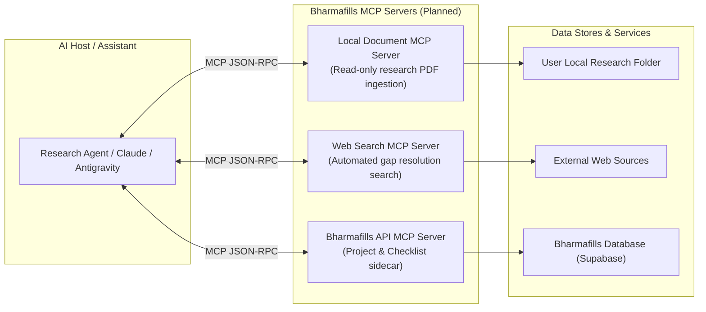

# Bharmafills — Model Context Protocol (MCP) Architecture & Strategy

> **Document Status**: Architectural Evaluation & Strategy
> **Integration Status**: `OPTIONAL / PLANNED` (Target: Post-Phase 4)
> **Workspace Identifier**: `Shinchan`

---

## 1. What is Model Context Protocol (MCP)?

The **Model Context Protocol (MCP)** is an open standard that enables AI models and assistants to securely discover, query, and interact with external data sources, local files, and specialized tools through standardized interfaces.

In the context of **Bharmafills**, MCP offers high-value opportunities to expand the platform's research ingestion and verification capabilities without modifying core application code.

---

## 2. Potential MCP Use Cases for Bharmafills

### 2.1 Local Research Document Ingestion (Filesystem MCP)
- **Problem**: Researchers often have dozens of PDF circulars and whitepapers saved across local folders. Uploading each document one-by-one through the web UI is cumbersome.
- **MCP Solution**: A read-only filesystem MCP server allowing an agent to scan a designated folder (`D:\Research\ProjectA\`), extract text from all PDFs, and ingest them directly into a Bharmafills research project.

### 2.2 Automated Gap Querying (Search MCP)
- **Problem**: When Bharmafills identifies an information gap (e.g. *"Missing issuing authority requirement for income certificate"*), the user currently must manually copy the suggested query and search the web.
- **MCP Solution**: Connect to a web search MCP server (e.g., Brave Search or Google Search) to automatically execute the suggested query, retrieve top official results, and propose them as new sources for user approval.

### 2.3 Bharmafills Platform Sidecar (API MCP)
- **Problem**: Users working in external AI environments (Antigravity IDE, Cursor, Claude Desktop) need direct access to their Bharmafills projects.
- **MCP Solution**: Expose a Bharmafills MCP Server providing tools:
  - `list_projects()`
  - `get_project_gaps(project_id)`
  - `add_checklist_item(project_id, item_text, priority)`
  - `export_verification_report(project_id)`

---

## 3. Security Boundaries & MCP Governance

If and when MCP servers are integrated, they must strictly comply with the following security boundaries:

1. **Read-Only by Default**: Filesystem access must be strictly scoped to user-selected research directories. Never grant root drive (`C:\` or `D:\`) or system directory access.
2. **Mandatory User In-the-Loop Confirmation**: Any action that creates, modifies, or deletes projects, sources, or checklist items requires explicit user confirmation.
3. **Prompt Injection Defense**: Content returned via MCP tool calls must undergo the same structured tagging and sanitization as web scrapes (see `docs/SECURITY.md`).
4. **No Direct Exposure of Secrets**: MCP servers must not transmit API keys or database service roles over JSON-RPC channels.

---

## 4. Implementation Timeline & Status

- **Steps 1–4 (Current)**: `NOT REQUIRED` — The core web application operates autonomously with client-side storage.
- **Steps 5–8 (Backend & Extraction)**: `EVALUATION` — Core FastAPI endpoints and web UI ingestion will be built first.
- **Steps 9–13 (AI & Verification)**: `PLANNED` — MCP server wrappers will be evaluated to allow external agent integration.
